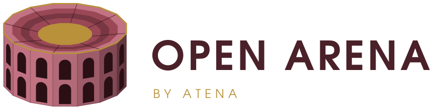

<div align="center">
<picture>
  <source media="(prefers-color-scheme: dark)" srcset="img/openarena-logo-dark.svg">
  
</picture>
</div>

<div align="center">

<b>Which model, or agent, does this job best, at what cost?</b>

<em>openarena runs every model on every dataset you name, scores each answer, and ranks the models on leaderboards. Declared in YAML, run from one command, on your own machine.</em>

<p align="center">
  <a href="https://atena-it.github.io/open-arena/"><strong>Documentation</strong></a> ·
  <a href="https://atena-it.github.io/open-arena/introduction/"><strong>Introduction</strong></a> ·
  <a href="https://atena-it.github.io/open-arena/cli/"><strong>CLI reference</strong></a> ·
  <a href="https://atena-it.github.io/open-arena/coding-agents/"><strong>With a coding agent</strong></a>
</p>

[](https://github.com/Atena-IT/open-arena/actions/workflows/tests.yml)
[](https://atena-it.github.io/open-arena/)

[](LICENSE)

</div>

## What is Open Arena?

**openarena** compares language models, and agents, on datasets. You describe
the candidates and the job in YAML; openarena runs every candidate on every
dataset, scores each answer, and ranks them. No server and no web app: files
in, files out.

- **Any model litellm routes**: OpenAI, Anthropic, Gemini, Mistral, Ollama, vLLM, ...
- **Any dataset source**: Hugging Face, local files, MLflow, Langfuse, LangSmith,
  Opik, Phoenix, Braintrust, Unity Catalog, each row shaped by Jinja2 templates.
- **Scored your way**: exact match, judge models, rubrics, multi-judge panels,
  agent judges, tool-call accuracy, retrieval recall.
- **Beyond one call**: models calling MCP tools, remote A2A agents, and agents
  working [Harbor](https://harborframework.com) tasks in a sandbox.
- **Ranked**: leaderboards weighing reward, cost, tokens and latency, with
  budgets and the Pareto frontier.
- **Ready for a coding agent**: every workspace comes with an `AGENTS.md` and
  an Agent Skill for each thing to do in it: add a model, run an evaluation, ...

## When to use it

Use it when you have to pick a model, or keep picking one. It measures on your
data, on your machine, and keeps every score so the next comparison builds on
the last one.

<div align="center">

| You want | openarena gives you |
| --- | --- |
| A cheaper model for a task that already works | The same dataset and reward on both, ranked by reward against cost |
| A local model to replace a hosted one | Ollama or vLLM next to the hosted model, on the same leaderboard |
| The model that uses your MCP tools best | Datasets with an `agent:` block: the tools really run and the final answer is scored. Or `tools:`, to grade the calls themselves |
| The deployed agent that answers your users best | Remote agents reached over A2A, listed in an evaluation in place of models and scored the same way |
| The coding agent that solves your tasks | Harbor tasks run in a sandbox, checked by each task's own tests |

</div>

## Quickstart

```shell
uv tool install "git+https://github.com/Atena-IT/open-arena"

openarena init my-arena && cd my-arena
cp .env.template .env                # the keys your models need
openarena check configs              # every registry: problems, lines, fixes
openarena evaluations run smoke      # 20 GSM8K questions, results in .open-arena/smoke/
openarena leaderboards run overall   # rank every finished run
```

`smoke` runs a model on a local [Ollama](https://ollama.com)
(`ollama pull qwen3.8:27b-mlx`); point it at `gpt-4o-mini` in
`configs/evaluations.yaml` to use `OPENAI_API_KEY` instead.

## A workspace

`openarena init my-arena` writes a workspace that runs as it is:

```
my-arena/
├── configs/                  one registry per file, every field explained in comments
│   ├── models.yaml           the models to compare, and the judge models
│   ├── rewards.yaml          how an answer is scored, and which way is better
│   ├── datasets.yaml         where the rows come from, their templates, their reward
│   ├── mcp_servers.yaml      tool servers a model can call
│   ├── a2a_agents.yaml       remote agents reached over A2A
│   ├── environments.yaml     sandboxes: their Dockerfile or image, resources, network
│   ├── evaluations.yaml      sweeps: which models run on which datasets
│   └── leaderboards.yaml     how finished runs are ranked
├── tasks/
│   └── hello-world/          a Harbor task
│       ├── task.toml
│       ├── instruction.md
│       ├── environment/
│       │   └── Dockerfile
│       ├── tests/
│       │   └── test.sh
│       └── solution/
│           └── solve.sh
├── environments/             the files each sandbox's Dockerfile copies in
│   └── python/               the `python` entry of environments.yaml
│       └── environment/      its build context, as Harbor expects it
│           └── requirements.txt
├── .agents/
│   └── skills/               an Agent Skill per action: openarena-add-model, ...
├── AGENTS.md                 the guide a coding agent reads first
├── CLAUDE.md -> AGENTS.md    the same guide, under the name Claude Code reads
├── README.md
├── .env.template             the keys your models need
└── .gitignore
```

Runs write their results under `.open-arena/`, one folder per evaluation.
Each registry has its guide:
[models](https://atena-it.github.io/open-arena/guides/models/) ·
[rewards](https://atena-it.github.io/open-arena/guides/rewards/) ·
[datasets](https://atena-it.github.io/open-arena/guides/datasets/) ·
[MCP tools](https://atena-it.github.io/open-arena/guides/mcp-tools/) ·
[A2A agents](https://atena-it.github.io/open-arena/guides/a2a-agents/) ·
[environments](https://atena-it.github.io/open-arena/guides/environments/) ·
[evaluations](https://atena-it.github.io/open-arena/guides/evaluations/) ·
[leaderboards](https://atena-it.github.io/open-arena/guides/leaderboards/).

The dataset the `smoke` evaluation runs, as `init` writes it:

```yaml
# configs/datasets.yaml
datasets:
  gsm8k-20:
    type: huggingface
    description: Grade-school math word problems, GSM8K test split, 20 rows.
    tags: [math, reasoning]
    config:
      path: openai/gsm8k
      name: main
      split: test
      limit: 20
      batch_size: 4
      # Jinja2 over the row's columns, each rendering to the JSON its schema describes.
      input_template: '{"question": {{ question | tojson }}}'
      # The reference is what follows `####`, commas removed.
      output_template: '{"answer": {{ answer.split(''####'')[-1] | replace('','', '''') | trim | tojson }}}'
      input_schema:
        type: object
        properties:
          question: {type: string, description: The question to answer}
        required: [question]
        additionalProperties: false
      output_schema:
        type: object
        properties:
          answer: {type: string, description: "The final numeric answer only, no units or commas"}
        required: [answer]
        additionalProperties: false
    generator:
      chain_of_thought: true
      instructions: Solve the problem. Reply with the final number only, no units, no commas.
    reward: exact-match                # a `rewards` key
```

See the [guides](https://atena-it.github.io/open-arena/) for every registry.

## Development

```shell
git clone https://github.com/Atena-IT/open-arena && cd open-arena
uv sync
uv run openarena --help
uv run pytest                                          # no network needed
uvx ruff check .
uv run --group docs zensical build --clean --strict    # the docs site, into site/
uv run --group docs zensical serve -a localhost:8100   # preview while editing
```

| path | |
| --- | --- |
| `src/openarena/config/` | the schema: one model per registry entry, a run's config, `check` |
| `src/openarena/evaluate.py` | `run_sweep`, every model × dataset cell |
| `src/openarena/programs/` | the program each dataset kind is answered by |
| `src/openarena/datasets/` | dataset providers |
| `src/openarena/rewards/` | the reward catalog and openarena's own rewards |
| `src/openarena/leaderboard.py` | `board` gathers results, `rank` scores them |
| `src/openarena/harbor.py` | Harbor tasks, agents and sandboxes |
| `src/openarena/cli/` | the `openarena` command and its `init` template |
| `src/openarena/skills/` | the Agent Skills `init` copies into a workspace |
| `docs/`, `mkdocs.yml` | the documentation site, built by [Zensical](https://zensical.org) |

The tests keep the docs and skills honest: every YAML example in them is
checked against the engine (`tests/test_docs.py`, `tests/test_skills.py`), and
the CLI reference must name every command and option.

## License

[Apache 2.0](LICENSE).
