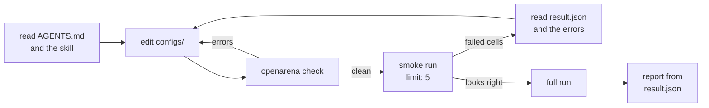

# With a coding agent

An openarena workspace is plain files: YAML in `configs/`, results in
`.open-arena/`. That makes it easy work for a coding agent (Claude Code, Codex,
Cursor, Copilot, ...). It can read every registry, write new entries, check
them, run them and report from the result files, the same way you would.

Start the agent in the workspace folder and ask in plain words:

> Add Mistral Small and compare it with gpt-4o-mini on GSM8K, then tell me which is better for the money.

This page covers what the agent reads, the skills it uses, the CLI behaviour
it relies on, prompts that work, and how to keep it cheap and honest.

## What the agent reads

`openarena init` writes three things for an agent next to the configs
(see [The workspace](workspace.md) for the rest of the layout):

| file | what it is | why it is there |
|---|---|---|
| `AGENTS.md` | the guide an agent reads first: the layout, the rules, the commands, which skill to read for what, how to report | so the agent starts from the workspace's rules instead of guessing |
| `CLAUDE.md` | a link to `AGENTS.md` (a copy where links cannot be made, as on Windows without the right) | agents that look for `CLAUDE.md` find the same guide |
| `.agents/skills/` | one [Agent Skill](https://agentskills.io) per action, copied from the package | the YAML of each registry, field by field, and the commands that go with it |

The rules in `AGENTS.md` are the ones that most often trip an agent up:

- **Refer to entries by name.** An evaluation lists `models.yaml` keys, not
  model ids. The id appears once, in `models.yaml`.
- **Invent no field.** Entries refuse unknown fields. The skills list the real
  ones, and `openarena check` names the valid choices.
- **Templates render JSON.** Pipe every value through `| tojson`, and give an
  `input_schema` / `output_schema`. Look at real rows first.
- **Check after every edit, run small before big.** `limit: 5` on a dataset
  first, then the full size.
- **Do not start or stop model servers or Docker.** If one does not answer,
  say so.
- **Report from the files.** Rewards from `result.json`, the ranking that
  `leaderboards run` printed, and what failed with the error. Never from
  memory.

!!! tip "Edit `AGENTS.md` for your project"
    It is your file once `init` has written it. Add what the agent should know
    about your work: which models are off limits, a cost ceiling, which
    evaluation is the reference one. The agent reads it before anything else.

## The skills

Each skill is a folder with a `SKILL.md`. Its `description` starts with "Use
when ...": the agent reads the descriptions and opens the skill whose
situation matches the task. The body teaches the YAML entry field by field,
with examples the test suite checks against the engine, and the commands to
run after.

| skill | the agent opens it when | what it teaches |
|---|---|---|
| `openarena-init-workspace` | starting a project from nothing, or it needs the general rules | `openarena init`, the layout, how every registry file is written, the edit, check, run loop |
| `openarena-check-configs` | after any YAML edit, or when a command fails on a config | `openarena check`, reading each problem and applying its fix, looping until clean |
| `openarena-add-model` | adding, changing or choosing a model | a `models.yaml` entry: the litellm id, type, params, the provider prefix and its API key |
| `openarena-add-reward` | a dataset needs something to score its answers | exact comparison or a judge model; the catalog types and the kwargs each accepts |
| `openarena-add-dataset` | a benchmark has to become a dataset | the provider config, the Jinja2 templates, the schemas, what answers each row, the reward |
| `openarena-add-mcp-tools` | models should answer by calling tools | an MCP server in `mcp_servers.yaml` and an `agent:` dataset that uses it |
| `openarena-compare-a2a-agents` | comparing remote A2A agents instead of models | `a2a_agents.yaml`, an `a2a` dataset, an evaluation whose axis lists agents |
| `openarena-add-environment` | ordinary rows should be worked by an agent in a sandbox | a Harbor environment in `environments.yaml` and a `harbor:` dataset over it |
| `openarena-create-harbor-task` | a terminal or codebase task, checked by a script, has to be written | a Harbor task folder, file by file, and the `harbor_tasks` dataset that runs it |
| `openarena-run-evaluation` | models have to be evaluated on datasets | an `evaluations.yaml` entry, `openarena evaluations run`, resuming, cost |
| `openarena-rank-leaderboard` | finished runs have to become a ranking | a `leaderboards.yaml` entry, `openarena leaderboards run`, why a model is unranked |
| `openarena-read-results` | a run finished or failed | `result.json`, why a cell failed or scored 0, Harbor trial logs |

A typical task touches several. "Add GSM8K and compare two models" goes
through add-dataset, add-reward, check-configs, run-evaluation and
read-results, in that order.

??? note "`arena-import`: a skill that is shipped but not installed"
    The package also holds `arena-import`. It is for the arena web app, not
    the CLI: it converts results computed elsewhere (an HTML dashboard, a CSV
    or JSON from another tool) into the JSON the app's Leaderboards → Import
    takes, and checks it against the app's validator. `init` copies only the
    `openarena-*` skills, so a workspace does not get it. Copy it by hand
    (below) if you import results into the app.

## Installing the skills

=== "In a new workspace"

    Nothing to do. `openarena init` copies every `openarena-*` skill into
    `.agents/skills/`, and `AGENTS.md` tells the agent to read the one that
    fits before acting.

    ```shell
    openarena init my-arena
    cd my-arena
    ```

=== "In an existing project"

    The skills ship inside the package, under `openarena/skills/`. Find the
    folder and copy (or link) what you need into the folder your agent reads
    skills from:

    ```shell
    SKILLS=$(python -c "import openarena, pathlib; print(pathlib.Path(openarena.__file__).parent / 'skills')")
    mkdir -p .agents/skills
    cp -r "$SKILLS"/openarena-* .agents/skills/
    ```

    Prefix `python` with `uv run` when openarena is installed in a uv project.

=== "For every project"

    Copy the folders into your user-level skills folder, for example
    `~/.claude/skills/` or `~/.agents/skills/`, depending on which one your
    agent reads.

!!! note "Where your agent looks"
    `.agents/skills/` is where `init` puts the skills, and `AGENTS.md` points
    the agent there by name, so it finds them either way. If your agent also
    loads skills on its own from another folder, you can link that folder to
    `.agents/skills/` so they load as native skills. Check your agent's
    documentation for the folder it uses.

!!! warning "Refreshing the skills after an upgrade"
    The skills change with the engine: a new reward type or dataset field
    lands in the skill too. After upgrading openarena, copy the folders again
    as in the "existing project" tab. Do not use `openarena init --force` for
    this: it overwrites every template file as well, your `configs/` and
    `AGENTS.md` included.

## What makes the CLI agent-friendly

The CLI has no prompts and no interactive mode. Every command takes its input
from arguments and files, so an agent can run it as is. The behaviours an
agent leans on:

| behaviour | command | what the agent does with it |
|---|---|---|
| exit code 1 on an error | `openarena check` | edit, check, read the problems, fix, check again until it exits 0. Warnings alone exit 0 |
| a line, a location and a fix per problem | `openarena check` | the `fix` line is often the YAML to write, so the agent does not guess field names |
| refuse instead of overwrite | `openarena init` | writes nothing and names every file in the way; `--force` is the only way past it |
| errors that name the choices | `evaluations run`, `leaderboards run` | an unknown evaluation or leaderboard name fails with `choose one of: ...` |
| a listing per registry | `openarena <registry> list` | what is already defined, before adding a duplicate |
| results as JSON on disk | `evaluations run` writes `.open-arena/<name>/result.json`; `--json FILE` on both `run` commands writes another copy | the agent reads numbers from JSON with a short script, not from a printed table |
| the exact config that ran | `.open-arena/<name>/config.yaml` | when a result looks wrong, compare what ran with what was meant |
| resume by default | `evaluations run` | a rerun after fixing a key only pays for the cells that did not finish |

The printed output is tables for people. The JSON files are what an agent
should read, and the `openarena-read-results` skill tells it to read them
with a script, not by eye.

!!! warning "A failed cell does not fail the command"
    `openarena evaluations run` exits 0 when it finishes, even if some cells
    failed. A failed cell prints `<model> failed: <why>` after its dataset and
    has `value: null` and a status other than `COMPLETED` in `result.json`. Ask
    the agent to check the status of every cell, not just the exit code.

Two more details to know:

- **`.env` is read for `evaluations run`**, from the folder above `configs/`,
  never over a variable already set. The agent does not need to export keys,
  and should never print or commit `.env` (the workspace's `.gitignore`
  already leaves it out).
- **The cache does not notice config changes.** After changing a dataset, a
  model's params or a reward, a rerun reuses old cells unless it gets
  `--no-cache`. See [Running evaluations](guides/evaluations.md#resuming-and-starting-over).

## The loop



The smoke step is the one to insist on. It catches a wrong template, a
missing key or a reward that scores everything 0 for the price of a few rows.

## Example prompts

Prompts work best when they name the outcome, the size and what to report.
The agent picks the skills.

=== "Add a dataset"

    > Add the test split of openai/gsm8k from Hugging Face as a dataset called gsm8k-test, scored on the final number. Look at a few real rows first, use limit: 5 for now, check it, and run it on gpt-4o-mini only. Show me the reward and one row's answer.

    The agent uses add-dataset (provider, templates, schemas), add-reward
    (an exact comparison on the number), check-configs, then run-evaluation
    with a one-model evaluation. Asking for one answer makes it show you what
    the model actually returned, which is where template and reward mistakes
    show.

=== "Run a sweep"

    > Compare qwen38 and gpt-4o-mini on gsm8k-20. Tell me how many rows times models that is before you run it. Run a smoke version with limit: 5 first, then the full one.

    The agent writes an evaluation, states the size, runs the small version,
    checks every cell's status, then raises the limit and runs again with
    `--no-cache` (the limit changed what the cells depend on).

=== "Read results"

    > The math-compare run finished. Which model is best on reward, and which is cheapest? List every cell that failed and the error it gave. Quote numbers from result.json only.

    The agent uses read-results: reads `result.json` with a script, reports
    the frontier and the failed cells with their printed errors.

=== "Rank runs"

    > Write a leaderboard over all finished runs that weighs reward 70% and cost 30%, leaves out any model whose cost is over 0.05, and print it. Tell me which models were not ranked and why.

    The agent uses rank-leaderboard (shares and a budget), runs
    `openarena leaderboards run`, and quotes the "Not ranked" and "Over
    budget" lines it prints.

`qwen38`, `gpt-4o-mini` and `gsm8k-20` are entries of the example workspace;
use the names in yours.

## Guarding cost

Every row is at least one model call per model, plus one per judge reward. A
Harbor row is a whole agent session in a sandbox. An agent that runs the full
size on its first try can spend real money on a broken config.

| guard | how | when |
|---|---|---|
| `limit` on the dataset | `limit: 5` in the dataset's `config` | every new or changed dataset, before the first run |
| a smoke evaluation | a second evaluation with one cheap or local model | before adding paid models to the sweep |
| `batch_size` | on the evaluation, or `--batch-size N` for one run | lower it for a local model, a rate-limited key, or Harbor on a small machine |
| ask for the size first | "tell me rows times models before you run" in the prompt or in `AGENTS.md` | any run with paid models or judges |
| resume, do not restart | rerun the same name after a fix; `--no-cache` only when the config changed | after a missing key or a server that was down |

A dataset with a limit looks like this (other fields left out):

```yaml
datasets:
  gsm8k-test:
    type: huggingface
    reward: exact-match
    config:
      limit: 5     # raise to the full size once the smoke run looks right
      # ...
```

And a smoke evaluation next to the real one:

```yaml
evaluations:
  math-smoke:
    description: One local model, to check the datasets before paying for the sweep.
    language_models: [qwen38]
    datasets: [gsm8k-20]
    batch_size: 4
  math-compare:
    description: The real comparison.
    language_models: [qwen38, gpt-4o-mini]
    datasets: [gsm8k-20]
```

!!! tip "Put the budget in `AGENTS.md`"
    A line such as "never run more than 200 rows times models without asking"
    in `AGENTS.md` applies to every session, not just the one where you
    remembered to say it.

## When to let it drive, when to do it yourself

| let the agent do it | do it yourself |
|---|---|
| writing and fixing YAML until `check` is clean | putting keys in `.env` |
| mapping a benchmark's columns to templates and schemas | starting Ollama, a vLLM server or Docker |
| smoke runs and reading why a cell failed | approving the full run when it uses paid models or judges |
| reading `result.json` and summarising the numbers | deciding what the reward should measure |
| writing a leaderboard and printing it | deciding which results you publish |

The agent is good at the mechanical part: field names, template syntax, the
check loop. The judgment calls stay yours, and what counts as a correct
answer is the main one. A reward that scores the wrong thing still gives
clean numbers.

## Reviewing what it changed

Keep the workspace in git and `git diff configs/` shows everything the agent
did. What to look at:

- **Model ids and params** in `models.yaml`. A wrong provider prefix is a
  different model, and a changed `temperature` changes every result.
- **Rewards.** The type, its kwargs, and `direction`. A reward that compares
  the wrong field can score 0 everywhere, or 1 everywhere.
- **Templates and schemas.** Does the input template send what the
  benchmark means to ask? Does the output schema allow the answer form the
  reward expects?
- **`limit`.** Still at the smoke value when you meant the full run, or
  removed when you meant a smoke run.
- **Evaluations.** The model and dataset lists you asked for, nothing more.

Then compare `.open-arena/<name>/config.yaml` with the diff: it is what
actually ran, every entry gathered. (`.open-arena/` is git-ignored, so it is
not in the diff.)

!!! warning "Report what failed"
    A failed cell says why. A missing key or a model server that is not
    running is yours to fix, not the agent's to work around. If it swapped a
    model, dropped a dataset or loosened a reward to get a green run, the diff
    shows it.

## See also

- [The workspace](workspace.md): the layout `init` writes.
- [Checking configs](guides/check.md): what `check` reports and what it does not.
- [Running evaluations](guides/evaluations.md) and [Reading results](guides/results.md).
- [CLI reference](cli.md): every command and option.
