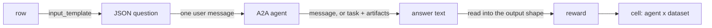
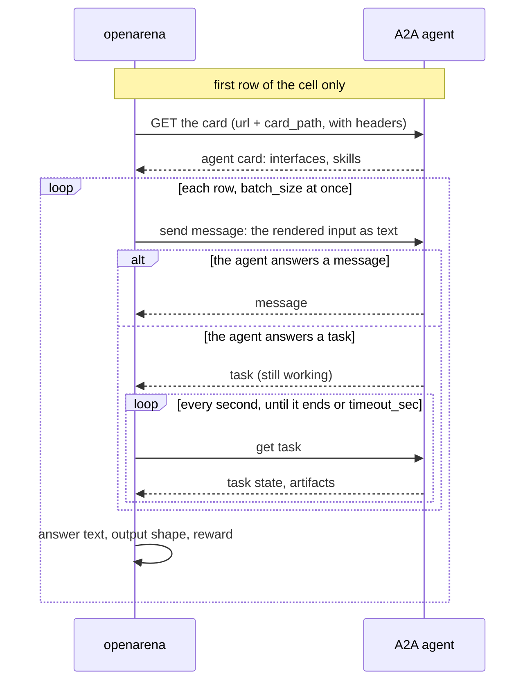

# A2A agents

Most evaluations compare models: openarena calls each model itself, with the
prompt, tools and settings you wrote. An A2A evaluation compares **deployed
agents** instead. Each agent is a running service that speaks the
[Agent2Agent protocol](https://a2a-protocol.org) at its own URL. openarena
sends it each row as a message, waits for its answer, and scores that answer
with the dataset's reward, exactly as it would score a model's.

What is under test is the whole service: its prompts, its model, its tools,
its memory, its guardrails. openarena sees none of that. It sees the question
it sent and the text that came back.

Three files are involved:

| file | what it holds for A2A |
|---|---|
| `configs/a2a_agents.yaml` | one entry per agent: where it is, how to authenticate, how long a row may take |
| `configs/datasets.yaml` | a dataset with an empty `a2a: {}` block: its rows go to agents |
| `configs/evaluations.yaml` | an evaluation whose `language_models` lists agent names, not model names |



## A2A agent or model + MCP tools?

openarena can evaluate an agent two ways. Over A2A, you point it at the
service you already run. With an [`agent:` dataset](mcp-tools.md), openarena
*is* the agent: it gives a model of `models.yaml` the tools of MCP servers and
runs the loop itself.

| | A2A agent | model + MCP tools |
|---|---|---|
| what is tested | the deployed service, as its users reach it | a model's ability to use the tools you give it |
| what you can vary | which deployment (version, environment, vendor) | the model, its params, the tools |
| the evaluation's axis | agents (`a2a_agents` keys) | models (`models` keys) |
| cost, tokens, latency | not measured: the agent spends on its side | measured per cell |
| what openarena sees | the final answer | the answer, from a loop it runs itself |
| needs | a running, reachable A2A endpoint | the MCP servers, a tool-calling model |

**Choose A2A when** the thing you ship is the agent, and you want to know how
that exact build behaves: a release candidate against the current release, two
vendors' agents on the same questions, a regression check before a deploy.
Rebuilding such an agent as model + tools would test your copy of it, not the
agent.

**Choose model + MCP tools when** the question is which model to put inside an
agent, or how models handle a given set of tools. Only then can you swap the
model, read its cost and tokens, and hold everything else fixed.

## Registering an agent

```yaml
a2a_agents:
  support-prod:
    url: https://support-agent.example.com       # required: the agent's base URL
    headers:                                      # sent on every request, the card's included
      Authorization: Bearer ${SUPPORT_PROD_TOKEN}   # read from the environment or .env
    timeout_sec: 120                              # one row, from sending to the last word (default 300)
    description: The support agent, current release.
    tags: [support, prod]
  support-staging:
    url: https://support-agent.staging.example.com
    card_path: /a2a/agent.json                    # the card is not at the well-known path
    headers:
      Authorization: Bearer ${SUPPORT_STAGING_TOKEN}
    description: The support agent, release candidate.
    tags: [support, staging]
```

The key (`support-prod`) is the agent's name everywhere else: in an
evaluation's `language_models`, in `result.json`, on a leaderboard.

| field | required | default | what it does |
|---|---|---|---|
| `url` | yes | | the agent's base URL; must start with `http://` or `https://`; a trailing `/` is dropped |
| `card_path` | no | the well-known path | where the agent card is, relative to `url`, when it is not at `<url>/.well-known/agent-card.json` |
| `headers` | no | `{}` | HTTP headers sent on every request to the agent, the card request included |
| `timeout_sec` | no | `300` | how long one row may take, in seconds, from sending the message to the agent's last word; above 0 |
| `description` | no | | for you and `openarena a2a-agents list`; the run does not read it |
| `tags` | no | `[]` | labels for browsing; the run does not read them |

No other field is accepted. In particular there is no streaming switch, no
retry count and no rate limit: see [what a row does](#what-a-row-does).

### `url` and the agent card

On the first row of a cell, openarena reads the agent's card from
`<url>/.well-known/agent-card.json`, or from `card_path` under `url` when you
set it. The card says which interfaces the agent serves and at which address.
openarena opens a client on the interface the card prefers and sends every
message there.

Look at the card before you register an agent:

```shell
curl -s https://support-agent.example.com/.well-known/agent-card.json
curl -s -H "Authorization: Bearer $TOKEN" https://support-agent.example.com/.well-known/agent-card.json
```

!!! warning "Messages go where the card says, not to `url`"
    `url` is only where the card is read. The messages go to the address in
    the card's interfaces. An agent behind a proxy or a tunnel often
    advertises its internal address (`http://localhost:9999`, a container
    name): the card reads fine, then every message fails to connect. Fix the
    card the agent serves; openarena has no field to override it.

Set `card_path` only when the agent publishes its card somewhere other than
the well-known path, for example an older agent serving
`/.well-known/agent.json`. It is a path under `url`, not a full URL.

### `headers`: authentication

Every request to the agent goes through one HTTP client that carries these
headers: the card request, each message, each poll of a running task. Use
them for whatever the agent's gateway expects: `Authorization`, an API key
header, a tenant header.

```yaml
a2a_agents:
  vendor-agent:
    url: https://agents.vendor.example.com/support
    headers:
      X-Api-Key: ${VENDOR_API_KEY}
      X-Tenant: arena-eval
```

Header names cannot contain whitespace, and values are strings: quote a value
YAML would read as a number.

Keep tokens out of the file with `${NAME}`. When a run reads its config, after
it has loaded the workspace's `.env`, each `${NAME}` in a value is replaced by
the environment variable `NAME`:

```shell
# .env, beside configs/
VENDOR_API_KEY=...
```

- `a2a_agents.yaml` and the run's copy, `.open-arena/<evaluation>/config.yaml`,
  keep `${VENDOR_API_KEY}`, not its value, so either can be committed.
- A variable set neither in your shell nor in `.env` stops the run before it
  starts, naming the variable and where it is used; `openarena check` warns
  about it first.
- `$${NAME}` writes a literal `${NAME}`.

Any string value takes a reference, `url` included
(`url: ${SUPPORT_AGENT_URL}`). Still use a key made for evaluation, scoped to
the least it needs and easy to revoke.

### `timeout_sec`: how long a row may take

`timeout_sec` bounds one whole row: sending the message, waiting for the
answer, and polling a task until it ends. It is also the timeout of each HTTP
request, the card's included. A row that runs past it gets no answer and
scores 0, with a warning; the cell goes on (see
[when a row fails](#when-a-row-fails)).

Set it from the agent's real behaviour, measured on a few rows:

| agent | where to start |
|---|---|
| answers in one turn, no tools | 30 to 60 |
| calls a few tools, searches | 120 to 300 (the default) |
| long tasks: research, code, multi-step workflows | above 300 |

Too low scores a slow row 0, as if the agent had answered wrong. Too high only costs time when the
agent hangs: the run waits that long before it says so. Rows of a batch are
sent at once, so an agent under load is slower than the same agent answering
one question alone: measure with the `batch_size` you will use.

### Staging or production

Register each deployment as its own entry, as above. The name is what results
and leaderboards show, so put the environment in it.

=== "Staging"

    The default for evaluation. You can run as often as you like, at any
    `batch_size`, without real users feeling the load or real systems seeing
    the questions. Compare `support-staging` (the candidate) with
    `support-prod` (the release) before promoting.

=== "Production"

    Measures what users actually get, with the production model, data and
    configuration. But every row is real traffic: it counts against the
    agent's rate limits and quotas, costs money on its side, may land in its
    logs and analytics, and may trigger side effects if the agent can act
    (open tickets, send mail). Use a small `limit`, a low `batch_size`, and
    questions that do not make the agent act.

=== "Local"

    An agent you run on your machine (`url: http://localhost:9999`), for a
    quick check while developing it. Its card must advertise an address the
    run can reach too.

## The dataset: `a2a: {}`

A dataset whose rows go to A2A agents carries an empty `a2a:` block. It takes
no settings: which agents answer is the evaluation's choice, not the
dataset's.

```yaml
datasets:
  support-questions:
    type: local
    config:
      path: support.jsonl              # {"question": "...", "expected": "..."}
      limit: 20
      input_template: '{"question": {{ question | tojson }}, "reply_format": "a JSON object with one string field, answer, and nothing else"}'
      output_template: '{"answer": {{ expected | tojson }}}'
      input_schema:
        type: object
        properties:
          question: {type: string, description: The customer's question}
          reply_format: {type: string, description: How to reply}
        required: [question, reply_format]
      output_schema:
        type: object
        properties:
          answer: {type: string, description: The answer to give the customer}
        required: [answer]
    a2a: {}                            # always empty: the agents come from the evaluation
    reward: judge
```

The provider, the templates, `limit` and `batch_size` work as for any dataset
([Datasets](datasets.md)). What changes is how the question reaches the agent
and how its answer is read back.

### What the agent receives

The row's rendered input, a JSON object, is sent as the text of **one user
message**: the agent literally reads
`{"question": "...", "reply_format": "..."}`. Nothing else goes with it: no
system prompt, no schema, no earlier rows. Each row is a new message, not
linked to the ones before.

So write the `input_template` for the agent as a user would. Most agents read
a JSON object fine; if yours expects prose, render one field that holds the
whole prompt.

### What openarena reads back

The answer the agent must give depends on the dataset's `output_template`.

=== "With an output template and schema"

    The agent must answer **a JSON object**. Its whole reply is parsed as JSON;
    a reply that is a single fenced block (` ```json ... ``` `) is unwrapped
    first. The object is the answer the reward compares with the expected one.

    This is what lets you score against a reference: `exact_match`,
    `answer_accuracy`, or a judge that reads the expected answer. The agent
    never sees your `output_schema`, so tell it the format in the input, as
    `reply_format` does above.

    A reply that is not a JSON object gets no answer: the row scores 0, with
    a warning, and the cell goes on. Use this only with an agent that
    follows the instruction every time, or the zeros measure its formatting,
    not its answers.

=== "Without an output template"

    An inputs-only dataset: leave out `output_template` and `output_schema`.
    The agent's text is taken as it is, as one chat message
    (`{"role": "assistant", "content": "..."}`). Nothing has to parse.

    There is no expected answer, so only a judge can score it: say what a good
    answer is in the judge's `instructions`. This suits agents whose replies
    are free text you cannot force into JSON.

    ```yaml
    datasets:
      support-open:
        type: local
        config:
          path: support.jsonl
          input_template: '{"question": {{ question | tojson }}}'
          input_schema: {type: object, properties: {question: {type: string, description: The customer's question}}, required: [question]}
        a2a: {}
        reward: judge
    ```

!!! warning "An output template without an output schema"
    The expected answer is then a chat message, and the agent must answer a
    JSON object of that shape (`{"role": ..., "content": ...}`) too: free text
    scores the row 0. Give an `output_schema`, or drop the `output_template`.

### Message or task

An A2A agent replies in one of two ways, and openarena handles both:

- **A message**: its text is the answer.
- **A task**: openarena asks for the task again every second until it ends.
  When it ends `completed`, the answer is the text of the task's artifacts,
  joined by new lines, or, when they hold no text, the text of the task's
  final status message. When it ends any other way (`failed`, `canceled`,
  `rejected`, `input required`, `auth required`), the row gets no answer and
  scores 0, with a warning saying what the agent said, e.g.
  `the agent's task ended input required: Which order?`.

Only text parts are read. An agent that answers with file or data parts only
gives an empty answer.

!!! note "One turn only"
    An agent that asks a clarifying question (`input required`) scores the
    row 0: openarena does not answer back. Put everything the agent needs in the row.

## The evaluation: agents on the axis

An evaluation over A2A datasets lists agents in `language_models`, by their
`a2a_agents` key:

```yaml
evaluations:
  support-release-check:
    description: The release candidate against the current release.
    language_models: [support-staging, support-prod]   # a2a_agents keys
    datasets: [support-questions]
    batch_size: 2                                      # rows sent to an agent at once
```

Every dataset of such an evaluation must be an `a2a` dataset. A run cannot mix
them with model datasets, because its axis is either agents or models; it
refuses with
`an A2A dataset cannot share a run with other kinds of dataset; run it on its own.`
Run agents and models as two evaluations.

The cells run one agent after another; within a cell, `batch_size` rows are
sent at once. See [Running evaluations](evaluations.md) for the run itself and
for resuming.

## What a row does



- The card is read once per cell, and the same client serves all of its rows;
  it is closed when the run ends.
- openarena does not stream, even when the card says the agent can: it sends,
  then waits for the reply or polls the task.
- There is no retry inside a cell. A row the agent does not answer (an HTTP
  error, a reply that is not JSON where JSON is expected, a task that does
  not complete, the timeout) is warned about as `A2A agent <url>: <why>` and
  scores 0; the other rows still count. When no row of a cell got an answer,
  the cell fails instead, with `no row got an answer: ...` and the first
  error, and the next run of the same command runs it again.

### What is recorded

| what | where |
|---|---|
| each cell's reward (the mean over its rows) and status | `.open-arena/<evaluation>/result.json` ([Reading results](results.md)) |
| why a cell failed | the run's output: `<agent> failed: <why>` |
| why a row scored 0 without an answer | the run's output: `A2A agent <url>: <why>` |
| the first rows of each cell: input, expected answer, the agent's answer as scored | handed to the caller of the run, which is how the arena app shows them; the CLI keeps scores only |

What is **not** recorded: the agent's intermediate steps, its tool calls, the
task's status history, non-text parts. openarena only sees the final answer,
so it cannot score how the agent got there. To score a trajectory
(`tool_correctness`, `step_efficiency`), the agent must put it in its answer,
or you evaluate it as [model + MCP tools](mcp-tools.md), where openarena runs
the loop.

## Scoring an agent

The reward is the dataset's, as for models ([Rewards](rewards.md)):

| your agent answers | reward |
|---|---|
| a short field you can compare exactly (a category, an id, yes or no) | `exact_match` or `answer_accuracy`, with an output schema |
| free text, and you have a reference answer | a judge (`lm_as_judge`, `rubrics_as_judge`), with an output schema and a reply instruction in the input |
| free text, no reference | a judge on an inputs-only dataset, its criteria in `instructions` |
| several qualities to report apart (correct, polite, on policy) | `rubrics_as_judge` |

A judge's calls are made by openarena, with its own model, and counted as
`reward_cost`.

## Comparing agents fairly

**Same rows, same reward, same load.** Agents in one evaluation share the
dataset, its order and its reward, so their cells compare directly. Keep
`batch_size` the same between runs you compare: load changes how fast an agent
answers, and an agent that times out under load loses the cell.

**Against a plain model.** One evaluation cannot hold both. Write two datasets
over the same rows, one with `a2a: {}` and one with `generator:` (or
`agent:`), with the same reward, and run them as two evaluations. Their
rewards are on the same scale, but they are two datasets: a leaderboard
normalizes each dataset against its own agents or models. Read the two
`result.json` side by side.

Two things make that comparison uneven; say so when you report it:

- **Cost.** A model's cell reports its cost and tokens; an agent's cannot,
  since it spends on its own side. A `cost` share or budget on a leaderboard
  means nothing for agents.
- **Instructions.** The model gets the dataset's `generator.instructions` and
  `output_schema` with each call; the agent only gets what the input says.
  Put the same instructions in the agent's input, or the model starts ahead.

??? details "Ranking agents on a leaderboard"
    A [leaderboard](leaderboards.md) ranks agents like models, by the names in
    `result.json`. Leave `models: []` to take every agent scored. When you
    list agent names in `models:`, `openarena check` warns that each one
    `is not in models`; the warning does not stop the leaderboard. Weight
    `reward` and your own metrics, not cost.

## Rate limits and cost

openarena does not rate-limit agents. What it sends:

- one card request per cell;
- per row, one message, plus one task request per second while a task runs;
- `batch_size` rows at once.

Keep `batch_size` within the agent's quota, and low for production. Start with
`limit: 5` on the dataset, read the answers, then run the full size. The
agent's own spend (its model calls, its tools) is not in the results: read it
on the agent's side.

## Checking and debugging

`openarena check configs` validates `a2a_agents.yaml`, the `a2a` block and the
evaluation's references, without contacting any agent
([Checking configs](check.md)).

| you wrote | `openarena check` reports | fix |
|---|---|---|
| `url: localhost:9999` | `` `url` must start with http:// or https:// `` | write the scheme: `http://localhost:9999` |
| no `url` | `` `url:` is missing ``, fix ``add `url: http://localhost:9999` `` | add the agent's base URL |
| `streaming: true`, `retries: 3`, any field not in the table | `not a field of a a2a_agents entry` | remove it; an entry reads `card_path, description, headers, tags, timeout_sec, url` |
| `timeout_sec: 0` | `Input should be greater than 0`, fix ``set `timeout_sec:` to more than 0`` | a positive number of seconds |
| a `${NAME}` in a value whose variable is set nowhere | a warning: `` `${NAME}` is not set in your shell or in <workspace>/.env; a run that reads it refuses to start `` | add `NAME=...` to `.env`, or export it |
| a header name with a space | `header '...' must not contain whitespace` | rename it |
| a header value YAML reads as a number | `Input should be a valid string` | quote it |
| `a2a: {agent: helper}` | `` `a2a:` takes no settings `` | write `a2a: {}`; list agents in the evaluation |
| `a2a: {}` beside `generator:` or `agent:` | `` `generator`, `a2a` are mutually exclusive `` | keep one |
| an agent name not in `a2a_agents.yaml` | an error on `evaluations.<name>.language_models[i]` | add the agent, or fix the name |
| an `a2a` dataset beside a model dataset in one evaluation | `an A2A dataset cannot share a run with other kinds of dataset` | two evaluations |

### When a row fails

`check` reads files only. Whether the agent is up, accepts your token and
answers in the expected shape shows only when the run reaches it. A row the
agent does not answer scores 0 and the run warns `A2A agent <url>: <why>`;
the cell goes on. A cell where no row got an answer (the agent is down, every
request is refused) fails with `no row got an answer: all N row(s) failed;
the first error: <why>`, and `openarena evaluations run` exits 1. Fix the cause and
run the same command again: failed cells run again, cells already scored are
kept. A cell that scored with some rows at 0 is kept too: rerun it with
`--no-cache` once the cause is fixed.

| the run says | likely cause | fix |
|---|---|---|
| a connection error or timeout on the first row | the agent is down, or its card advertises an address the run cannot reach | `curl` the card; check its interface URLs |
| an HTTP 401 or 403 | missing or wrong `headers` | test the token with `curl -H` |
| an HTTP 404 on the card | the card is elsewhere | set `card_path` |
| a timeout on later rows | `timeout_sec` too low for this agent, or too many rows at once | raise `timeout_sec`, lower `batch_size` |
| `the agent did not answer JSON for the dataset's output schema` | free text where the output template needs a JSON object | add a reply instruction to the input, or make the dataset inputs-only |
| `the agent's JSON answer is not an object` | a JSON list or string | ask for an object in the instruction |
| `the agent's task ended failed: ...` (or `canceled`, `rejected`, `input required`, `auth required`) | the agent gave up, or wanted a second turn | read its message; put what it needs in the row |
| `the agent sent no answer` | the agent closed the reply with no message or task | on the agent's side |

## See also

- [Datasets](datasets.md): providers, templates, schemas, `limit`, `batch_size`
- [Rewards](rewards.md): judges and their `instructions`
- [Running evaluations](evaluations.md), [Reading results](results.md), [Leaderboards](leaderboards.md)
- [MCP tools](mcp-tools.md): the model + tools alternative
- [`A2aAgentEntry`](../api/entries.md): the schema of an entry
- [Coding agents](../coding-agents.md): the `openarena-compare-a2a-agents` skill
- [CLI](../cli.md): `openarena a2a-agents list` prints the registered agents
