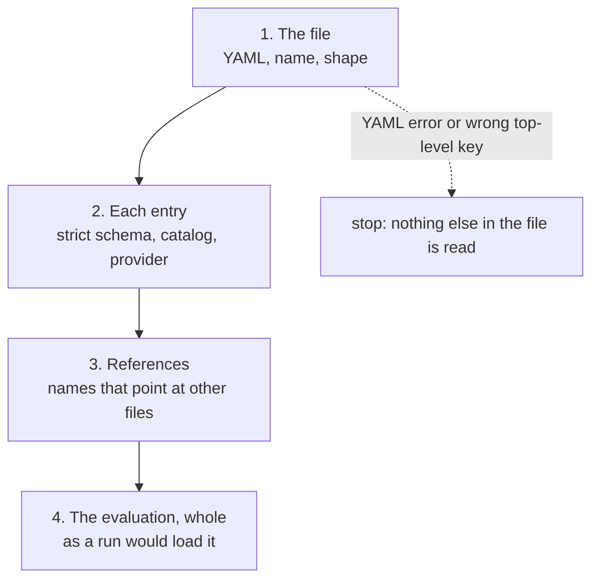

# Checking configs

`openarena check` reads your registry files and reports everything wrong with
them, before anything runs. Each problem comes with the file, the line, the
dotted path to the field, what is wrong, and a fix you can apply as written.

It uses the same strict schema the engine and the arena app load. A field the
engine would refuse is refused here first, in seconds, instead of when a sweep
starts.

```shell
openarena check                                 # ./configs, every registry file in it
openarena check configs/datasets.yaml           # one file, references checked against its folder
```

## Why run it

A run already validates its config. The check is still worth running,
because it covers more and says more:

- **It reads every entry.** `evaluations run` loads only the evaluation you
  name and the entries it selects. A typo in a dataset no evaluation uses
  yet waits there until the day you add it. `check` reads all of them.
- **It reports every problem at once.** A run stops at the first thing it
  refuses. `check` keeps going, so one pass lists everything to fix.
- **It gives the line and the fix.** A run's error names the rule. `check`
  names the line, and the rename, value or snippet that fixes it.
- **It costs nothing.** It reads files only. No model is called, no dataset
  is downloaded, no sandbox starts, no key is needed.

## When to run it

| When | Why |
|---|---|
| After every edit to `configs/` | The fastest way to catch a typo, an unknown field, a broken reference. |
| Before every `evaluations run` | A run refuses what `check` rejects, but only once it starts loading. |
| After renaming or removing an entry | Every name is a key other files refer to. `check` finds each place that still uses the old name. |
| In CI, on every pull request | A broken config never reaches the main branch. It exits 1 on any error. |
| In a pre-commit hook | Same, before the commit exists. |
| After a coding agent edits configs | The agent's skill loops on it until clean; run it yourself to confirm. See [With a coding agent](../coding-agents.md). |

!!! tip "After a rename, check the folder"
    Renaming `exact-match` to `exact` in `rewards.yaml` breaks every dataset
    whose `reward:` still says `exact-match`. The errors show up in the files
    that refer to the name, not in the one you edited. So run
    `openarena check configs` on the whole folder, not just the file you
    changed. Each stale reference reads ``'exact-match' is not in `rewards` ``,
    with a fix naming the closest key.

## Usage

```shell
openarena check [PATH] [--configs DIR]
```

| Argument / option | What it does | Default |
|---|---|---|
| `PATH` | A configs folder, or one registry file. | `configs` |
| `--configs DIR` | For a single file only: the folder whose registries its references are checked against. Ignored when `PATH` is a folder. | the file's own folder |

There is one `check` command for every registry. There is no
`openarena datasets check`. The [CLI reference](../cli.md) lists every
command.

=== "A folder"

    ```shell
    openarena check configs
    ```

    Checks each `<registry>.yaml` in the folder, each one's references
    against the others. Any other `.yaml` or `.yml` file in the folder is an
    error, since nothing reads it. A folder with no registry file fails with
    ``no registry files in configs; write some with `openarena init` ``.

    Use this by default, in CI, and after renames.

=== "One file"

    ```shell
    openarena check configs/datasets.yaml
    ```

    Checks one file, its references against the other registry files of its
    own folder. Shorter output while you work on one registry. It does not
    tell you about other files that refer to this one: after a rename, check
    the folder.

=== "A file elsewhere"

    ```shell
    openarena check drafts/datasets.yaml --configs configs
    ```

    Checks a file that lives outside the workspace (a draft, a file from a
    colleague) against the registries of a real configs folder, before you
    copy it in. References are checked against `DIR` only, not against the
    file's own folder.

### Exit codes

| Code | When |
|---|---|
| `0` | No error in any file. Warnings are allowed. |
| `1` | At least one error; or nothing at `PATH` (`nothing at <PATH>; pass a configs folder or a registry file`); or a folder with no registry file. |

Warnings never fail the command. To fail CI on warnings too, use the
[Python API](#from-python).

### Which registry a file holds

A registry is read only from the file named after it: `models.yaml`,
`rewards.yaml`, `datasets.yaml`, `mcp_servers.yaml`, `a2a_agents.yaml`,
`environments.yaml`, `evaluations.yaml`, `leaderboards.yaml`. That file holds
one top-level key, the registry's own. See [The workspace](../workspace.md)
for the layout.

A file with any other name is an error, ``not a registry file: a registry is
read only from `<registry>.yaml` ``, even when its top-level key is right. When
the name is close, the fix says what to call it: `my-models.yaml` and
`dataset.yaml` get ``rename it to `models.yaml` `` and
``rename it to `datasets.yaml` ``. A run follows the same rule: it never reads
`my-models.yaml`.

## Reading the output

A clean file is one line:

```
✓ configs/models.yaml: 2 models, no problems
```

A file with problems gets a header, then one block per problem:

```
✗ configs/rewards.yaml: 3 rewards, 3 errors

  error    line 3  rewards.exact-match.type
           unknown reward 'exact_matsh'
     fix   change 'exact_matsh' to 'exact_match'

  error    line 8  rewards.judge.config.instruction
           lm_as_judge does not take `instruction`
     fix   rename `instruction:` to `instructions:` under rewards.judge.config

  error    line 7  rewards.judge.config.language_model
           'openai/gpt-4o-mini' is not in `models`
     fix   name the entry that calls it: 'gpt-4o-mini'
```

| Part | Meaning |
|---|---|
| `✓` / `✗` / `!` | Clean / at least one error / warnings only. |
| header | How many entries the file holds, then how many errors and warnings. |
| level | `error` or `warning`. See [Levels](#levels). |
| `line N` | The line in the file. For a key that is missing, the line of the nearest part of its path that is written. Left out when the problem has no place in the file (a registry missing beside it). |
| where | The dotted path to the field: `<registry>.<entry>.<field>`, list items as `[i]`, e.g. `datasets.agent.agent.mcp_servers[0]`. A file-level problem shows the registry or the file name. |
| message | What is wrong, in one sentence. |
| `fix` | The change to make. Apply it as written. A multi-line fix is a snippet to paste. |

A fix takes one of a few shapes:

- a rename: ``rename `pth:` to `path:` under datasets.d.config``;
- a replacement value: `change 'hugingface' to 'huggingface'`;
- a removal: ``remove `provider:`; the provider is read off the model id``;
- an addition: ``add `url: https://<host>/mcp` ``;
- what is accepted, when nothing is close: `use one of the rewards: ...`;
- a snippet, when a shape is easier shown than said:

```
  error    line 4  models.qwen38.temprature
           not a field of a `models` entry
     fix   move it under `params:` (spelled `temperature:`):
             params:
               temperature: 0
```

The "did you mean" suggestions are near misses against what is actually
accepted: the registry's fields, the provider's settings, the reward's
arguments, the keys of the registry referred to. When nothing is close
enough, the fix lists the accepted values instead.

!!! note "No JSON output"
    The command prints for people only. For a machine-readable result, call
    the checker from Python: see [From Python](#from-python).

## Levels

There are two levels, `error` and `warning`. There is no `info` level.

| Level | Meaning | Blocks a run? | Fails `check`? |
|---|---|---|---|
| `error` | The engine or the app would refuse this. | Yes, when the run loads that entry. | Yes, exit 1. |
| `warning` | It loads, but likely not as you meant, or something could not be checked. | No. | No, exit 0. |

Warnings come from a few places only:

| Warning | Why it is not an error | What to do |
|---|---|---|
| A leaderboard names a dataset or model not in its registry: ``'retired' is not in `datasets`; only scores from runs made before it was removed can be ranked`` | A leaderboard ranks finished runs, which outlive the entries that made them. Scoping a board to a retired dataset is legitimate. | Keep it if you want the old scores ranked. Otherwise fix the name. |
| A registry the file refers to is not beside it: ``no `rewards` registry to check references against; they are not checked`` | Nothing is wrong in this file; the check cannot see the other one. | Keep the file in its configs folder, or pass `--configs DIR`. |
| A registry beside the file does not parse: `does not read; its entries are not used for references` | That file's own check reports the real error. | Fix it first: the fix gives the command. |
| An evaluation names an entry that does not validate: ``not validated whole: `datasets` it names does not read`` | The error belongs to that entry and is reported in its own file. | Fix that registry, then check again. |

!!! warning "A missing-registry warning means not checked"
    When `check` cannot see a registry, it skips every reference to it. A
    result with no error but a `no ... registry` warning means "references
    not checked", not "references correct". Check the whole folder, or point
    `--configs` at it.

## What it checks

The check runs in layers. Each finds what the one before cannot see.



### 1. The file

| Check | Message |
|---|---|
| The file exists. | `no file at <path>` |
| Its name is a registry's. | ``not a registry file: a registry is read only from `<registry>.yaml` `` |
| It is valid YAML. | `not valid YAML: <what the parser found> (<context>)` |
| No key is written twice in one mapping. Plain YAML keeps the last one silently; `check` and runs refuse it. | `'a' is written twice in one mapping (in the mapping at line 2); YAML would keep only the last` |
| The top-level key is the registry's. | ``no `rewards:` at the top of the file (it holds `models:`)`` |
| No other top-level key. A `models:` block inside `rewards.yaml` is never read. | ``not read from rewards.yaml: it holds `rewards:` only`` |
| The registry maps names to entries. | `` `datasets:` maps each name to its entry`` |
| Each name starts with a letter or a digit, then letters, digits, `_`, `.` or `-`. | ``a name starts with a letter or a digit, then letters, digits, `_`, `.` or `-` `` |
| Each entry is a mapping of fields. | `an entry is a mapping of its fields` |

A YAML error or a wrong top-level key stops the check of that file, since
nothing below can be read. For a wrong shape, the fix includes a working
example entry to copy.

### 2. Each entry

Every entry is validated against its registry's strict schema, the same one
the app's registries use. Strict means **a field the schema does not know is
an error**, not something silently ignored. That is what catches typos.

| Registry | Checked beyond types, bounds and required fields |
|---|---|
| `models` | No unknown field. A call option written beside `model:` (`temperature`, `max_tokens`, `top_p`, `seed`, `api_base`, ...) gets a fix that moves it under `params:`. `provider:` is refused: the provider comes from the model id. `params:` holds only what the model's `type` takes. See [Models](models.md). |
| `rewards` | `type` is a reward in the catalog. Each key of `config:` is an argument that reward takes. `name` and `direction` are not inside `config:`. Every model a reward names (`language_model`, `smart_language_model`, `sub_language_model`, `embedding_model`, `panel_language_models`) is a `models` key of the right type. See [Rewards](rewards.md). |
| `datasets` | `type` is a known provider. `config:` has every setting the provider requires and nothing it does not take (unless the provider accepts any setting). `config.input_template` is set and not blank. `config:` holds no top-level key (`reward`, `metrics`, a kind block). Only one of `generator`, `agent`, `a2a`, `embedding`, `tools`, `harbor`. `a2a: {}` takes no settings. `tools:` lists at least one `tool_schemas` entry. `agent:` names at least one MCP server and does not set `language_model` or `tools`. A `harbor_tasks` dataset has `harbor:` and no `harbor.environment`; a `harbor:` dataset over rows has `harbor.environment`. `harbor.agent` is a known Harbor agent. See [Datasets](datasets.md). |
| `mcp_servers` | `transport` is known. A `stdio` server has `command`; any other transport has a `url` starting `http://`, `https://`, `ws://` or `wss://`. No field the transport does not read (`url` on a stdio server, `command` on an `sse` one). No whitespace in `env` or `headers` keys. See [MCP tools](mcp-tools.md). |
| `a2a_agents` | `url` starts `http://` or `https://`. Header values are text. `timeout_sec` is above 0. See [A2A agents](a2a-agents.md). |
| `environments` | Exactly one of `docker_image` and `dockerfile`. `network_mode: allowlist` needs `allowed_hosts`, and `allowed_hosts` needs `allowlist`. No whitespace in `env` keys. See [Environments](environments.md). |
| `evaluations` | Types and bounds, e.g. `batch_size` is 1 or more. See [Evaluations](evaluations.md). |
| `leaderboards` | `title` is set. Each share is 0 or more, and at least one is above 0 when `shares:` is set. Group and dataset weights are 0 or more. See [Leaderboards](leaderboards.md). |

Tags follow one rule on every registry, the app's: written as a list, each
at most 40 characters, at most 32 of them. A tag the app only tidies
(`Local`, `Open Weights`) passes. One it would refuse gets the spelling it
takes, e.g. ``write it as `bad-tag` ``.

### 3. References

Names are how files point at each other. Each reference is checked against
the registry beside the file:

| From | Field | Must be a key of |
|---|---|---|
| `datasets` | `reward` | `rewards` |
| `datasets` | `agent.mcp_servers[i]` | `mcp_servers` |
| `datasets` | `harbor.environment` | `environments` |
| `datasets` | models named in `metrics[i]` | `models`, of the right type |
| `rewards` | `config.language_model` and the other model arguments | `models`, of the right type |
| `environments` | `mcp_servers[i]` | `mcp_servers` |
| `evaluations` | `datasets[i]` | `datasets` |
| `evaluations` | `language_models[i]` | `models`; `a2a_agents` when every dataset it selects is an `a2a` dataset |
| `evaluations` | `default_language_model`, `default_embedding_model`, models named in `metrics[i]` | `models`, of the right type |
| `leaderboards` | `datasets[i]`, `models[i]` | `datasets`, `models` (a warning, not an error) |

A model reference is a `models` key, never a raw model id. Writing
`language_model: openai/gpt-4o-mini` in a reward is an error. When an entry
already calls that id, the fix names it: `name the entry that calls it:
'gpt-4o-mini'`. "Of the right type" means a judge names a language model and
an embedding argument names an embedding model:
`'vectors' is an embedding model; this setting needs a language model`.

Dataset and evaluation references are checked even when the entry failed
its schema, so one pass shows both kinds of problem.

### 4. The evaluation, whole

When an evaluation has no error so far and the `datasets` registry is there,
it is validated whole, as `evaluations run` would: gathered with every entry
it names, then checked across them. This finds rules no single entry can
see:

| Message | Fix given |
|---|---|
| `a Harbor dataset cannot share a run with other kinds of dataset; run it on its own.` (the same for A2A and embedding datasets) | split it in two evaluations: one for the datasets of that kind, one for the others |
| `` `evaluation.language_models:` 'vectors' is an embedding model; this sweep needs language models.`` | list only models of the type the datasets need in `language_models:`, or move the others to their own evaluation |
| ``dataset 'x' has no `reward:`; set one before evaluating on it.`` | set `reward:` on that dataset (a rewards key), or leave it out of this evaluation |

It also checks that a Harbor dataset's agent can drive each model on the
axis, and that a Harbor environment's MCP servers resolve. See
[Harbor tasks](harbor-tasks.md).

## The most common problems

| Message | Usual cause | Fix |
|---|---|---|
| ``not a field of a `models` entry`` on `temperature` | Call options written beside `model:`. | Move them under `params:`; the fix shows the snippet. |
| ``not a field of a `models` entry`` on `provider` | Copied from another tool's config. | Remove it. The provider is the prefix of the model id (`openai/...`). |
| ``not a field of a `<registry>` entry`` | A typo, or a field from another registry. | Rename to the suggested field, or remove it; the fix lists what an entry reads. |
| `unknown reward 'exact_matsh'` | Typo in `type:`, or a reward that does not exist. | Change to the suggested name. [Rewards](rewards.md) lists the catalog. |
| ``lm_as_judge does not take `instruction` `` | A misspelled reward argument. | Rename as suggested (`instructions`). |
| ``config cannot set direction: use `type` and `direction` `` | `direction:` written inside `config:`. | Move it beside `config:`. |
| ``'openai/gpt-4o-mini' is not in `models` `` | A raw model id where a `models` key is expected. | Name the `models` entry that calls it. |
| `'vectors' is an embedding model; this setting needs a language model` | The wrong model type for a judge or a sweep. | Name a model of the right `type`. |
| `unknown provider 'hugingface'` | Typo in a dataset's `type:`. | Change to the suggested provider. |
| `not a setting of the local provider` on `pth` | Typo in a provider setting. | Rename as suggested (`path`). A misspelled required setting is reported once, as the rename. |
| ``the huggingface provider needs `path` `` | A required provider setting is missing. | Add it under `config:`. |
| ``no `config.input_template`: nothing says what each row asks`` | A row-based dataset without a question template. | Paste the snippet the fix shows, then adapt the column names. |
| `` `config` cannot contain arena-level keys ['reward'] `` | `reward:`, `metrics:` or a kind block written inside `config:`. | Move it to the dataset's top level. |
| `` `generator`, `agent` are mutually exclusive `` | Two ways of answering in one dataset. | Keep one block. |
| ``'exact-mach' is not in `rewards` `` | Typo, or the entry was renamed or removed. | Change to the suggested key, or add the entry. |
| ``a stdio server needs a `command` to spawn`` / ``a sse server needs a `url` `` | Transport and fields do not match. | Add the missing field, or change `transport:`. |
| `a stdio server does not take ['url']; it reads [...]` | A field the transport does not read. | Remove it, or switch to a transport that reads it. |
| ``an environment is a `docker_image` or a `dockerfile`, not both`` | Both set. | Keep one. |
| ``an `allowlist` network lets nothing through without `allowed_hosts` `` | `network_mode: allowlist` alone. | Add `allowed_hosts`, or use `network_mode: public`. |
| `Input should be greater than or equal to 1` on `batch_size` | `batch_size: 0`. | Set it to 1 or more. |
| `no metric carries weight` | Every leaderboard share is 0. | Give one metric a share above 0, or remove `shares:` for the default. |
| `'a' is written twice in one mapping` | A copy-pasted entry whose name was not changed. | Delete one, or rename it. |
| `not valid YAML: ...` | Bad indentation, an unclosed bracket or quote, an unquoted `: `, or a value starting with `{`. | Fix the syntax on that line. |

!!! tip "Quote templates"
    A Jinja template such as `{"question": {{ question | tojson }}}` starts
    with `{`, so YAML reads it as a mapping unless it is quoted. Put it in
    single quotes, and double any single quote inside it (`''`).

## What it does not check

It reads files only. These pass `check` and show up when a run reaches them
(see [Reading results](results.md)):

- **Keys and environment.** `check` does not read `.env` and does not look
  for `OPENAI_API_KEY` or any other variable. A missing key fails the first
  call. See [The workspace](../workspace.md) for keys.
- **Reachability.** A model id is not tried. An MCP server is not started or
  connected to. An A2A agent's URL is not called. A Docker image is not
  pulled or built.
- **Data.** A dataset is not downloaded or opened. A wrong Hugging Face path,
  a missing local file, a `harbor_tasks` folder that does not exist: all
  pass. Provider settings are checked by name, not by value.
- **Template syntax and columns.** Only that `input_template` is set is
  checked. The Jinja is not parsed, and the columns it uses are not matched
  against the data.

!!! tip "Check, then smoke test"
    `check` proves the config is well formed. A run on a small slice proves
    it works: a few rows (`limit:` on the dataset) and one cheap model. Do
    both before a long sweep.

## In CI and pre-commit

The exit code is all CI needs: 0 passes, 1 fails. No key is needed, since
`check` never calls a model.

=== "GitHub Actions"

    ```yaml
    # .github/workflows/configs.yml, a sketch: install openarena the way your project does
    name: configs
    on: [pull_request]
    jobs:
      check:
        runs-on: ubuntu-latest
        steps:
          - uses: actions/checkout@v4
          - uses: astral-sh/setup-uv@v5
          - run: uv run openarena check configs
    ```

=== "pre-commit"

    ```yaml
    # .pre-commit-config.yaml; `openarena` must be on the PATH (language: system)
    repos:
      - repo: local
        hooks:
          - id: openarena-check
            name: openarena check
            entry: openarena check configs
            language: system
            pass_filenames: false
            files: ^configs/
    ```

    `pass_filenames: false` matters: the hook checks the whole folder, not
    just the changed file, so a rename is caught where the old name is still
    used.

## From Python

The same checks are plain functions. Use them for a machine-readable result,
or to apply your own policy (for example, fail on warnings too).

```python
from pathlib import Path
from openarena.config.check import check_folder, check_registry

reports = check_folder(Path("configs"))          # one Report per file
for report in reports:
    for p in report.problems:                     # Problem: level, where, message, fix, line
        print(report.path, p.level, p.line, p.where, p.message, p.fix)

failed = any(r.errors for r in reports)           # r.warnings: the warnings only

# A registry held in memory, as the arena app checks one; references against the registries given.
report = check_registry("rewards", {"judge": {"type": "lm_as_judge"}}, registries={"models": {}})
```

`check_folder` raises `FileNotFoundError` when the folder does not exist.
`check_file(path, beside=DIR)` is the single-file check, `--configs` being
`beside`. `check_registry` gives no line numbers, since there is no file, and
with no `registries` it checks no reference at all. Signatures are in the
[API reference](../api/check.md).
