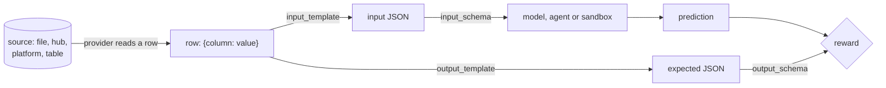
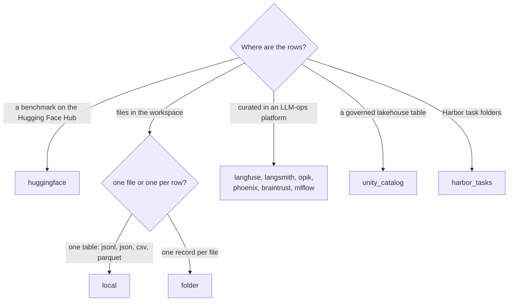

# Datasets

`configs/datasets.yaml` says, for each dataset, where its rows come from, how
each row becomes a question and an expected answer, what answers it, and
which reward scores it. An evaluation then names datasets by their key
([Running evaluations](evaluations.md)).

Every row goes through the same steps, whatever the provider:



The provider only decides where rows come from and what their columns are
called. Everything after that (the templates, the schemas, the block that
answers, the reward) works the same for all of them. So choosing a provider
is about where your data lives and how you pin a version of it, not about
what you can evaluate.

## An entry, field by field

```yaml
datasets:
  gsm8k-20:                            # the key evaluations and leaderboards use
    type: huggingface                  # the provider
    description: GSM8K test split, 20 rows.
    tags: [math]                       # for browsing; the run ignores them
    config:                            # the provider's settings, the templates, the schemas
      path: openai/gsm8k
      name: main
      split: test
      limit: 20                        # the first 20 rows; leave out for all
      batch_size: 4                    # rows sent to the model at once
      input_template: '{"question": {{ question | tojson }}}'
      output_template: '{"answer": {{ answer.split(''####'')[-1] | replace('','', '''') | trim | tojson }}}'
      input_schema:
        type: object
        properties:
          question: {type: string, description: The question to answer}
        required: [question]
      output_schema:
        type: object
        properties:
          answer: {type: string, description: "The final number only, no units or commas"}
        required: [answer]
    generator:                         # what answers: a model, in one call
      chain_of_thought: true
      instructions: Solve the problem. Reply with the final number only.
    reward: exact-match                # a rewards.yaml key; required to run
```

| field | values | default | effect |
|---|---|---|---|
| the key | letters, digits, `_`, `.`, `-`; starts with a letter or digit | | the name evaluations and leaderboards refer to |
| `type` | a provider ([below](#providers)) | required | where rows are read from |
| `config` | the provider's settings, the templates, the schemas | `{}` | how rows are read and rendered |
| `description` | text | none | shown when browsing; not read by the run |
| `tags` | list of labels | `[]` | lower-cased and de-duplicated; for browsing only |
| `generator`, `agent`, `a2a`, `embedding`, `tools`, `harbor` | at most one block | a generator | what answers each row ([below](#what-answers-each-row)) |
| `reward` | a key of `rewards.yaml` | none | the dataset's score; an evaluation refuses a dataset without one |
| `metrics` | list | `[]` | extra columns beside the reward ([below](#extra-metrics)) |

`reward`, `metrics` and the answering block always sit at the entry's top
level, never inside `config`. `openarena check` says so and tells you to
move them up.

## Settings every provider takes

These live in `config`, next to the provider's own settings.

| field | values | default | effect |
|---|---|---|---|
| `input_template` | Jinja2 rendering a JSON object | required (not for `harbor_tasks`) | what the model receives for a row |
| `output_template` | Jinja2 rendering a JSON object | none | the expected answer the reward compares with; leave out for an inputs-only dataset |
| `input_schema` | JSON Schema, as YAML or a JSON string | chat messages | the shape `input_template` renders |
| `output_schema` | JSON Schema, as YAML or a JSON string | one chat message | the shape `output_template` renders, and the structure the model answers in |
| `limit` | integer | all rows | read at most this many rows, the first ones in the source's order |
| `batch_size` | integer | `1` | rows in flight at once |
| `repeat` | integer, at least 1 | `1` | each row is sent this many times in a row, each copy scored as a row |

`batch_size` is the concurrency knob. `openarena evaluations run --batch-size`
and an evaluation's own `batch_size` override every dataset's: the flag wins,
then the evaluation's, then the dataset's. Keep it low for a local model or a
rate-limited key; raise it for a hosted model with headroom.

`repeat` sends the same row several times. Use it to see how much a sampled
model's answers vary on a small set. Leave it at `1` for a benchmark score:
repeated rows weigh each question more without adding questions.

## Templates: from a row to JSON

Both templates are Jinja2 over **one row**: each column of the row is a
variable. Each must render to a **JSON object**, which is then read against
its schema.

- `input_template` is what the model receives: `{"question": ...}` for
  question answering.
- `output_template` is the expected answer. A judge can score without one;
  `exact_match` and the other deterministic rewards cannot. Leave it out and
  the dataset is inputs-only: its rows carry no expected answer.

Pipe every value through `| tojson`. It quotes and escapes strings, and keeps
numbers, lists and objects as JSON. Never write `"{{ question }}"`: it breaks
on the first quote or newline in a question.

| you write | for |
|---|---|
| `{{ question \| tojson }}` | a column |
| `{{ input.question \| tojson }}` | a field of a column holding an object |
| `{{ answers.text[0] \| tojson }}` | an item of a list |
| `{{ answer.split('####')[-1] \| trim \| tojson }}` | Python string methods and Jinja filters |
| `{{ "ABCD"[answer] \| tojson }}` | an index turned into a letter |
| `{{ answer \| string \| tojson }}` | a number compared as text |
| `{{ hint \| default("") \| tojson }}` | a column some rows lack |
| `{{ metadata.difficulty \| tojson }}` | a platform item's metadata, carried into the input |

!!! warning "Quoting in YAML"
    Write a template as a single-quoted YAML string, and double every single
    quote inside it: `split(''####'')` in YAML is `split('####')` in Jinja.
    Double quotes need no escaping.

Templates are strict: a variable the row does not have is an error, not an
empty string. That catches a misspelled column on the first row instead of
scoring a whole run against blanks. When a column really is optional, say so
with `| default(...)`.

Look at real rows before writing a template. For a Hugging Face dataset:

```shell
python -c "import datasets; print(next(iter(datasets.load_dataset('openai/gsm8k', 'main', split='test', streaming=True))))"
```

For a local file, `head -n 1 data/qa.jsonl`. For a platform, open one item
in its UI: the template variables are the provider's fields
([table below](#what-each-provider-calls-a-row)), and your data sits inside
them.

### Worked examples

=== "Messy answer column"

    GSM8K's `answer` holds the worked solution, then `####`, then the
    number, sometimes with a thousands separator. The expected answer keeps
    only the number:

    ```yaml
    datasets:
      gsm8k-clean:
        type: huggingface
        config:
          path: openai/gsm8k
          name: main
          split: test
          limit: 20
          input_template: '{"question": {{ question | tojson }}}'
          # "... #### 1,234" becomes "1234"
          output_template: '{"answer": {{ answer.split(''####'')[-1] | replace('','', '''') | trim | tojson }}}'
          input_schema: {type: object, properties: {question: {type: string, description: The question to answer}}, required: [question]}
          output_schema: {type: object, properties: {answer: {type: string, description: The final number only}}, required: [answer]}
        reward: exact-match
    ```

=== "Multiple choice"

    MMLU has the question, a list of `choices` and the index of the right
    one. The input lists the choices under the question; the expected
    answer is the letter:

    ```yaml
    datasets:
      mmlu-math:
        type: huggingface
        config:
          path: cais/mmlu
          name: high_school_mathematics
          split: test
          limit: 50
          input_template: '{"question": {{ (question ~ "\n" ~ (choices | map("string") | list | join("\n"))) | tojson }}}'
          output_template: '{"answer": {{ "ABCD"[answer] | tojson }}}'
          input_schema: {type: object, properties: {question: {type: string, description: The question to answer}}, required: [question]}
          output_schema:
            type: object
            properties:
              answer: {type: string, enum: [A, B, C, D], description: The letter of the correct choice}
            required: [answer]
        generator:
          instructions: Answer with the letter of the correct choice only.
        reward: exact-match
    ```

    The `enum` keeps "Option B" out where "B" is expected.

=== "Several columns"

    A support-ticket CSV with `subject`, `body`, `product` and
    `expected_team`. Every CSV value is text. The input carries what the
    model needs as separate keys, and the label is normalised:

    ```yaml
    datasets:
      ticket-routing:
        type: local
        config:
          path: data/tickets.csv
          input_template: '{"ticket": {{ (subject ~ "\n\n" ~ body) | tojson }}, "product": {{ product | tojson }}}'
          output_template: '{"team": {{ expected_team | trim | lower | tojson }}}'
          input_schema:
            type: object
            properties:
              ticket: {type: string, description: The ticket's subject and body}
              product: {type: string, description: The product the ticket is about}
            required: [ticket, product]
          output_schema:
            type: object
            properties:
              team: {type: string, enum: [billing, technical, sales], description: The team to route the ticket to}
            required: [team]
        reward: exact-match
    ```

=== "Platform items"

    Platforms store an item's input and expected output as objects. With
    Langfuse a row is `input`, `expected_output`, `metadata` and `id`, so
    your fields are one level down:

    ```yaml
    datasets:
      support-golden:
        type: langfuse
        config:
          dataset_name: support-golden
          input_template: '{"question": {{ input.question | tojson }}, "tier": {{ metadata.tier | default("free") | tojson }}}'
          output_template: '{"answer": {{ expected_output.answer | tojson }}}'
          input_schema: {type: object, properties: {question: {type: string}, tier: {type: string}}, required: [question, tier]}
          output_schema: {type: object, properties: {answer: {type: string}}, required: [answer]}
        reward: judge
    ```

    If the items were stored as plain strings, drop the field:
    `{{ input | tojson }}`.

=== "Chat messages"

    Without schemas, a row is read as chat messages. The input renders
    `{"messages": [...]}`, the expected answer one message:

    ```yaml
    datasets:
      chat-replies:
        type: local
        config:
          path: data/chats.jsonl         # {"prompt": "...", "reply": "..."} per line
          input_template: '{"messages": [{"role": "user", "content": {{ prompt | tojson }}}]}'
          output_template: '{"role": "assistant", "content": {{ reply | tojson }}}'
        reward: judge
    ```

    Use this for free-form conversation scored by a judge. For anything
    with a structured answer, write schemas.

There is no metadata template: a row is an input and, optionally, an expected
answer. When the source carries metadata the model should see, put it in the
input. When you only want it to select rows, select at the source (Opik's
`filter_string`, Phoenix's `splits`) or keep a separate file.

!!! note "Column names"
    A column is a template variable, so its name must be a valid identifier.
    A column called `expected answer` or `gold-label` cannot be named in a
    template: rename it in the file or at the source.

### Schemas

`input_schema` and `output_schema` are the JSON Schemas of what the templates
render. With an `output_schema` the model answers in that structure, and each
field's `description` is the instruction for that field. An `enum` holds the
model to the exact labels the expected answer uses.

**Give both whenever a template renders anything but chat messages**, which
is nearly always. Without `input_schema` a row is read as chat messages
(`{"messages": [...]}`), and without `output_schema` the expected answer is
read as one chat message (`{"role": ..., "content": ...}`), so `{"question": ...}`
and `{"answer": ...}` fail when the run reads the rows. A free-text answer
still gets a schema: one `string` field, no `enum`.

Every object in a schema is closed for you (`additionalProperties: false`,
unless you set it otherwise), because some model providers refuse structured
output on an open object. List `required` yourself.

Two kinds of dataset get their shapes for you: an [`embedding`](#retrieval)
dataset gets the retrieval shapes, and a `harbor_tasks` dataset has fixed
templates and schemas.

An `output_schema` without an `output_template` is refused when the run loads
the dataset: there is nothing for the schema to describe.

## Choosing a provider

Pick the provider for where the rows already live, then pin a version.



| provider | choose it when | pin with | extra to install |
|---|---|---|---|
| `huggingface` | a public benchmark (GSM8K, MMLU), or a team dataset on the Hub | `revision` | none |
| `local` | you own the rows and keep them in git beside the configs | git | none |
| `folder` | each case is a file people edit (a YAML per case, a Markdown prompt) | git | none |
| `langfuse` | items curated in Langfuse, often from traces | `version` (a time) | `langfuse` |
| `langsmith` | examples curated in LangSmith | `as_of` (a version tag) | `langsmith` |
| `opik` | items in Opik, selected with server-side filters | `version` (a version name) | `opik` |
| `phoenix` | examples in Phoenix, divided into splits | `version_id` | `phoenix` |
| `braintrust` | records in a Braintrust project | `version` (a transaction id) | `braintrust` |
| `mlflow` | an MLflow evaluation dataset | nothing | none |
| `unity_catalog` | a Delta or Parquet table governed by Unity Catalog | `version` or `as_of` | `unity-catalog` |
| `harbor_tasks` | tasks an agent works in a sandbox, scored by their own tests | git | none |

The trade-offs:

- **A file in git** (`local`, `folder`) is the most reproducible. The
  dataset changes only in a commit, and anyone with the workspace can run it
  without an account anywhere. Prefer it for a small, hand-made set.
- **The Hub** is right for public benchmarks, so others compare on the same
  rows. Pin `revision`: a dataset's `main` can change under you.
- **A platform** is right when the rows are curated there, for instance
  production traces promoted to a golden set. Reading it directly avoids a
  stale export, but the dataset moves as people curate it. Pin a version,
  or results two weeks apart compare different questions.
- **Unity Catalog** is right when the evaluation data is a governed table
  others maintain. Pin a Delta version.

## Providers

Each tab gives the provider's settings, the variables a row exposes to the
templates, what it reads from the environment, how to pin it, and its
pitfalls. `openarena check` refuses a setting a provider does not take,
except on `huggingface`, which forwards unknown settings to the Hugging Face
loader. Keys and endpoints go in the workspace's `.env`
([Workspace](../workspace.md)), never in `datasets.yaml`.

=== "huggingface"

    Reads a dataset from the Hugging Face Hub, row by row.

    ```yaml
    datasets:
      gsm8k-pinned:
        type: huggingface
        config:
          path: openai/gsm8k               # the repo
          name: main                       # the subset
          split: test
          revision: main                   # a commit hash for a frozen benchmark
          streaming: true                  # download rows as they are read
          limit: 50
          input_template: '{"question": {{ question | tojson }}}'
          output_template: '{"answer": {{ answer.split(''####'')[-1] | replace('','', '''') | trim | tojson }}}'
          input_schema: {type: object, properties: {question: {type: string}}, required: [question]}
          output_schema: {type: object, properties: {answer: {type: string}}, required: [answer]}
        reward: exact-match
    ```

    | field | values | default | effect |
    |---|---|---|---|
    | `path` | a repo id (`openai/gsm8k`) or a loader name | required | which dataset |
    | `name` | a subset | none | which configuration of a multi-subset dataset (`main`, `high_school_mathematics`) |
    | `split` | `train`, `test`, `validation`, ... | none | the split; without one, every split is read in turn |
    | `revision` | a commit hash, branch or tag | latest | the version of the repo |
    | `streaming` | `true`, `false` | `true` | `true` reads rows as they download; `false` downloads the split first |
    | anything else | e.g. `data_files`, `token`, `trust_remote_code` | | passed to `datasets.load_dataset` |

    **Row variables**: the dataset's columns, as its card shows them.

    **When to use it**: public benchmarks, and team datasets on the Hub.
    Keep `streaming: true` when you take a few rows of a large dataset: rows
    are read only until `limit` is reached.

    **Pitfalls**

    - Without `split`, every split is read in turn, so `limit: 20` takes the
      first 20 rows of the first split, often `train`.
    - Without `name`, a multi-subset dataset fails to load: the Hub asks
      which configuration you mean.
    - Without `revision`, an upstream update changes your score with no
      change to your config. Pin the commit hash for anything you publish.
    - Unknown settings are passed on, so `check` cannot catch a misspelled
      one here: it fails when the run loads the dataset.

=== "local"

    Reads one file: one row per record.

    ```yaml
    datasets:
      qa-local:
        type: local
        config:
          path: data/qa.jsonl              # {"question": "...", "answer": "..."} per line
          # format: jsonl                  # only when the extension does not say
          limit: 5
          input_template: '{"question": {{ question | tojson }}}'
          output_template: '{"answer": {{ answer | string | tojson }}}'
          input_schema: {type: object, properties: {question: {type: string}}, required: [question]}
          output_schema: {type: object, properties: {answer: {type: string}}, required: [answer]}
        reward: exact-match
    ```

    | field | values | default | effect |
    |---|---|---|---|
    | `path` | a file | required | the file |
    | `format` | `json`, `jsonl`, `csv`, `parquet` | from the extension | how to read it |

    The extension decides the format: `.jsonl` and `.ndjson` are JSON lines,
    `.json` is JSON, `.csv` comma-separated, `.tsv` tab-separated, `.parquet`
    Parquet. Set `format` only for another extension.

    | format | a row is | note |
    |---|---|---|
    | JSON lines | one object per line | blank lines are skipped |
    | JSON | an item of the top-level list, or of the one list an object holds (`{"data": [...]}`) | an object holding two lists is refused |
    | CSV, TSV | one line, keyed by the header | every value is a string |
    | Parquet | one record | read in row groups, so a large file need not fit in memory |

    **Row variables**: the record's keys, or the header's columns.

    **When to use it**: your own set, small enough to keep in git. It is the
    simplest dataset to pin: its version is the commit.

    **Pitfalls**

    - A relative `path` is read from the directory you run `openarena` in.
      Run from the workspace root, or give an absolute path.
    - CSV values are text: `{{ score | int }}` to use one as a number,
      `{{ answer | trim }}` against stray spaces.
    - A `.txt`, or any other extension, is refused until `format` says how
      to read it.

=== "folder"

    Reads a folder where each file is one row. Files are read in
    alphabetical order.

    ```yaml
    datasets:
      cases:
        type: folder
        config:
          path: data/cases                 # one YAML per case: {question: ..., answer: ...}
          pattern: "*.yaml"
          recursive: false
          input_template: '{"question": {{ question | tojson }}, "case": {{ _stem | tojson }}}'
          output_template: '{"answer": {{ answer | tojson }}}'
          input_schema: {type: object, properties: {question: {type: string}, case: {type: string}}, required: [question, case]}
          output_schema: {type: object, properties: {answer: {type: string}}, required: [answer]}
        reward: judge
    ```

    | field | values | default | effect |
    |---|---|---|---|
    | `path` | a folder | required | where the files are |
    | `pattern` | a glob | `*` | which files are rows |
    | `recursive` | `true`, `false` | `false` | also look in sub-folders |
    | `format` | `json`, `yaml`, `text` | from each file's extension | how to read every file |
    | `encoding` | a text encoding | `utf-8` | how files are decoded |

    **Row variables**

    | file | variables |
    |---|---|
    | `.json`, `.yaml`, `.yml` holding an object | its keys |
    | `.json`, `.yaml`, `.yml` holding anything else | `record` |
    | `.txt`, `.md`, or any file under `format: text` | `text` |
    | every file | `_filename` (`case-01.yaml`), `_stem` (`case-01`), `_path` (relative to `path`) |

    **When to use it**: cases written and reviewed by people, one per file,
    so a pull request shows exactly which case changed. Also prompts kept as
    Markdown, read as `text`.

    **Pitfalls**

    - The default pattern `*` takes every file, a stray `README.md`
      included. Narrow it to `*.yaml` or `*.json`.
    - A file with any other extension stops the run until `format` says how
      to read it.
    - `limit` takes the first files in alphabetical order: number them
      (`001-...`) when the order matters.

=== "langfuse"

    Reads a Langfuse dataset, a page of items at a time.

    ```yaml
    datasets:
      lf-golden:
        type: langfuse
        config:
          dataset_name: support-golden
          version: "2026-04-15T00:00:00Z"  # the items as they were then
          streaming: true
          page_size: 50
          input_template: '{"question": {{ input.question | tojson }}}'
          output_template: '{"answer": {{ expected_output.answer | tojson }}}'
          input_schema: {type: object, properties: {question: {type: string}}, required: [question]}
          output_schema: {type: object, properties: {answer: {type: string}}, required: [answer]}
        reward: judge
    ```

    | field | values | default | effect |
    |---|---|---|---|
    | `dataset_name` | the dataset's name | required | which dataset |
    | `version` | an ISO 8601 time; UTC when it has no zone | latest | the items as they were at that time |
    | `streaming` | `true`, `false` | `true` | `true` fetches a page at a time; `false` fetches every item first |
    | `page_size` | integer | `50` | items per page when streaming |

    **Row variables**: `input`, `expected_output`, `metadata`, `id`.

    **Environment**: `LANGFUSE_PUBLIC_KEY`, `LANGFUSE_SECRET_KEY`,
    `LANGFUSE_HOST`.

    **Extra**: `langfuse`.

    **Pinning**: Langfuse versions a dataset by time, not by name. Set
    `version` to the moment you froze the set; items added later are left
    out.

=== "langsmith"

    Reads the examples of a LangSmith dataset.

    ```yaml
    datasets:
      ls-golden:
        type: langsmith
        config:
          dataset_name: support-golden
          as_of: golden-2026-04            # a version tag
          input_template: '{"question": {{ inputs.question | tojson }}}'
          output_template: '{"answer": {{ outputs.answer | tojson }}}'
          input_schema: {type: object, properties: {question: {type: string}}, required: [question]}
          output_schema: {type: object, properties: {answer: {type: string}}, required: [answer]}
        reward: judge
    ```

    | field | values | default | effect |
    |---|---|---|---|
    | `dataset_name` | the dataset's name | required | which dataset |
    | `as_of` | a version tag | latest | the examples as tagged |

    **Row variables**: `inputs`, `outputs`, `metadata`, `id`. Note the
    plurals: these are LangSmith's names, not Langfuse's.

    **Environment**: `LANGSMITH_API_KEY`, `LANGSMITH_ENDPOINT`.

    **Extra**: `langsmith`.

    **Pinning**: tag a version in LangSmith and set `as_of` to the tag.
    Moving a tag (`prod`) moves every evaluation that names it, which suits
    "the current golden set" but not a published result: use a tag you
    never move for those.

=== "opik"

    Reads the items of an Opik dataset, optionally filtered by Opik.

    ```yaml
    datasets:
      opik-regressions:
        type: opik
        config:
          dataset_name: support-golden
          version: v1                      # a named version
          filter_string: 'tags contains "regression"'
          input_template: '{"question": {{ input.question | tojson }}}'
          output_template: '{"answer": {{ expected_output.answer | tojson }}}'
          input_schema: {type: object, properties: {question: {type: string}}, required: [question]}
          output_schema: {type: object, properties: {answer: {type: string}}, required: [answer]}
        reward: judge
    ```

    | field | values | default | effect |
    |---|---|---|---|
    | `dataset_name` | the dataset's name | required | which dataset |
    | `version` | a version name (`v1`) | latest | the items of that version |
    | `filter_string` | an Opik filter expression | none | only the items it matches, filtered by Opik |

    **Row variables**: the item's fields: `input`, `expected_output`,
    `metadata`, `id`, and any custom field the item was created with.

    **Environment**: `OPIK_API_KEY`, `OPIK_WORKSPACE`, `OPIK_URL_OVERRIDE`.

    **Extra**: `opik`.

    **When to use it**: `filter_string` makes several datasets out of one
    (the regressions, one product's items) without copying items. `limit` is
    sent to Opik, so only that many items are fetched.

=== "phoenix"

    Reads the examples of an Arize Phoenix dataset.

    ```yaml
    datasets:
      phoenix-golden:
        type: phoenix
        config:
          dataset_name: support-golden
          version_id: <version id>         # from the Phoenix UI
          splits: [test]
          input_template: '{"question": {{ input.question | tojson }}}'
          output_template: '{"answer": {{ output.answer | tojson }}}'
          input_schema: {type: object, properties: {question: {type: string}}, required: [question]}
          output_schema: {type: object, properties: {answer: {type: string}}, required: [answer]}
        reward: judge
    ```

    | field | values | default | effect |
    |---|---|---|---|
    | `dataset_name` | the dataset's name or id | required | which dataset |
    | `version_id` | a version id | latest | the examples of that version |
    | `splits` | list of split names | all | only the examples in these splits |

    **Row variables**: `id`, `input`, `output`, `metadata`. The expected
    answer is `output` here.

    **Environment**: `PHOENIX_API_KEY`, and `PHOENIX_COLLECTOR_ENDPOINT` or
    `PHOENIX_HOST` with `PHOENIX_PORT`.

    **Extra**: `phoenix`.

    **Pitfall**: Phoenix returns the whole version in one call, and `limit`
    is applied after. To evaluate a slice of a large dataset, give the slice
    its own split.

=== "braintrust"

    Reads the records of a Braintrust dataset.

    ```yaml
    datasets:
      bt-golden:
        type: braintrust
        config:
          project: support
          dataset_name: golden
          version: "1000192656880881099"   # a transaction id
          input_template: '{"question": {{ input.question | tojson }}}'
          output_template: '{"answer": {{ expected.answer | tojson }}}'
          input_schema: {type: object, properties: {question: {type: string}}, required: [question]}
          output_schema: {type: object, properties: {answer: {type: string}}, required: [answer]}
        reward: judge
    ```

    | field | values | default | effect |
    |---|---|---|---|
    | `project` | the project's name | `project` or `project_id` is required | where the dataset is |
    | `project_id` | the project's id | | instead of `project` |
    | `dataset_name` | the dataset's name | required | which dataset |
    | `version` | a transaction id | latest | the records as of that transaction |
    | `org_name` | an organization | `BRAINTRUST_ORG_NAME` | for an account in several organizations |
    | `fetch_batch_size` | integer | the SDK's | records per request to Braintrust; not the run's `batch_size` |

    **Row variables**: `id`, `input`, `expected`, `metadata`. The expected
    answer is `expected` here.

    **Environment**: `BRAINTRUST_API_KEY`, and optionally
    `BRAINTRUST_APP_URL`, `BRAINTRUST_ORG_NAME`.

    **Extra**: `braintrust`.

    **Pitfall**: the provider loads nothing without a project and a
    dataset name. `openarena check` reports either one missing
    (``the braintrust provider needs `project` or `project_id` ``).

=== "mlflow"

    Reads an MLflow evaluation dataset.

    ```yaml
    datasets:
      mlflow-golden:
        type: mlflow
        config:
          name: qa_golden_set              # or dataset_id
          input_template: '{"question": {{ inputs.question | tojson }}}'
          output_template: '{"answer": {{ expectations.answer | tojson }}}'
          input_schema: {type: object, properties: {question: {type: string}}, required: [question]}
          output_schema: {type: object, properties: {answer: {type: string}}, required: [answer]}
        reward: judge
    ```

    | field | values | default | effect |
    |---|---|---|---|
    | `name` | the dataset's name | `name` or `dataset_id` is required | which dataset |
    | `dataset_id` | the dataset's id | | when the name is ambiguous |
    | `tracking_uri` | an MLflow URI | see below | the server to read from |

    **Row variables**: `inputs`, `expectations`, `outputs`, `tags`,
    `record_id`.

    **Environment**: the server is `tracking_uri` when set, else
    `MLFLOW_SOURCE_TRACKING_URI`, else the tracing server,
    `MLFLOW_TRACKING_URI`. Set the first variable when the datasets live on
    one MLflow server and runs are traced to another.

    **Extra**: none.

    **Pitfalls**

    - With an `output_template`, every record needs expectations; one
      without stops the run. Leave `output_template` out to read an
      unlabelled set, for a judge that scores without a reference.
    - Evaluation datasets need an MLflow server backed by a database, not a
      plain `./mlruns` folder.
    - There is no version to pin: the dataset is read as it is now.
    - Without `name` or `dataset_id` there is nothing to read: `openarena
      check` reports ``the mlflow provider needs `name` or `dataset_id` ``.

=== "unity_catalog"

    Reads a Delta (or Parquet) table registered in Unity Catalog, straight
    from its object storage, in batches.

    ```yaml
    datasets:
      uc-questions:
        type: unity_catalog
        config:
          table: main.evals.questions      # catalog.schema.table
          version: 3                       # a Delta version
          # as_of: "2026-04-15T00:00:00Z"  # or a time; not both
          input_template: '{"question": {{ question | tojson }}}'
          output_template: '{"answer": {{ reference_answer | tojson }}}'
          input_schema: {type: object, properties: {question: {type: string}}, required: [question]}
          output_schema: {type: object, properties: {answer: {type: string}}, required: [answer]}
        reward: judge
    ```

    | field | values | default | effect |
    |---|---|---|---|
    | `table` | `catalog.schema.table` | required | the table |
    | `version` | an integer Delta version | latest | the table at that version |
    | `as_of` | an ISO 8601 time | latest | the table at that time; not with `version` |
    | `storage_path` | an `s3://...` path | looked up in the catalog | read this path and skip the catalog |
    | `read_batch_size` | integer | `10000` | rows per read from storage; not the run's `batch_size` |

    **Row variables**: the table's columns.

    **Environment**

    | variable | for |
    |---|---|
    | `UNITY_CATALOG_API_URL` | the catalog's REST API, `/api/2.1/unity-catalog` included; not read with `storage_path` |
    | `UC_TOKEN` | its bearer token; not read with `storage_path` |
    | `AWS_ACCESS_KEY_ID`, `AWS_SECRET_ACCESS_KEY` | the object storage |
    | `AWS_DEFAULT_REGION` | its region; `fr-par` when unset |
    | `S3_ENDPOINT` | an S3-compatible store (MinIO, Scaleway) |

    **Extra**: `unity-catalog`.

    **Pinning**: set `version` to the Delta version you evaluated. `version`
    and `as_of` apply to Delta tables only: a table the catalog reports as
    Parquet is read as it is now.

    **Pitfalls**

    - `table` must have exactly three parts, and `version` must be an
      integer, `3` and not `"3"`.
    - With `storage_path`, nothing tells the provider the table's format,
      and it reads the path as a Delta table.

=== "harbor_tasks"

    Reads [Harbor task folders](harbor-tasks.md): every sub-folder of `path`
    holding a `task.toml` is a row, run in its own sandbox and scored by its
    own tests.

    ```yaml
    datasets:
      my-tasks:
        type: harbor_tasks
        config:
          path: tasks                      # relative to the workspace; the run copies it
          tasks: [hello-world]             # only these folders; leave out for every task
        harbor:
          agent: terminus-2
        reward: harbor-tests               # type: harbor_verifier
    ```

    | field | values | default | effect |
    |---|---|---|---|
    | `path` | a folder of task folders | required | where the tasks are |
    | `tasks` | list of folder names | every task, sorted by name | only these tasks |

    No templates and no schemas: they are fixed, and each task's tests
    score it. The entry needs a `harbor:` block without `environment`,
    since each task brings its own, and without `instructions` or
    `answer_file`: a task says what the agent is told in its
    `instruction.md` and is scored by its own `tests/`, so `check` refuses
    both. `limit`, `batch_size` and `repeat` work
    as for the other providers. [Harbor tasks](harbor-tasks.md) covers the
    folders, the agents and the trials.

### What each provider calls a row

The quickest way to write a template over a platform's items is to know which
variable holds what:

| provider | the input | the expected answer | also |
|---|---|---|---|
| `huggingface`, `local`, `unity_catalog` | your columns | your columns | |
| `folder` | the file's keys, or `text`, or `record` | the file's keys | `_filename`, `_stem`, `_path` |
| `langfuse` | `input` | `expected_output` | `metadata`, `id` |
| `langsmith` | `inputs` | `outputs` | `metadata`, `id` |
| `opik` | `input` | `expected_output` | `metadata`, `id`, custom fields |
| `phoenix` | `input` | `output` | `metadata`, `id` |
| `braintrust` | `input` | `expected` | `metadata`, `id` |
| `mlflow` | `inputs` | `expectations` | `outputs`, `tags`, `record_id` |

### Installing a provider's SDK

The platform providers need their SDK, which openarena installs only when
asked, as an extra named after the provider:

| provider | extra | installs |
|---|---|---|
| `langfuse` | `langfuse` | `langfuse` |
| `langsmith` | `langsmith` | `langsmith` |
| `opik` | `opik` | `opik` |
| `phoenix` | `phoenix` | `arize-phoenix-client` |
| `braintrust` | `braintrust` | `braintrust` |
| `unity_catalog` | `unity-catalog` | `deltalake` |
| all of the above | `all` | every one |

```shell
uv tool install "openarena[langfuse] @ git+https://github.com/Atena-IT/open-arena"
uv add "openarena[langfuse]"          # in a project
```

Without it, the run stops when it loads the dataset and names the extra to
install. `openarena check` does not need the SDK, so a config can check clean
on a machine that cannot run it.

## Reproducibility: pin the version

A score means something only if the rows behind it can be read again. Pin
every dataset you publish or compare over time:

| provider | pin with | example |
|---|---|---|
| `huggingface` | `revision` | the dataset repo's commit hash |
| `local`, `folder`, `harbor_tasks` | git | commit the files with the configs |
| `langfuse` | `version` | `"2026-04-15T00:00:00Z"` |
| `langsmith` | `as_of` | a tag you never move, `golden-2026-04` |
| `opik` | `version` | `v3` |
| `phoenix` | `version_id` | the version's id |
| `braintrust` | `version` | a transaction id |
| `unity_catalog` | `version` | `3` |
| `mlflow` | nothing | export it to a `local` file to freeze it |

!!! tip "Change the key with the version"
    A run keeps finished cells by dataset key and reuses them when run
    again. After changing a pinned version (or a template, or `limit`), give
    the dataset a new key (`golden-v3` to `golden-v4`), or run with
    `--no-cache` ([Resuming](evaluations.md#resuming-and-starting-over)). A new key also keeps
    the old scores readable beside the new ones.

## Smoke subsets

Start small, read the answers, then scale. `limit` caps the rows a dataset
reads, and is the quickest way to get there.

```yaml
datasets:
  gsm8k-smoke:                         # 5 rows: do the template, the schema and the reward work?
    type: huggingface
    config:
      path: openai/gsm8k
      name: main
      split: test
      limit: 5
      input_template: '{"question": {{ question | tojson }}}'
      output_template: '{"answer": {{ answer.split(''####'')[-1] | replace('','', '''') | trim | tojson }}}'
      input_schema: {type: object, properties: {question: {type: string}}, required: [question]}
      output_schema: {type: object, properties: {answer: {type: string}}, required: [answer]}
    reward: exact-match
  gsm8k-full:                          # the same source, every row
    type: huggingface
    config:
      path: openai/gsm8k
      name: main
      split: test
      input_template: '{"question": {{ question | tojson }}}'
      output_template: '{"answer": {{ answer.split(''####'')[-1] | replace('','', '''') | trim | tojson }}}'
      input_schema: {type: object, properties: {question: {type: string}}, required: [question]}
      output_schema: {type: object, properties: {answer: {type: string}}, required: [answer]}
    reward: exact-match
```

Keep the smoke entry and the full one side by side under different keys, and
point a `smoke` evaluation at the first. Editing `limit` on one entry back and
forth makes a resumed run reuse cells computed at the other size.

!!! warning "`limit` is not a sample"
    `limit` takes the **first** rows in the source's order; nothing shuffles
    them. When a dataset is sorted (by topic, by difficulty), its first 20
    rows are not representative. For a representative subset, make one: a
    `local` file of rows you picked, a Phoenix split, an Opik
    `filter_string`, or a subset on your platform.

How each provider applies `limit`:

| provider | what is fetched |
|---|---|
| `huggingface` (streaming), `langfuse` (streaming), `local`, `folder`, `unity_catalog` | rows are read in order until `limit` |
| `opik` | `limit` items, asked of Opik |
| `phoenix`, `mlflow`, `langfuse` with `streaming: false` | the whole dataset, then cut |

## What answers each row

At most one block. Without one, a model answers in one call.

| block | answered by | the evaluation's `language_models` are |
|---|---|---|
| none, or `generator:` | a model in one call; `instructions`, `chain_of_thought` | models |
| `agent:` | a model calling MCP tools ([MCP tools](mcp-tools.md)) | models |
| `a2a: {}` | remote agents ([A2A agents](a2a-agents.md)) | A2A agents |
| `embedding:` | retrieval with an embedding model ([below](#retrieval)) | embedding models |
| `tools:` | one call with tool declarations, nothing executed ([below](#tool-calls)) | models |
| `harbor:` | an agent the model drives in a sandbox ([Environments](environments.md), [Harbor tasks](harbor-tasks.md)) | models |

Two blocks on one entry are refused: a dataset is answered one way. To compare
a model alone with the same model using tools on the same rows, write two
entries over the same source.

### Retrieval

The input renders a `query` and the `chunks` to search, the expected answer
the gold `chunks`. The embedding model under test ranks the chunks, the top
`k` are returned, and `retrieval_recall` scores them. No schemas to write: an
embedding dataset gets these shapes by default.

```yaml
datasets:
  passages:
    type: local
    config:
      path: retrieval.jsonl            # {"query": "...", "passages": [...], "gold": [...]}
      input_template: '{"query": {{ query | tojson }}, "chunks": {{ passages | tojson }}}'
      output_template: '{"chunks": {{ gold | tojson }}}'
    embedding:
      k: 3
    reward: recall                     # type: retrieval_recall
```

### Tool calls

The model gets the declared functions and answers with the calls it would
make; nothing is executed. The expected answer renders the gold `tool_calls`,
each `{name, arguments}`, with an `output_schema` saying so. That schema only
shapes the expected answer: the model's answer is its chat message, tool calls
included.

```yaml
datasets:
  weather-calls:
    type: local
    config:
      path: calls.jsonl                # {"question": "...", "calls": [{"name": "get_weather", "arguments": {"city": "Paris"}}]}
      input_template: '{"question": {{ question | tojson }}}'
      output_template: '{"tool_calls": {{ calls | tojson }}}'
      input_schema: {type: object, properties: {question: {type: string, description: The question to answer}}, required: [question]}
      output_schema: {type: object, properties: {tool_calls: {type: array, description: The gold calls}}, required: [tool_calls]}
    tools:
      instructions: Call the function that answers the question.
      tool_schemas:
        - type: function
          function:
            name: get_weather
            description: The weather in a city.
            parameters: {type: object, properties: {city: {type: string}}, required: [city]}
    reward: tool-calls                 # type: tool_calls_accuracy
```

## Extra metrics

`metrics:` adds columns beside `reward`. Each is a catalog reward, averaged
over the rows, or a plain metric (`accuracy`, `f1_score`, ...): a bare name,
or a mapping with `class`, an `alias` (the column's name, never `reward`), a
`direction` and the type's settings ([Rewards](rewards.md)).

```yaml
datasets:
  gsm8k-20:
    # ...
    reward: exact-match
    metrics:
      - answer_accuracy
      - {class: lm_as_judge, alias: judged, language_model: gpt-4o-mini}
```

Cost, tokens and latency reach `result.json` only when listed here or on the
evaluation, by their measurement names. Their direction is set for you: a
metric written without `direction:` is `min` when it measures cost, tokens or
latency (`cost`, `total_tokens`, `avg_latency`, ...) and `max` otherwise. Write
`direction:` to override it; the leaderboard ranks by the direction the run
recorded ([Running evaluations](evaluations.md#metrics-the-columns-beside-reward)).

## Common mistakes

`openarena check configs` catches what the file gets wrong
([Checking configs](check.md)). It reads no rows, so what depends on the data
shows up when the run loads the dataset.

| mistake | caught by | what you see |
|---|---|---|
| a misspelled provider, `hugginface` | `check` | unknown provider, with the fix "change 'hugginface' to 'huggingface'" |
| a misspelled setting, `pth:` | `check` | not a setting of the provider, with the fix "rename `pth:` to `path:`" |
| a setting the provider does not take, `as_of:` on `langfuse` | `check` | the list of settings the provider takes |
| a required setting missing, `table:` on `unity_catalog` | `check` | the provider needs it, with a placeholder to fill in |
| no project or dataset name on `braintrust`, no `name` or `dataset_id` on `mlflow` | `check` | ``the braintrust provider needs `project` or `project_id` ``, with a placeholder to fill in |
| no `input_template` | `check` | "nothing says what each row asks", with templates to paste |
| `reward:` inside `config:` | `check` | arena-level keys in `config`, with the fix to move them up |
| two answering blocks | `check` | the blocks are mutually exclusive |
| `harbor_tasks` without `harbor:` | `check` | it needs a `harbor:` block, with `harbor: {agent: terminus-2}` to add |
| `instructions` or `answer_file` in a `harbor_tasks` dataset's `harbor:` | `check` | they have no effect on task folders, with where each belongs instead |
| a column the row does not have | the run | the template fails on the first row |
| a value not piped through `tojson` | the run | the template renders invalid JSON |
| a template that does not match its schema, or no schema | the run | the row is refused when read |
| a missing SDK | the run | the extra to install |
| a wrong Hugging Face path, a bad key, an unreachable server | the run | [Reading results](results.md#when-a-cell-failed-or-scored-0) |

Every mistake caught by the run is also caught by a smoke run with `limit: 5`,
in seconds rather than after a full sweep.

!!! note "Imported scores are not datasets"
    Scores computed by another tool can be imported and ranked on a
    leaderboard. They appear as `<import>/<dataset>`, so they never collide
    with the datasets of this file, but they are results, not rows: nothing
    in `datasets.yaml` describes them ([Leaderboards](leaderboards.md)).
