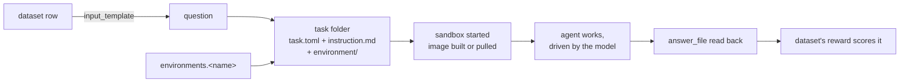

# Environments

An environment is a sandbox definition: the image an agent works in, the
resources it gets, what network it may reach, and the tools it is handed. On
its own it does nothing. A dataset whose `harbor:` block names it turns each of
its rows into a [Harbor](https://harborframework.com) task in that sandbox:
the row's question becomes the task's instruction, the model under test drives
an agent that works there with a terminal and files, and the agent's answer is
scored by the dataset's own reward.

Environments live in `configs/environments.yaml`, one entry per name.

## Do you need one?

An environment is the most expensive way to ask a question: every row starts
a sandbox, and the agent makes many model calls to answer it. Use one only
when the answer should be **worked out**, not just stated.

| you want to measure | use |
|---|---|
| the answer a model gives in one call | a plain dataset ([Datasets](datasets.md)) |
| a model calling tools you serve | a dataset with MCP tools ([MCP tools](mcp-tools.md)) |
| ordinary questions (GSM8K, your CSV) solved with a shell, Python, files | **an environment** and a dataset over it (this page) |
| tasks that each bring their own files, setup and tests | [Harbor tasks](harbor-tasks.md): each task folder carries its own environment, and no entry here is needed |

!!! note "Harbor tasks bring their own"
    A `type: harbor_tasks` dataset reads each task's `[environment]` from its
    own `task.toml`. An `environments:` entry is that same section, written
    once in YAML and shared by every row of a dataset, under the same field
    names.

## How a row runs



For every row, and every model of the evaluation:

1. The row's question, after the block's `instructions`, is written as the
   task's `instruction.md`.
2. The environment entry is written as the task's `task.toml`
   `[environment]` section. A copy of the environment's build context goes
   into the task's `environment/` folder, and a `dockerfile` is written there
   as `Dockerfile`.
3. Harbor starts a sandbox from it with the configured provider, waits for
   the healthcheck, and lets the agent work.
4. When the agent is done, or its `timeout_sec` runs out, the `answer_file`
   is copied out of the sandbox. Without one, the agent's last message is the
   answer.
5. The dataset's reward scores the answer on your machine, not in the
   sandbox.

**What is isolated.** Each row is its own trial, with its own sandbox: one
row's files, installed packages and processes never reach another row, nor
another model's run of the same row. The sandbox does not see your machine's
files, only the image and its build context. What crosses the boundary is
what you put there: the `env:` variables, the MCP servers, and whatever the
network mode lets through.

## A first environment

```yaml
environments:
  python:
    description: Python 3.12 with tmux.   # shown when browsing
    tags: [python]
    dockerfile: |                          # the image is built from this...
      FROM python:3.12-slim
      RUN apt-get update && apt-get install -y --no-install-recommends tmux && rm -rf /var/lib/apt/lists/*
      WORKDIR /app
      COPY requirements.txt /tmp/requirements.txt
      RUN pip install --no-cache-dir -r /tmp/requirements.txt
    # docker_image: python:3.12-slim      # ...or pulled from this; one of the two
    workdir: /app                          # where the agent starts; the image must have it
    cpus: 1                                # blank: the provider's default
    memory_mb: 2048
    network_mode: public                   # public | no-network | allowlist
```

The `COPY requirements.txt` above reads from the environment's **build
context**, a folder beside `configs/`:

```
my-arena/
  configs/
    environments.yaml
  environments/
    python/
      environment/          the build context: whatever the Dockerfile COPYs
        requirements.txt
```

When a run starts, `environments/<name>/` is copied beside the run's own
config, fresh each time: a file you removed since the last run does not
linger. A `docker_image` environment needs no folder.

## Fields

| field | type | default | what it sets |
|---|---|---|---|
| `docker_image` | string | none | a prebuilt image to pull, e.g. `python:3.12-slim` |
| `dockerfile` | string | none | a Dockerfile to build from the build context |
| `os` | `linux` or `windows` | `linux` | the sandbox's operating system |
| `workdir` | string | the image's | the directory the agent starts in |
| `cpus` | integer, 1 or more | the provider's | CPUs the sandbox gets |
| `memory_mb` | integer, 1 or more | the provider's | memory, in MB |
| `storage_mb` | integer, 1 or more | the provider's | disk, in MB |
| `gpus` | integer, 0 or more | the provider's | GPUs the sandbox gets |
| `gpu_types` | list of strings | `[]` (any) | accepted GPU types, e.g. `H100` |
| `network_mode` | `public`, `no-network`, `allowlist` | `public` | what the sandbox may reach |
| `allowed_hosts` | list of strings | `[]` | the hosts an `allowlist` sandbox may reach |
| `env` | map of string to string | `{}` | environment variables set in the container |
| `build_timeout_sec` | number above 0 | `600` | how long building the image may take, in seconds |
| `healthcheck` | mapping | none | a command that says when the sandbox is ready |
| `clock` | mapping | none | a virtual start time and rate, read in the sandbox from `/run/arena/clock.json` |
| `mcp_servers` | list of names | `[]` | MCP servers the agent is given, by their `mcp_servers` key |
| `description` | string | none | a line shown when browsing |
| `tags` | list of strings | `[]` | labels for browsing, e.g. `python`, `gpu`, `offline` |

Exactly one of `docker_image` and `dockerfile` is required. Any other key is
an error: a typo like `memory:` is caught, not ignored.

## The image: `docker_image` or `dockerfile`

The image is everything the agent can use without the network: the language
runtime, the libraries, the command-line tools, the data files.

=== "docker_image"

    ```yaml
    environments:
      slim:
        docker_image: python:3.12-slim
    ```

    The image is pulled as it is. Nothing to build, no folder to keep.

=== "dockerfile"

    ```yaml
    environments:
      data:
        dockerfile: |
          FROM python:3.12-slim
          RUN apt-get update && apt-get install -y --no-install-recommends tmux git && rm -rf /var/lib/apt/lists/*
          WORKDIR /app
          COPY data/ /app/data/
          RUN pip install --no-cache-dir pandas
        workdir: /app
    ```

    The image is built from `environments/data/environment/`, which holds
    `data/`. The Dockerfile in the YAML is written into that folder as
    `Dockerfile`.

**When to use which.**

- `docker_image` when a public or registry image already has what the agent
  needs. It skips the build and leaves nothing to drift.
- `dockerfile` when the agent needs tools, packages or files the base image
  lacks. Keep it short: every line is something to trust and maintain.
- A `dockerfile` that is slow to build, used across many rows and models:
  build it once yourself, push it to a registry the sandbox provider can pull
  from, and name it with `docker_image`. Whether a built image is reused
  between rows is up to the sandbox provider, not the arena.

!!! warning "tmux and python3"
    `terminus-2`, the default agent, works its terminal through `tmux`. When
    the image lacks it, terminus-2 tries to install it at the start of every
    task, which needs a package manager and the network, and fails without
    them. Install `tmux` in the Dockerfile. Most agents also run Python:
    start from an image that has `python3`.

**`build_timeout_sec`** bounds the build (600 seconds by default). Raise it
for a heavy build (CUDA bases, large `pip install`s) rather than letting the
rows fail on it; lower it to fail fast on a build that should be quick.

**`os`** is `linux` unless you set `windows`. Leave it unless your image is a
Windows one and your sandbox provider runs those.

## Where the agent starts: `workdir`

`workdir` is the directory every command in the sandbox starts in, the
agent's included. Set it to where the work happens, and put `answer_file`
under it (`/app/answer.txt` with `workdir: /app`), so the agent finds both
without searching.

!!! warning "The image must have it"
    With a `docker_image`, a `workdir` the image lacks makes every command
    fail, and so every row. Either create it in a Dockerfile (`WORKDIR /app`)
    or leave `workdir` out to keep the image's own.

## Resources

```yaml
environments:
  heavy:
    docker_image: python:3.12
    cpus: 4
    memory_mb: 8192
    storage_mb: 20480
```

| field | blank means |
|---|---|
| `cpus`, `memory_mb` | on the local Docker: 2 CPUs (no more than the machine has) and 2048 MB. Elsewhere: the provider's default |
| `storage_mb`, `gpus` | the provider's default |
| `gpu_types` | any GPU type |

**How to size them.** Give the sandbox what the work needs, not what the
machine has.

- Question answering with a shell and Python: 1 to 2 CPUs and 2048 MB.
- Data work (pandas over a real file, compiling, running test suites): 2 to
  4 CPUs and 4096 to 8192 MB. An agent killed for lack of memory scores 0,
  which looks like a wrong model.
- `storage_mb` only when the agent writes large files or installs a lot.
- `gpus` only when the task runs a model or GPU code. Not every provider has
  GPUs: E2B, the default provider, has none, and the arena app refuses such a
  run before it starts.

!!! tip "Keep resources equal across models"
    Every model of an evaluation runs in the same environment, so the
    comparison is fair by construction. Change the resources between two
    evaluations, though, and their scores no longer compare.

**On the local Docker**, a container without limits would get the whole
machine, and a few at once can freeze it, more so with a local model loading
beside them. So the arena fills in 2 CPUs and 2048 MB there when the entry
leaves them blank, and runs **one trial at a time**. What the entry asks for
is always kept. The [settings](#where-it-runs-the-sandbox-provider) below
change both defaults.

## Network

```yaml
environments:
  offline:
    docker_image: python:3.12-slim
    network_mode: no-network
  pip-only:
    docker_image: python:3.12-slim
    network_mode: allowlist
    allowed_hosts: [pypi.org, files.pythonhosted.org]
```

| `network_mode` | the sandbox can reach | use it when |
|---|---|---|
| `public` (default) | anything | the agent needs to install packages or fetch data, or you are still building the environment |
| `no-network` | nothing | the answer must come from the model and the image alone: fair, reproducible, nothing leaks out |
| `allowlist` | only `allowed_hosts` | the agent needs one or two hosts (a package index, your API), and nothing else |

**Why turn it off.** With `public`, an agent can search the web for the
answer to a well-known benchmark question, download a solution, or send data
anywhere. For a leaderboard that claims to measure the model, `no-network` is
the honest setting. It is also the safe one when the agent runs code you did
not review.

**What it costs.** The network mode applies to everything in the sandbox,
the agent included:

- `terminus-2` runs on your machine and types into the sandbox, so it works
  with any network mode, as long as the image already has `tmux`.
- An agent installed in the sandbox (`claude-code`, `codex`, `openhands`,
  ...) calls its model from there. With `no-network` it cannot work at all,
  and the run refuses the pairing:
  `Harbor agent 'openhands' runs inside the sandbox and calls its model from there, which a no-network environment forbids`.
  With `allowlist`, its model provider's host has to be on the list. See
  [Agents and models](harbor-tasks.md#agents-and-models).
- An HTTP MCP server has to be reachable under the network mode too.

Not every provider can cut or filter the network. E2B can do both; on the
local Docker it depends on the host. In the arena app, a run whose provider
cannot give the network mode asked for is refused before it starts.

## Environment variables: `env`

```yaml
environments:
  python:
    docker_image: python:3.12-slim
    env:
      PYTHONUNBUFFERED: "1"
      DATA_DIR: /app/data
```

Set in the container, so the agent's commands and any stdio MCP server
started there see them. Keys must have no whitespace; values are strings, so
quote numbers.

Use `env` for settings the work needs: paths, flags, and a stdio MCP server's
variables, which Harbor cannot hand to the server itself.

A value can name a variable of your machine as `${NAME}`. When a run reads its
config, after it has loaded the workspace's `.env`, the reference is replaced
by the variable's value:

```yaml
environments:
  search:
    docker_image: python:3.12-slim
    network_mode: public
    env:
      SEARCH_API_KEY: ${SEARCH_API_KEY}   # from your shell or the workspace's .env
```

The YAML, and the copy of it beside each run's config, keep `${SEARCH_API_KEY}`,
not the value. A variable set nowhere stops the run before it starts, naming it;
`openarena check` warns about it first. `$${NAME}` writes a literal `${NAME}`.

!!! warning "Anything in `env` is the agent's"
    The value is set in the sandbox, so the agent can read every variable,
    print it, and, with a network, send it anywhere. `${NAME}` keeps a key out
    of your files, not out of the agent's reach. Put in no key you would not
    hand to the model; prefer one scoped to the evaluation and easy to
    revoke.

## Healthcheck

```yaml
environments:
  service:
    dockerfile: |
      FROM python:3.12-slim
      RUN apt-get update && apt-get install -y --no-install-recommends tmux curl && rm -rf /var/lib/apt/lists/*
      # ... and starts the service the agent will query
    healthcheck:
      command: curl -fs http://localhost:8000/health   # exit 0 means ready
      interval_sec: 5
      timeout_sec: 30
      retries: 3
```

Harbor runs `command` inside the container until it succeeds, and the agent
starts only once the sandbox is ready. Leave it out when the image is ready
as soon as it starts, which is the usual case. Add it when the image starts a
server, loads a database or warms a cache the agent depends on: without it,
the agent's first commands race the service and fail.

| field | default | |
|---|---|---|
| `command` | required | run in the container; exit 0 means ready |
| `interval_sec` | `5` | seconds between tries |
| `timeout_sec` | `30` | how long one try may take |
| `retries` | `3` | how many failed tries are allowed |
| `start_period_sec` | `0` | a grace period after the container starts |
| `start_interval_sec` | `5` | seconds between tries during that grace period |

They are written to the task's `[environment.healthcheck]` as they are. The
command's tools must be in the image: `curl` is not in `python:3.12-slim`,
hence the install above.

## Virtual clock: `clock`

```yaml
environments:
  world:
    docker_image: python:3.12-slim
    clock: {start: "2026-01-05T09:00:00Z", rate: 0}
```

A clock gives every process in the sandbox the same virtual time: the MCP
servers the agent is given (a mail server that dates what it sends, say), the
agent's own commands, and the verifier. Use one when the world the agent works
in keeps a time that should not be the machine's: a deadline, a calendar, an
email from "yesterday".

| field | default | |
|---|---|---|
| `start` | required | the virtual time when the sandbox is ready, ISO 8601 with an offset (`Z` for UTC) |
| `rate` | `0` | virtual seconds per real second: `0` frozen, `1` real time, up to `86400` (a day a second) |

A frozen clock, the default, gives every trial of a row the same time, so runs
are reproducible: that is what an evaluation usually wants.

**How it is armed.** Before your own healthcheck, if any, Harbor runs a shell
command that writes `/run/arena/clock.json` once:

```json
{"t0": 1767603600, "rate": 0, "anchor": 1767700000, "ahead": 0}
```

`t0` is `start` in epoch seconds and `anchor` the real time the file was
written; every reader computes `now = t0 + (real_now - anchor) * rate + ahead`.
So `start` is the moment the sandbox is ready, not the moment the agent begins:
Harbor sets the agent up after the healthcheck, and with a running clock the
agent starts later in virtual time by its install time times the rate. Your own
healthcheck command runs after the arm, in a subshell, with its own timings; an
arm that fails (the image's user cannot create `/run/arena`) fails the
healthcheck, and the trial with it.

**How to read it.** The path is fixed, so a server finds it whoever started it:

- the file is there: use the virtual time;
- it is there but cannot be read or parsed: fail, rather than fall back to real time;
- it is not there: the environment has no clock, use the machine's.

```python
import json, time
from pathlib import Path

def now() -> float:
    clock = Path("/run/arena/clock.json")
    if not clock.exists():
        return time.time()
    c = json.loads(clock.read_text())
    return c["t0"] + (time.time() - c["anchor"]) * c["rate"] + c["ahead"]
```

The arena's environment check (`openarena.harbor.probe`) reports the virtual
time it read.

**What it does not reach.** MCP servers served over HTTP from outside the
sandbox; `agent:` datasets, whose servers run on the arena's own machine; and
Harbor task folders, whose `task.toml` is their own (copy the healthcheck from a
generated task to give one a clock). A clock needs `os: linux`, and nothing
stops an agent running as root from rewriting the file.

## MCP servers

```yaml
environments:
  web:
    docker_image: python:3.12-slim
    network_mode: public
    mcp_servers: [fetch]          # keys of mcp_servers.yaml
```

The agent gets these servers' tools beside its terminal. Harbor carries less
of a server than a plain dataset does: no `websocket`, no `headers`, no stdio
`env` or `cwd`, and a stdio command runs inside the sandbox, so the image must
have it. [MCP tools](mcp-tools.md#tools-in-a-harbor-sandbox) has the details.

## The dataset over it

An environment runs only through a dataset that names it:

```yaml
datasets:
  gsm8k-terminal:
    type: huggingface
    config:
      path: openai/gsm8k
      name: main
      split: test
      limit: 5
      input_template: '{"question": {{ question | tojson }}}'
      output_template: '{"answer": {{ answer.split(''####'')[-1] | replace('','', '''') | trim | tojson }}}'
      input_schema: {type: object, properties: {question: {type: string, description: The question to answer}}, required: [question]}
      output_schema: {type: object, properties: {answer: {type: string, description: The answer only}}, required: [answer]}
    harbor:
      environment: python              # an environments.yaml key
      agent: terminus-2
      instructions: Solve the problem; you may use Python. Write the bare number only.
      answer_file: /app/answer.txt     # the agent is told to write its answer here
      timeout_sec: 300                 # per row
    reward: exact-match
```

| `harbor:` field | default | |
|---|---|---|
| `environment` | none | the sandbox every row runs in; required unless the dataset is `harbor_tasks` |
| `agent` | `terminus-2` | the Harbor agent the model drives ([Agents and models](harbor-tasks.md#agents-and-models)) |
| `instructions` | none | said to the agent before every row's question; not on a `harbor_tasks` dataset |
| `answer_file` | none | an absolute path in the sandbox; the agent is told to write its final answer there, and nothing else; not on a `harbor_tasks` dataset |
| `timeout_sec` | Harbor's | how long the agent may work on one row, in seconds |

The question must render to `{"question": ...}`. The prediction is the
agent's whole trajectory plus `answer`: the content of `answer_file`, else
the agent's last message. The reward reads `answer`, so any reward works. Set
`answer_file` whenever the reward compares strings (`exact_match`): an
agent's last message is often a summary of what it did, not the bare answer.

A Harbor dataset cannot share an evaluation with other kinds of dataset; give
it an evaluation of its own ([Running evaluations](evaluations.md)).

## Where it runs: the sandbox provider

The environment says **what** the sandbox is. **Where** it runs is a setting
of your machine, not of the YAML: the same entry runs on any provider that
can give what it asks for.

=== "E2B (default)"

    Remote sandboxes. Set `E2B_API_KEY`, in your shell or in the workspace's
    `.env`. The sandboxes do not run on your machine, and the arena does not
    hold them to one at a time. `no-network` and `allowlist` are supported;
    GPUs are not.

=== "Local Docker"

    ```shell
    export ARENA_HARBOR_SANDBOX=docker
    ```

    Runs on your machine's Docker, with no key. Good for building and
    debugging an environment, and for private images. One trial at a time by
    default, 2 CPUs and 2048 MB unless the entry asks otherwise. GPUs and
    network modes depend on your Docker host.

=== "Other providers"

    `ARENA_HARBOR_SANDBOX` takes any provider Harbor knows, such as
    `daytona`, `modal`, `runloop` or `podman`. Each needs its own
    credentials, which Harbor checks before a trial. A name Harbor does not
    know is refused, with the list of those it does.

    A provider's own settings go in `ARENA_HARBOR_SANDBOX_OPTIONS`, a JSON
    object Harbor hands its environment as it is (what `harbor run --ek`
    sets). The Kubernetes provider, `ack`, runs each trial as a pod of the
    cluster your kubeconfig, or the pod the arena runs in, reaches:

    ```shell
    export ARENA_HARBOR_SANDBOX=ack
    export ARENA_HARBOR_SANDBOX_OPTIONS='{"namespace": "sandboxes"}'
    ```

    Which keys a provider takes is Harbor's to say; one it does not know
    fails the trial with Harbor's error. A value that is not a JSON object
    stops the run before its first row, whichever provider the trials would
    run on. The local Docker a trial falls back to gets none of them.

!!! warning "The silent fallback"
    When the configured provider cannot start (E2B with no `E2B_API_KEY`),
    trials run on the local Docker instead. That keeps a first run working,
    but it also changes the defaults: local resource limits, one trial at a
    time. When neither can start, the run is refused.

| setting | default | what it does |
|---|---|---|
| `ARENA_HARBOR_SANDBOX` | `e2b` | the sandbox provider |
| `ARENA_HARBOR_SANDBOX_OPTIONS` | none | the provider's own settings, a JSON object Harbor hands its environment |
| `E2B_API_KEY` | none | E2B's key; without it, trials fall back to the local Docker |
| `ARENA_HARBOR_LOCAL_CPUS` | `2` | CPUs a local Docker sandbox gets when the entry leaves `cpus` blank (no more than the machine has) |
| `ARENA_HARBOR_LOCAL_MEMORY_MB` | `2048` | memory a local Docker sandbox gets when the entry leaves `memory_mb` blank |
| `ARENA_HARBOR_LOCAL_TRIALS` | `1` | local Docker trials at once |
| `ARENA_HARBOR_WORKDIR` | the run's state | where task folders and trials are written; set it when Docker cannot read the default folder |

Raise `ARENA_HARBOR_LOCAL_TRIALS` only when the machine has room for that
many sandboxes at once, plus the model if you serve it locally.

!!! note "Docker installed as a snap"
    A snap Docker reads neither `/tmp` nor a hidden folder of your home, so
    it cannot read the run's state under a hidden folder. The arena then
    writes task folders and trials under `~/arena-harbor/` instead, unless
    `ARENA_HARBOR_WORKDIR` says where.

## Timeouts

Three limits, set in three places:

| limit | where | default | bounds |
|---|---|---|---|
| `build_timeout_sec` | the environment | 600 s | building the image |
| `healthcheck.timeout_sec` | the environment | 30 s | one healthcheck try |
| `timeout_sec` | the dataset's `harbor:` block | Harbor's | the agent's work on one row |

The agent's limit sits on the dataset, not the environment, because the same
sandbox can serve quick and slow questions.

## Recipes

??? details "Offline Python, for a fair leaderboard"

    ```yaml
    environments:
      offline-python:
        description: Python 3.12, numpy and pandas, no network.
        tags: [python, offline]
        dockerfile: |
          FROM python:3.12-slim
          RUN apt-get update && apt-get install -y --no-install-recommends tmux && rm -rf /var/lib/apt/lists/*
          RUN pip install --no-cache-dir numpy pandas
          WORKDIR /app
        workdir: /app
        cpus: 1
        memory_mb: 2048
        network_mode: no-network
    ```

    Everything is in the image, so nothing is needed from the network. Pair
    it with `terminus-2`, which runs on your machine.

??? details "Package installs only"

    ```yaml
    environments:
      pip-only:
        dockerfile: |
          FROM python:3.12-slim
          RUN apt-get update && apt-get install -y --no-install-recommends tmux && rm -rf /var/lib/apt/lists/*
          WORKDIR /app
        workdir: /app
        network_mode: allowlist
        allowed_hosts: [pypi.org, files.pythonhosted.org]
    ```

    The agent may `pip install` what it needs, and reach nothing else.

??? details "A GPU sandbox"

    ```yaml
    environments:
      cuda:
        docker_image: registry.example.com/team/cuda-agent:1.0   # your own image, with tmux
        gpus: 1
        gpu_types: [H100, A100]
        memory_mb: 32768
    ```

    Needs a provider with GPUs, so not E2B. An empty `gpu_types` accepts any
    GPU.

## Common mistakes

`openarena check` catches these from the YAML alone:

| mistake | what `check` reports | fix |
|---|---|---|
| neither image field | `an environment needs an image` | add `docker_image:` or `dockerfile: \|` |
| both image fields | ``an environment is a `docker_image` or a `dockerfile`, not both`` | remove one |
| `allowlist` with no hosts | ``an `allowlist` network lets nothing through without `allowed_hosts` `` | add `allowed_hosts:`, or use `public` |
| `allowed_hosts` with another mode | `` `allowed_hosts` is only read with `network_mode: allowlist`, not 'public' `` | set `network_mode: allowlist`, or remove the hosts |
| a misspelled field (`memory:`) | ``not a field of a `environments` entry`` | rename it as the fix says (`memory_mb:`) |
| a mode that does not exist (`off`) | `Input should be 'public', 'no-network' or 'allowlist'` | use one of the three |
| `cpus: 0` | `Input should be greater than or equal to 1` | 1 or more, or leave it blank |
| an unknown MCP server | ``'nope' is not in `mcp_servers` `` | add it to `mcp_servers.yaml` |
| a dataset naming an unknown environment | the dataset's `harbor.environment` is flagged | add the entry, or fix the name |
| a `${NAME}` in `env` whose variable is set nowhere | a warning: `` `${NAME}` is not set in your shell or in <workspace>/.env; a run that reads it refuses to start `` | add `NAME=...` to `.env`, or export it |

Checking an evaluation as a whole, `check` and `evaluations run` also refuse
an agent that cannot work with a model or with the environment's network, and
an MCP server Harbor cannot carry.

What `check` cannot see, because it starts nothing: an image that does not
exist, a Dockerfile that does not build, a `workdir` missing from the image,
a missing `tmux`, a provider without the GPUs or network mode asked for.
These show up as rows that score 0, or as a cell that fails because no row
got an answer. Read the trial's logs ([Reading results](results.md#harbor-runs)).

!!! tip "Build an environment on one row"
    While building an environment, set `limit: 1` on the dataset, run on the
    local Docker, and read the first trial before running the full grid.

## See also

- [Harbor tasks](harbor-tasks.md): the task format, and the agents
- [MCP tools](mcp-tools.md#tools-in-a-harbor-sandbox): tools in a sandbox
- [Datasets](datasets.md): templates and schemas
- [Checking configs](check.md)
- [Reading results](results.md#harbor-runs): trials and their logs
