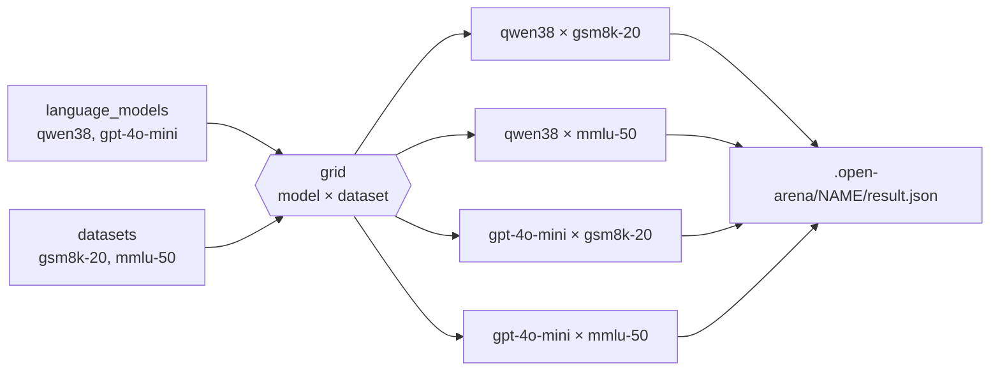
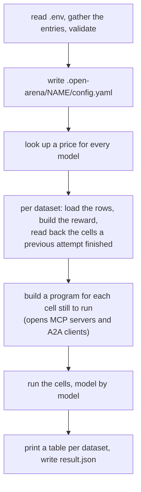

# Running evaluations

An evaluation is a saved sweep, kept in `configs/evaluations.yaml`. It names
models and datasets. Running it evaluates every model on every dataset: one
**cell** per pair. A cell sends each row of the dataset to the model, scores
each answer with the dataset's reward, and keeps the mean.



Two models on two datasets make four cells. The evaluation holds no rows, no
prompts and no scoring rules: those belong to the [datasets](datasets.md), the
[rewards](rewards.md) and the [models](models.md) it names. It says what to
put on the grid, plus a few settings that apply to every cell.

Why save a sweep instead of passing flags? A saved evaluation is the same
experiment every time you run it: the same models, datasets and batch size.
Next week you rerun it on a new model by adding one name, and the run's folder
records exactly what ran.

## The entry

```yaml
evaluations:
  math-compare:                              # the name you run it by, and its folder under .open-arena/
    description: Local Qwen against the hosted baseline on GSM8K.
    tags: [math, weekly]                     # for listings only
    language_models: [qwen38, gpt-4o-mini]   # the grid's rows: models keys (a2a_agents keys for an A2A sweep)
    datasets: [gsm8k-20]                     # the grid's columns: datasets keys, each with a reward
    batch_size: 4                            # rows in flight at once, for every dataset of this sweep
    metrics:                                 # extra columns, on every dataset
      - cost                                 # what the model under test cost, in USD; lower is better
      - avg_latency                          # seconds per model call; lower is better
      - answer_accuracy                      # a catalog reward, averaged over the rows
    seed: 0                                  # seeds the engine's own randomness, not the model's sampling
```

The name follows the rule of every registry key: a letter or a digit, then
letters, digits, `_`, `.` or `-`. It is also the folder the run writes to, so
keep it short.

## Fields

| field | required | default | what it is |
|---|---|---|---|
| `language_models` | yes | | The models to compare, by their key in `models.yaml`. At least one. For an A2A dataset, keys of `a2a_agents.yaml` instead. |
| `datasets` | yes | | The datasets to run them on, by key. At least one. Each must have a `reward:`. |
| `batch_size` | no | each dataset's own, else 1 | Rows sent at once, for every dataset of this sweep. 1 to 1024. |
| `metrics` | no | none | Columns added beside `reward` on every dataset. |
| `seed` | no | none | Seeds the engine's own random number generators before anything is built. |
| `default_language_model` | no | none | The model a reward or metric uses when its config names none. A `models` key of type `llm`, called with its `params`. |
| `default_embedding_model` | no | none | The same, for rewards and metrics that need an embedding model. A `models` key of type `embedding`. |
| `description` | no | | One line for listings. |
| `tags` | no | | Labels for listings, e.g. `math`, `weekly`. |

Nothing else is accepted: a field the schema does not know is an error, not
silently ignored. The sections below take each field in turn.

### `language_models`: the grid's rows

The models you want to compare, by the name you gave them in `models.yaml`,
not by their provider id. That name is what the result tables, `result.json`
and leaderboards show.

A model entry is an id **plus** its params, so two entries can call the same
id with different settings, and they are two rows of the grid. That is how you
compare `temperature: 0` with `temperature: 0.7`, or two `reasoning_effort`
levels, on one model:

```yaml
models:
  gpt-4o-mini:
    model: openai/gpt-4o-mini
    params: {temperature: 0}
  gpt-4o-mini-warm:
    model: openai/gpt-4o-mini
    params: {temperature: 0.7}
evaluations:
  temperature-check:
    language_models: [gpt-4o-mini, gpt-4o-mini-warm]
    datasets: [gsm8k-20]
```

What a row of the grid must be depends on the datasets:

| the datasets are | `language_models` lists |
|---|---|
| plain, `generator`, `agent`, `tools`, `harbor` | `models` keys of type `llm` |
| `embedding` | `models` keys of type `embedding` |
| `a2a` | `a2a_agents` keys: the agents themselves are compared ([A2A agents](a2a-agents.md)) |

### `datasets`: the grid's columns

The datasets, by key, in the order the result tables show them. Every one
needs a `reward:` ([Datasets](datasets.md)). A dataset without one cannot be
scored, and the evaluation is refused before anything runs.

Some kinds of dataset cannot share a sweep with other kinds, because the grid's
rows are different things for them, or because they run in a sandbox:

| kind | can share a sweep with |
|---|---|
| plain, `generator`, `agent`, `tools` | each other |
| `embedding` | only other `embedding` datasets |
| `a2a` | only other `a2a` datasets |
| `harbor` (including `harbor_tasks` datasets) | only other Harbor datasets |

To run GSM8K and a Harbor suite on the same models, write two evaluations.
Their scores still meet on a [leaderboard](leaderboards.md), which reads every
finished run.

### `batch_size`: how much runs at once

A batch is the group of rows the engine sends at once and evaluates as one
step. `batch_size` is therefore the concurrency knob: with `batch_size: 8`, up
to eight rows are answered at the same time, so eight requests are in flight
against the provider (more when a judge reward scores them).

The size a cell uses is the first one set of:

1. `--batch-size N` on the command line, for this run only;
2. the evaluation's `batch_size`;
3. the dataset's own `batch_size` in its `config`;
4. 1.

Cells run one after the other, never two at once. A larger batch speeds up
each cell; nothing makes two cells overlap.

| setup | a good starting `batch_size` | why |
|---|---|---|
| a local model (Ollama, vLLM) on one machine | 1 to 4 | the server answers a few requests at a time; more just queue, and can time out |
| a hosted model on a new or low-tier key | 2 to 4 | rate limits are per minute; a burst gets throttled |
| a hosted model on a high-tier key | 8 to 32 | the provider can take it; the run finishes many times faster |
| a judge reward on top | about half of the above | each row also makes a judge call |
| an `agent` dataset | 1 to 4 | each row is a loop of model and tool calls, and the MCP servers take the load too |
| Harbor, on a laptop | 1 | each row in flight is a sandbox with an agent session in it |

!!! warning "A rate limit does not stop the run: it lowers the score"
    A model call that fails is retried, up to five attempts, waiting longer
    between them and honouring a provider's `Retry-After`. A call that still
    fails leaves its row without an answer and logs a warning,
    `All retries failed for ...`. The row scores 0 and the cell carries on.
    A batch size too high for your key therefore shows up as a reward that is
    too low, not as an error. If you see those warnings, lower `batch_size`
    and run the evaluation again with `--no-cache`. (When every call of a
    cell fails, the cell fails instead, and a plain rerun runs it again; see
    [What can fail](#failures).)

Where to set it: the dataset's `batch_size` is a property of the data (a
Harbor dataset that should never run more than one sandbox at a time). The
evaluation's is a property of the setup you run it on (a sweep of local models
that a laptop must survive). `--batch-size` is for one run: a quick try at a
higher speed, or a slower retry after throttling.

### `metrics`: the columns beside `reward`

`reward` is always the first column: the mean of the dataset's reward over its
rows. `metrics` adds more columns, on every dataset of the sweep. A dataset can
add its own too ([Datasets](datasets.md#extra-metrics)); when both name the
same column, the dataset's wins.

Each entry is a bare name, or a mapping:

| key | default | what |
|---|---|---|
| `class` | required | a catalog reward (averaged over the rows), or a measurement such as `cost` |
| `alias` | the class's name | the column's name; never `reward`, which is taken |
| `direction` | `min` for a cost, tokens or latency measurement, else `max` | `max` if higher is better, `min` if lower is better |
| `objective` | `false` | `true` puts the column on the dataset's Pareto frontier, beside `reward` |
| anything else | | the class's own settings, e.g. a judge's `language_model` (a `models` key, called with its `params`) |

The measurements of a run are columns like any other. Only the columns you
list are kept in `result.json`, so only those can be ranked on a leaderboard:

| `class` | what it measures over the cell |
|---|---|
| `cost` | USD spent on calls to the model under test |
| `reward_cost` | USD spent on judge calls while scoring |
| `embedding_cost` | USD spent on embedding calls |
| `input_tokens`, `output_tokens`, `total_tokens` | tokens consumed |
| `avg_latency` | seconds per model call, on average |

!!! note "Which way is better is read off the name"
    Without `direction:`, a metric is `min` when it measures what the calls
    spend or how often they fail: a name ending in `tokens` (but not
    `cached_tokens`), `token_share`, `cost`, `latency`, `time_to_...`,
    `elapsed_time`, `error_rate`, `failed_calls` or `fallback_activations`,
    optionally followed by `_per_call`. So `cost`, `reward_cost`,
    `total_tokens` and `avg_latency` rank the cheaper, faster model first.
    Anything else is `max`, rates such as `cache_hit_rate` included. Write
    `direction:` only to override it.

`objective: true` asks the run for trade-offs. On a dataset with more than one
objective, `result.json` lists the models no other model beats on every
objective at once (`frontier_by_ds`, see [Reading results](results.md)). Use
it when the best model is not the cheapest and you want to see which models
are worth considering at all.

```yaml
evaluations:
  quality-vs-cost:
    language_models: [qwen38, gpt-4o-mini, gpt-4o]
    datasets: [gsm8k-20]
    metrics:
      - {class: cost, objective: true}
      - {class: lm_as_judge, alias: judged, language_model: gpt-4o-mini}
```

Put a metric on the evaluation when you want it on every dataset of the sweep
(cost, latency). Put it on the dataset when it only makes sense for that data
(an `answer_accuracy` for numeric answers).

### `seed`

Before anything is built, the run seeds the engine's random number generators
with this value. That makes the engine's own choices repeatable. It does
**not** make the models' answers repeatable: sampling happens at the provider,
out of reach of this seed. For steadier answers, set `temperature: 0` on the
models ([Models](models.md)), and still expect small differences between two
runs of a hosted model.

Set it on any evaluation you will compare over time: it costs nothing and
removes one source of drift.

### `default_language_model`, `default_embedding_model`

Some rewards and metrics call a model: a judge, a semantic similarity. Their
config usually names it (`language_model: gpt-4o-mini`). When it does not,
they use these defaults.

```yaml
evaluations:
  judged-sweep:
    language_models: [qwen38, gpt-4o-mini]
    datasets: [support-golden]
    default_language_model: judge-4o      # the judge of every reward that names none
```

Prefer naming the judge on the reward itself ([Rewards](rewards.md)): the
choice then travels with the reward to every evaluation that uses it. Use the
default when one sweep should swap the judge of all its rewards at once.

!!! note
    When a run sets a default model, the engine also writes it to its settings
    file in your home folder. Name the judge explicitly on rewards you care
    about rather than relying on what an earlier run left behind.

### `description`, `tags`

Shown by `openarena evaluations list` and in the app's listings. They change
nothing in a run. A tag such as `smoke` or `weekly` tells a quick check from
the real thing at a glance.

## Things that are not evaluation fields

If you are looking for one of these on the evaluation, it lives elsewhere:

| you want | set | where |
|---|---|---|
| fewer rows, for a quick try | `limit: N` in the dataset's `config` (the first N rows) | [Datasets](datasets.md) |
| each row answered several times, to average out sampling | `repeat: N` in the dataset's `config`: each row is sent N times, and the reward is the mean over all the answers | [Datasets](datasets.md) |
| temperature, max tokens, reasoning effort | the model's `params` | [Models](models.md) |
| a spending limit | a leaderboard's `budgets:`: a model over budget is left out of the ranking. Nothing stops a run while it spends | [Leaderboards](leaderboards.md) |
| more cells at once | not possible within one run: raise `batch_size`, or run two evaluations side by side | [A large sweep](#when-to-use-what) |
| more or fewer retries | not configurable: each model call gets up to five attempts | [`batch_size`](#batch_size-how-much-runs-at-once) |

!!! tip "`repeat` gives a steadier mean, not a spread"
    With `repeat: 5`, a cell's reward is the mean over five answers per row,
    which smooths out a lucky or unlucky sample. It does not tell you how much
    the answers varied. To see the spread between runs, run the same
    evaluation under different `--state-dir`s and compare the `result.json`s.

## Running it

```shell
openarena check configs                    # every registry, as the run will read it
openarena evaluations list                 # the saved evaluations
openarena evaluations run math-compare     # run one
```

| option | default | what |
|---|---|---|
| `--configs DIR` | `./configs` | the configs folder to read |
| `--state-dir DIR` | `./.open-arena` | where runs live, one folder per evaluation |
| `--no-cache` | off | start over instead of resuming |
| `--batch-size N` | | the batch size for this run, over the evaluation's |
| `--json FILE` | | also write the result there |
| `-v`, `-vv` | | a progress bar per cell, or a line per batch |

The run first reads the workspace's `.env` (beside `configs/`), without
overriding a variable your shell already sets. It then gathers the evaluation
and every entry it names into one config, replaces each `${NAME}` with its
variable ([Secrets in configs](../workspace.md#secrets-in-configs)), and
validates it whole. It refuses to start on a problem: a `${NAME}` not set, an
unknown dataset, a dataset without a reward, a model of the wrong type, kinds
that cannot share a run. The snapshot it writes keeps the `${NAME}`
references, not their values.

[CLI](../cli.md#openarena-evaluations-run) has every option in detail.

## What happens during a run



Every dataset is loaded and every program built before the first cell runs. A
broken dataset fails the run in its first minute, not after an hour of model
calls. An agent whose MCP servers give no tools (a server down, a command not
found, a server with no tools) fails only its own cells, with
`could not load the MCP tools of [...]`, and the other cells run.

The cells then run **model by model**: every dataset for the first model, then
every dataset for the second. A local server that holds one model at a time
loads each model once, not once per cell.

### Watching it

```
Running math-compare (.open-arena/math-compare/config.yaml)
gsm8k-20
  qwen38 running…
  qwen38 done reward 0.6500, cost 0.0000, avg_latency 2.1043, answer_accuracy 0.7000
  gpt-4o-mini running…
  gpt-4o-mini done reward 0.8500, cost 0.0021, avg_latency 0.8120, answer_accuracy 0.9000
```

A line when a cell starts, a line with its numbers when it ends. `-v` adds a
progress bar per cell and `-vv` a line per batch: use them on long cells, to
see that something is moving. After each dataset, every failed cell gets a
line with the reason: `<model> failed: <why>`.

At the end, a table per dataset: a row per model, a column per metric, `—`
where a cell has no value.

### Failures

Things go wrong at three levels:

| level | what happens | what you see |
|---|---|---|
| a row | a model call fails five times: the row gets no answer and scores 0 | `All retries failed for ...` in the log; a lower reward |
| a cell | an error the cell cannot get past (a template naming a missing column, an agent whose MCP servers give no tools), or no row got an answer at all (a missing key, a model server that is down, a model id the provider does not know): the cell is recorded as failed, and the run moves on | `<model> failed: <why>`, for example `no row got an answer: all 20 call(s) failed; the first: <error>`; `—` in the table; a status other than `COMPLETED` in `result.json` |
| the run | every cell runs, however many fail; then, if any cell failed, the command exits 1 | after the table and `result.json`, `N cell(s) failed: <model> × <dataset>, ...` |

A row an A2A agent does not answer (an error, a task that did not complete,
the timeout) is a row-level failure too: a warning, a 0 for that row, and the
cell goes on.

[Reading results](results.md#when-a-cell-failed-or-scored-0) lists the usual
causes and their fixes.

## Resuming and starting over

A run keeps each cell's state in its folder as the cell finishes. Running the
same evaluation again picks up where it stopped:

- cells that finished are not run again: their scores are read back;
- cells that failed, or were running when the process stopped, run again;
- cells never reached run for the first time.

So after a crash or a `Ctrl-C`, run the same command and only what is
missing runs. The same goes for a missing key or a model server that was
down: no row of those cells got an answer, so they failed rather than scoring
0, and a plain rerun runs them once the cause is fixed. Only a cell where some
rows answered is kept with 0 for the others; rerun it with `--no-cache`.

The saved state does not record what a finished cell was computed from, so it
keeps the cell even when its inputs changed. Use `--no-cache` to start over:

| you changed | finished cells are | do |
|---|---|---|
| nothing; the run stopped or a cell failed | still right | run again |
| `--batch-size` or `batch_size` | still right | run again |
| `description`, `tags` | still right | run again |
| the `language_models` list | possibly stale | `--no-cache` |
| a dataset's rows, templates, `limit` or `repeat` | stale | `--no-cache` |
| a reward, or any `metrics` | stale | `--no-cache` |
| a model's `params` or `model` id | stale | `--no-cache` |
| rate limits made rows score 0 | finished, but scored too low | `--no-cache` |

!!! warning "`--no-cache` drops every cell of the evaluation"
    It wipes the saved cells of every dataset in the evaluation, so everything
    runs, and is paid for, again. To redo only part of a sweep, write a
    smaller evaluation for that part.

Two evaluations never share saved state: each has its own folder.

## What a run writes

```
.open-arena/math-compare/
  config.yaml              the evaluation and every entry it names, gathered: what ran
  result.json              the scores, written when the run ends
  gsm8k-20/                each dataset's saved cells: what a resumed run reads back
  harbor/                  Harbor trials, for Harbor datasets
  tasks/  environments/    copies of the Harbor folders the run used
```

`config.yaml` is written again at every launch, from the configs as they are
then, and the Harbor folders are copied again. `result.json` is written only
when the run ends: after an interrupted run, the one there (if any) is from
the previous finished run. What is in it, and how to read it:
[Reading results](results.md).

## Cost

### How a run is priced

Each call is priced by litellm from its token counts. Before the first cell,
the run looks up a price for every model in `models.yaml`, the ones under test
and the judges, from the first source that knows it:

1. a local server (`ollama/`, `vllm/`, `hosted_vllm/`, `lm_studio/`,
   `llamafile/`): free, there is no bill;
2. litellm's pricing table;
3. OpenRouter's catalogue, which also prices many vendors' direct ids when
   OpenRouter serves the same model.

An `openrouter/` model's answers carry their own cost.

!!! warning "A cost of 0 is not always free"
    A model that no source prices still runs, but its spend reads 0. If a
    hosted model shows `cost 0.0000`, its price is unknown, not zero. Check
    what you were billed before trusting that column.

To keep the cost in the results and on leaderboards, list it under `metrics`
([above](#metrics-the-columns-beside-reward)).

### Estimating it before you run

Count the calls:

```
cells          = models × datasets
rows per cell  = limit (or the dataset's size) × repeat
model calls    = cells × rows per cell × calls per row
judge calls    = cells × rows per cell × judges (rewards and metrics that call a model)
```

A plain or `generator` row is one call. An `agent` row is a loop: one call per
step, plus the tool calls. A Harbor row is a whole agent session in a sandbox,
often dozens of calls. Each judge adds a call per row.

Then measure rather than guess: run the sweep with `limit: 5` and `cost` as a
metric, read the cost per cell, and multiply by `rows / 5`.

## When to use what

=== "First run of a new setup"

    Smoke it. Set `limit: 5` on the datasets, run one cheap model, and read
    the answers ([Reading results](results.md)), not only the scores. A reward
    of 0 everywhere usually means a template or an answer format is off, and
    that is cheap to find on five rows.

    ```yaml
    evaluations:
      math-smoke:
        tags: [smoke]
        language_models: [gpt-4o-mini]   # one cheap model is enough to test the setup
        datasets: [gsm8k-20]             # with limit: 5 in its config
        batch_size: 1
    ```

    Then raise `limit`, add the other models, and run the real evaluation.

=== "Comparing models"

    Every model on the same datasets, `temperature: 0` on each, `cost` and
    `avg_latency` as columns (both rank lower first on their own), a `seed`. When a new model
    comes out, add it to the list and run with `--no-cache`, or give it an
    evaluation of its own: a leaderboard puts them side by side either way.

=== "A large sweep"

    Split it into several evaluations: by provider, by kind of dataset, or by
    size. Each has its own folder, its own saved state, and its failures do
    not hold the others back. Run them one after the other, or side by side in
    two terminals when they call different providers, so that their rate
    limits do not add up. A [leaderboard](leaderboards.md) then reads every
    `result.json` under `.open-arena/` and ranks them together.

=== "A noisy task"

    When two runs of one model disagree, set `repeat: 3` to `5` on the
    dataset: the reward becomes a mean over several answers per row. It
    multiplies the cost by the same factor, so try it on a `limit`ed dataset
    first.

=== "Keeping runs apart"

    `--state-dir` gives a run a different home. Use it to keep last month's
    results while running the same evaluation again, or to run it twice and
    compare.

    ```shell
    openarena evaluations run math-compare --state-dir runs/2026-10
    openarena leaderboards run overall --state-dir runs/2026-10
    ```

    `openarena leaderboards run` reads the `--state-dir` you give it, so point
    it at the same one.

## Common mistakes

`openarena check configs` reads each evaluation as a run would, and reports:

| mistake | `openarena check` says |
|---|---|
| `language_models: []` | `List should have at least 1 item ...`: give it a value |
| `batch_size: 0` | `Input should be greater than or equal to 1`: set 1 or more |
| a field the schema does not have (`concurrency:`, `repeats:`, `limit:`) | `not a field of a evaluations entry`, with the fields an entry reads |
| a model or dataset that is not in its registry | `'gpt4' is not in models`, with the closest name or the ones there |
| a dataset without `reward:` | `dataset 'd' has no reward:`: set one, or leave the dataset out |
| an embedding model in a text sweep, or the other way round | `... this sweep needs embedding models`: list only models of the type the datasets need |
| an A2A, embedding or Harbor dataset beside other kinds | `... cannot share a run ...`: split it in two evaluations |
| an embedding model as `default_language_model` | `'e' is an embedding model; this setting needs a language model` |

What `check` cannot see:

- **A missing key.** A hosted model without its key fails every call at run
  time, and its cell fails with `no row got an answer: ...`. Set the key in
  `.env` and run the same command again: the failed cell runs, the others are
  read back.
- **A batch too large for your rate limit.** It shows as `All retries failed`
  warnings and a low reward, not as an error.
- **Saved cells from before a change.** The run reuses them silently. Add
  `--no-cache` after changing what they depend on.
- **A `${NAME}` set nowhere.** `check` only warns; the run refuses to start
  and names it.

[Checking configs](check.md) has every check.

??? note "Tracing to MLflow"
    `openarena evaluations run` does not trace to MLflow. The arena app runs
    the same sweep with tracing on when `MLFLOW_TRACKING_URI` is set and the
    server answers its `/health` check (`ARENA_MLFLOW_TRACING=0` opts out).
    Each run then gets its own experiment, under `MLFLOW_EXPERIMENT_NAME`, and
    each cell one MLflow run named `<dataset> · <model>`, tagged with the
    dataset and the model, with a span per model call and its cost. A server
    that is down never fails an evaluation: the run goes on untraced, with a
    warning.

## Next

- [Reading results](results.md): `result.json`, the answers, failed cells.
- [Leaderboards](leaderboards.md): rank models across runs, with budgets.
- [Checking configs](check.md): every check, before you pay for a run.
