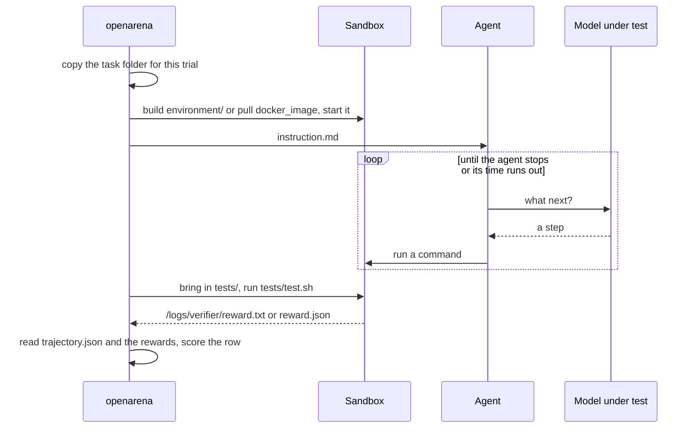

# Harbor tasks

A [Harbor](https://harborframework.com/docs/tasks) task is a folder. It holds
what the agent is told, the sandbox it works in, the tests that score it, and
a reference solution. openarena runs task folders as Harbor defines them: one
trial per task, the model under test driving a Harbor agent, and the task's
own tests giving the score.

## When to use Harbor tasks

A question-and-answer dataset scores what a model **says**. A Harbor task
scores what an agent **does**: the files it leaves, the code it fixes, the
service it gets running. Pick the tool by what you need to check.

| you want to measure | use |
|---|---|
| a short answer, a label, a number | an ordinary dataset ([Datasets](datasets.md)) |
| tool calls against live servers | an `agent:` dataset ([MCP tools](mcp-tools.md)) |
| ordinary questions, worked with a terminal, scored on the answer | a dataset over an [environment](environments.md) |
| work in a sandbox, checked by a script: coding, fixing, configuring | **Harbor tasks** (this page) |

Harbor tasks are the right tool when:

- **The result is a state, not a sentence.** A test suite passes, a file has
  the right content, a server answers on a port.
- **Each task needs its own setup.** Its own repository, data files, packages
  or image.
- **The check is code.** A script can decide, without a model judging free
  text.

They cost more. Every row builds or pulls an image, starts a sandbox, and runs
a whole agent session of many model calls. A Q&A row is one call. Use Harbor
tasks for what a Q&A dataset cannot measure, not as a slower way to ask
questions.

!!! tip "Environment or task folders?"
    When many questions share one sandbox and a reward can score the final
    answer, use a dataset over an [environment](environments.md). When each
    task brings its own files and its own tests, write task folders.

## How a trial runs



For each row (one task), openarena:

1. Copies the task folder, so a trial never writes into your source folder.
   The copy is deleted when the trial is done.
2. Starts one Harbor trial with the dataset's agent and the model on the
   evaluation's axis.
3. Lets Harbor build the sandbox, run the agent, then run the verifier
   (`tests/test.sh`) in the same sandbox.
4. Reads back the agent's trajectory and what the verifier wrote. The
   `harbor_verifier` reward turns that into the row's score.

## The task folder

```
tasks/<name>/
  task.toml                    the task's settings: timeouts, resources, network
  instruction.md               what the agent is told
  environment/Dockerfile       the sandbox, built from environment/
  tests/test.sh                runs after the agent, writes the score
  solution/solve.sh            what a correct agent does
```

`tasks/` sits beside `configs/` in the [workspace](../workspace.md).
`openarena init` writes a working one, `tasks/hello-world/`. Copy it to start
a new task.

A folder is a task when it holds a `task.toml`. Other folders under `tasks/`
are ignored.

### task.toml

The task's settings, in Harbor's format.

```toml
[metadata]
difficulty = "easy"
category = "general"

[agent]
timeout_sec = 300.0            # how long the agent may work

[verifier]
timeout_sec = 60.0             # how long tests/test.sh may take

[environment]
build_timeout_sec = 600.0
cpus = 1
memory_mb = 1024
# network_mode = "no-network"
# docker_image = "python:3.12-slim"  # a prebuilt image instead of environment/Dockerfile
```

| section | key | what it does | why you set it |
|---|---|---|---|
| `[metadata]` | free labels | describes the task | to sort and read tasks; not used for scoring |
| `[agent]` | `timeout_sec` | how long the agent may work | a hard task needs more; a cap stops a looping agent burning tokens |
| `[verifier]` | `timeout_sec` | how long `tests/test.sh` may take | a test suite that compiles or starts a server needs more |
| `[environment]` | `build_timeout_sec` | how long building the image may take | a heavy image (compilers, ML packages) needs more |
| `[environment]` | `cpus`, `memory_mb`, `storage_mb` | the sandbox's resources | a build or test suite that would be slow or killed otherwise |
| `[environment]` | `gpus`, `gpu_types` | GPUs | only for tasks that need them; not every sandbox provider has any |
| `[environment]` | `network_mode`, `allowed_hosts` | `public`, `no-network`, or `allowlist` | to stop the agent fetching the answer, or limit it to a package index |
| `[environment]` | `docker_image` | a prebuilt image instead of `environment/Dockerfile` | a faster start when nothing task-specific is installed |
| `[environment]` | `workdir`, `env` | where commands start; variables in the container | to match what the instruction says |

The `[environment]` keys are the ones openarena writes for an
[environment](environments.md) entry. That page explains each in more depth.

!!! warning "A task folder is run as written"
    openarena adds nothing to a task's `task.toml`. On the local Docker, a
    dataset over an environment gets default limits (2 CPUs, 2048 MB) when it
    sets none. A task folder does not, and Docker would give the container
    the whole machine. Set `cpus` and `memory_mb` in every task.

!!! warning "In-sandbox agents need the network"
    Most agents run inside the sandbox and call the model from there (see
    [Agents and models](#agents-and-models)). A task with
    `network_mode = "no-network"` cuts them off. `check` catches this for an
    environment entry, but does not read a task folder's `task.toml`. Use
    `terminus-2` for a no-network task.

### instruction.md

Plain text for the agent: what to do, where the inputs are, where the result
must go. It is the only thing the agent is told.

- **Name exact paths and formats.** "Write the total to `/app/total.txt`, as a
  single integer." The tests check those, so the agent must know them.
- **State what the tests check.** If they run the project's test suite, say
  it must pass. Do not hide a requirement the agent cannot guess.
- **Say what must be true at the end, not how to get there.** The tests
  check the outcome, not the commands.

The instruction is also the row's `question` in the trials log and the
answers view.

### environment/

The sandbox's build context. Harbor builds `environment/Dockerfile` from it,
unless `task.toml` names a `docker_image`.

```dockerfile
FROM python:3.12-slim
# terminus-2 works its terminal through tmux.
RUN apt-get update && apt-get install -y --no-install-recommends tmux && rm -rf /var/lib/apt/lists/*
WORKDIR /app
COPY data/ /app/data/
```

- `COPY` paths are relative to `environment/`. Put the task's input files
  there (`environment/data/`).
- Install what the agent and the tests need. A test that runs `python3` or
  `pytest` needs them in the image: the tests run in the same sandbox.
- Do not put the tests or the solution in the image. Harbor brings the tests
  in after the agent is done, so the agent cannot read them.
- Pin versions (`FROM python:3.12-slim`, `pip install pandas==2.2.2`). An
  image that changes between runs moves scores for reasons that are not the
  model.

!!! warning "tmux"
    `terminus-2`, the default agent, works through `tmux`. Without it in the
    image, it installs tmux at the start of every trial, which needs a
    package manager and the network, and fails without them. Install it in
    the Dockerfile.

### tests/: the verifier

Harbor runs `tests/test.sh` in the sandbox after the agent stops. It writes
the score to one of two files:

=== "reward.txt"

    One number from 0 to 1. `1` is solved, `0` is not, fractions are allowed.
    It is read as the key `reward`.

    ```bash
    #!/bin/bash
    mkdir -p /logs/verifier
    if [ "$(cat /app/hello.txt 2>/dev/null)" = "Hello, world!" ]; then
      echo 1 > /logs/verifier/reward.txt
    else
      echo 0 > /logs/verifier/reward.txt
    fi
    ```

=== "reward.json"

    Several named numbers. The `harbor_verifier` reward reads `reward` unless
    you point it at another key.

    ```json
    {"reward": 0.75, "builds": 1, "tests_pass": 0.5}
    ```

    Every value must be a number: a text value fails the row. Always write a
    `reward` key, or point the reward at a key you do write.

How the score is held to range:

| the verifier wrote | the row scores |
|---|---|
| a number in 0–1 | that number |
| a number outside 0–1 | clamped to 0 or 1, with a warning in the run's log |
| `nan` or `inf` | 0, with a warning |
| no `reward` key, or no file | 0 |

#### Writing a verifier you can trust

The verifier is the whole measurement. A wrong one ranks models on noise.

- **Test the outcome, not the method.** Check the file, the output, the exit
  code. Do not look for the command you expected the agent to run.
- **Never fail on what the instruction did not ask for.** If it says "a
  CSV", do not require a header it never mentioned.
- **Write a score on every path.** Write `0` first, then overwrite it. A
  crash halfway still leaves a score.
- **Make it deterministic.** No network calls, no clock, no random data; fix
  seeds. Give slow checks a generous `[verifier] timeout_sec`, so a busy
  machine does not fail a solved task.
- **Give partial credit when the task has parts.** 0.6 for "builds and passes
  3 of 5 tests" separates models that a 0 for both would not.
- **Keep the sub-scores.** Write them to `reward.json` beside `reward`, and
  report them as extra metrics (see [A dataset of tasks](#a-dataset-of-tasks)).

A verifier with partial credit:

=== "tests/test.sh"

    ```bash
    #!/bin/bash
    mkdir -p /logs/verifier
    # Written first: if the check crashes, the task still scores 0.
    echo '{"reward": 0}' > /logs/verifier/reward.json
    python3 "$(dirname "$0")/check.py"
    ```

=== "tests/check.py"

    ```python
    import json
    from pathlib import Path

    try:
        report = json.loads(Path("/app/report.json").read_text())
    except (OSError, ValueError):
        report = None
    ok = isinstance(report, dict)
    checks = {
        "exists": ok,
        "total": ok and report.get("total") == 42,
        "regions": ok and sorted(report.get("regions") or []) == ["eu", "us"],
    }
    scores = {name: float(passed) for name, passed in checks.items()}
    scores["reward"] = sum(scores.values()) / len(checks)
    Path("/logs/verifier/reward.json").write_text(json.dumps(scores))
    ```

A `pytest` file works the same way: `test.sh` runs it, then writes the score
from its result.

### solution/

`solution/solve.sh` is what a correct agent would do. Harbor's `oracle` agent
runs it, and the tests must then give 1. That proves the task can be solved
and the tests are right. An evaluation does not run the oracle: it is for
checking the task while you write it.

Both scripts must be executable:

```sh
chmod +x tests/test.sh solution/solve.sh
```

??? details "Multi-step tasks"
    A Harbor task may hold a `steps/` folder, one sub-folder per step, instead
    of a top-level `instruction.md`. openarena runs the folder as Harbor
    defines it. The row's `question`, shown in the trials log, is the first
    step's `instruction.md`.

## A dataset of tasks

A `harbor_tasks` dataset reads a folder of tasks, one row per task.

```yaml
datasets:
  my-tasks:
    type: harbor_tasks
    config:
      path: tasks                  # relative to the workspace; the run copies it
      tasks: [hello-world]         # only these folders; none runs every task under path
    harbor:
      agent: terminus-2
      timeout_sec: 600             # per task, over task.toml's [agent] timeout_sec
    reward: harbor-tests
    metrics:
      - {class: harbor_verifier, alias: tests_pass, key: tests_pass}
rewards:
  harbor-tests:
    type: harbor_verifier          # reads what tests/test.sh wrote
```

| field | what it does | when to set it |
|---|---|---|
| `config.path` | the folder holding the tasks | always. Relative to the workspace (the parent of `configs/`), and copied beside the run's config at every run. An absolute path is read in place |
| `config.tasks` | only these task folders, by name | to run a subset. A name without a `task.toml` stops the run. Left out, every task under `path` runs, sorted by name |
| `config.limit` | at most this many tasks | a first run on a few tasks |
| `config.repeat` | each task this many times | to measure how often a model succeeds, not whether it did once |
| `config.batch_size` | tasks run at once (default 1) | on a cloud sandbox, to run trials in parallel |
| `harbor.agent` | the Harbor agent the model drives (default `terminus-2`) | see [Agents and models](#agents-and-models) |
| `harbor.timeout_sec` | how long the agent may work on each task | one budget for every task, whatever its `task.toml` says |
| `reward` | a `harbor_verifier` reward | always |
| `metrics` | more `harbor_verifier` columns, each with its `key` | to report `reward.json`'s sub-scores beside `reward` |

No `input_template` is needed: each row is the task's name, its folder and its
instruction.

The `harbor_verifier` reward takes one setting, `key`: the key of
`reward.json` it reads, `reward` by default.

!!! warning "Not for task folders"
    `harbor.environment` is refused: each task brings its own sandbox.
    `harbor.instructions` and `harbor.answer_file` belong to a dataset over an
    [environment](environments.md), and `openarena check` refuses them here.
    A task folder runs as written, so neither would reach its instruction:
    `check` says `` a `harbor_tasks` dataset runs each task as written:
    `instructions` is never said to the agent `` (write it in the task's
    `instruction.md`) and `` a `harbor_tasks` dataset is scored by each task's
    own tests: `answer_file` is never written, and leaves the answer empty ``
    (the task's `tests/` read what the agent left in the sandbox).

A Harbor dataset cannot share an evaluation with other kinds of dataset. Give
it its own evaluation ([Running evaluations](evaluations.md)).

After editing a task, run with `--no-cache`. The tasks are copied again at
every run, but a cell that already finished is reused as it is.

## Agents and models

The agent is the program that works in the sandbox. The model on the
evaluation's axis is what the agent calls to decide each step.

| agent | runs | calls |
|---|---|---|
| `terminus-2` (the default) | on your machine | any provider |
| `claude-code` | in the sandbox | Anthropic models only |
| `codex` | in the sandbox | OpenAI models only |
| `gemini-cli` | in the sandbox | Google models only |
| `goose`, `opencode`, `openhands`, `mini-swe-agent`, `swe-agent`, `cline-cli`, `cursor-cli` | in the sandbox | any provider |

How to choose:

- **Comparing models:** keep one agent for all of them. `terminus-2` takes
  any provider, so it is the usual choice.
- **Comparing agents:** one dataset per agent over the same tasks, with the
  same models where the agents allow it.
- **A local model** (`ollama/...`, `vllm/...`): only `terminus-2`. An agent
  in the sandbox cannot reach your machine's `localhost`.
- **A task with no network:** only `terminus-2`. The others call their model
  from inside the sandbox.

`check` and the run refuse a pairing that cannot work, and say why.

The model entry's `params` reach the agent where it takes them:
`temperature`, `reasoning_effort` and, for agents that pass call settings
through, `max_tokens`. A param the agent does not take is dropped, with a
warning in the run's log. See [Models](models.md).

## Where it runs

`ARENA_HARBOR_SANDBOX` names the sandbox provider (`e2b`, `docker`,
`daytona`, `modal`, ...), `e2b` by default. Without `E2B_API_KEY`, trials
fall back to the local Docker. With neither, the run refuses to start. A
provider name Harbor does not know fails the run with the list of known ones.

| variable | default | what it does |
|---|---|---|
| `ARENA_HARBOR_SANDBOX` | `e2b` | the sandbox provider |
| `ARENA_HARBOR_SANDBOX_OPTIONS` | none | the provider's own settings, a JSON object Harbor hands its environment |
| `ARENA_HARBOR_LOCAL_TRIALS` | `1` | trials at once on the local Docker |
| `ARENA_HARBOR_LOCAL_CPUS`, `ARENA_HARBOR_LOCAL_MEMORY_MB` | `2`, `2048` | default limits for a dataset over an environment, on the local Docker |
| `ARENA_HARBOR_WORKDIR` | the run's state folder | where task copies and trials are written |

On the local Docker, trials run one at a time unless
`ARENA_HARBOR_LOCAL_TRIALS` says otherwise, whatever the `batch_size`. A few
containers at once, with a local model loading, can freeze the machine.

??? details "Docker installed as a snap"
    A snap Docker reads neither hidden folders (the run's state is under
    `.open-arena/` by default) nor `/tmp`. When openarena detects one, task
    copies, trials and temporary files go under `~/arena-harbor/` instead.
    Set `ARENA_HARBOR_WORKDIR` to choose the folder yourself.

## What a trial produces

The row's prediction is the agent's **trajectory**, in Harbor's ATIF format,
plus two fields openarena adds:

| field | what it holds |
|---|---|
| `steps` | each step: its `source` (`system`, `user` or `agent`), its `message`, its `tool_calls` and the `observation` that came back |
| `agent`, `final_metrics`, ... | the rest of Harbor's trajectory, as the agent wrote it |
| `answer` | the agent's last message with text |
| `rewards` | what the verifier wrote: `reward.txt` as `reward`, or the keys of `reward.json` |

The trajectory is read from the trial's `agent/trajectory.json`. Only agents
that write one are offered.

Each trial's logs land under the run's `harbor/trials/<trial>/`, named after
the task, the model and a short id. One line per trial goes to
`harbor/trials.jsonl`:

| key | |
|---|---|
| `trial`, `dir` | the trial's name and its logs folder |
| `dataset`, `task`, `model`, `agent` | what ran |
| `question` | the instruction |
| `status` | `answered` or `failed` |
| `answer`, `steps`, `rewards` | for an answered trial |
| `error` | why it failed, or why an answered trial stopped early |
| `seconds`, `input_tokens`, `output_tokens`, `cost_usd` | time and usage, as the agent reported them |

See [Reading results](results.md) for how to read a run.

How failures score:

- **The agent ran out of time:** the trial still answered. The verifier
  scores what the agent left, and `error` says why it stopped.
- **No trajectory** (the sandbox would not start, the agent crashed before
  its first step): the row scores 0, with Harbor's error in `error`. One flaky
  sandbox does not sink the cell.
- **No row of a cell answered:** the cell fails. That is the sandbox, the
  image or a key, not the model, and a 0 would rank it as if it were.

!!! tip "A task that scores 0 for every model"
    Check the task before blaming the models. Its `solution/solve.sh` should
    make its tests give 1, and the trial's logs show what the verifier saw.

## Scoring with the arena's rewards

Some tasks have no answer a script can check: a written summary, an
explanation. A task folder can then have the arena's rewards score it, a
judge model for example.

- `tests/rewards.yaml` lists the rewards, written like the workspace's
  `rewards.yaml`. Models are named by their `models.yaml` key.
- `tests/expected.txt`, when present, is the expected answer the rewards
  compare with.
- `tests/test.sh` copies the agent's answer to `/logs/verifier/answer.txt`.
  Without that file, the answer is the agent's last message.

=== "tests/rewards.yaml"

    ```yaml
    rewards:
      judge:
        type: lm_as_judge
        config:
          language_model: gpt-4o-mini
          instructions: Score 1 when the summary names the root cause and the fix, else 0.
    ```

=== "tests/test.sh"

    ```bash
    #!/bin/bash
    mkdir -p /logs/verifier
    cp /app/summary.md /logs/verifier/answer.txt 2>/dev/null
    echo '{"answer_collected": 1}' > /logs/verifier/reward.json
    ```

Each reward is one named score, merged into `rewards`. The first is also
`reward`, unless one of them is named `reward`, and it replaces any `reward`
the verifier wrote. The dataset's own reward stays `harbor_verifier`.

A `rewards.yaml` that is not valid, names an unknown reward type or a model
missing from `models.yaml` stops the run, saying what to fix. One that fails
while scoring sets `reward` to 0 and says why in the trial's `error`.

A judge costs a model call per trial, on top of the agent's.

## Timeouts and attempts

| knob | where | what it limits |
|---|---|---|
| `[environment] build_timeout_sec` | `task.toml` | building the image |
| `[agent] timeout_sec` | `task.toml` | the agent's work on this task |
| `harbor.timeout_sec` | the dataset | the agent's work on every task; overrides `task.toml` |
| `[verifier] timeout_sec` | `task.toml` | `tests/test.sh` |
| `repeat` | the dataset's `config` | trials per task (default 1) |

How to set them:

- **Agent timeout.** Time the solution yourself, then give the agent several
  times that. Too short and good models fail on the clock; too long and a
  looping agent spends tokens for nothing. Use `harbor.timeout_sec` for one
  budget across tasks, `task.toml` when tasks differ.
- **Verifier timeout.** Be generous. A verifier that times out scores a
  solved task 0.
- **Build timeout.** Raise it for heavy images, or build the image once and
  use `docker_image`.
- **Attempts.** A failed trial is not retried. `repeat: 3` runs each task
  three times and the cell's score is the mean: the success rate. Agents are
  not deterministic, so one trial per task says little on a small set.

## Importing existing task sets

openarena has no importer. A task set already in Harbor's folder format runs
as it is: copy its task folders under `tasks/`, or point `config.path` at
them, and list them in a `harbor_tasks` dataset. A set in another format must
be converted to this layout first.

Before you run an imported set:

- **Check the agent fits.** For `terminus-2`, the images need `tmux`, or a
  package manager and the network to install it.
- **Check the network.** A task with `network_mode = "no-network"` works only
  with `terminus-2`.
- **Check the resources.** A task that leaves `cpus` and `memory_mb` blank
  gets the whole machine on the local Docker.
- **Run a few first.** `limit: 3` with one model. Read the trials before you
  run the whole set.

## Cost and time

A Harbor evaluation runs `tasks × repeat × models` trials. Each trial is an
image build or pull, a sandbox start, an agent session of many model calls,
and the verifier.

- **Time.** On the local Docker, trials run one at a time by default: 50 tasks
  of 5 minutes each is about 4 hours per model. A cloud provider with a
  larger `batch_size` runs them in parallel.
- **Tokens.** An agent session makes many model calls, each over a growing
  history. One task can cost as much as many Q&A rows. The agent's timeout is
  your cost cap.
- **What is reported.** Tokens and cost are the agent's own count: an agent
  that reports no cost shows 0. Latency is the agent's seconds per model
  call, the commands it ran in between included.
- **Plan in steps.** One task with one model, then a few tasks, then the set.
  Finished cells are kept, so a stopped run resumes where it stopped.

See [Running evaluations](evaluations.md) for running and resuming.

## Checklist for a new task

1. Copy `tasks/hello-world/` to `tasks/<name>/` and write the five files.
2. `chmod +x tests/test.sh solution/solve.sh`.
3. Set `cpus`, `memory_mb` and the timeouts in `task.toml`.
4. Make sure the solution makes the tests give 1, and that doing nothing
   gives 0.
5. Add the task to a `harbor_tasks` dataset, then run `openarena check configs`
   ([Checking configs](check.md)).
6. Run it with one model and read the trial before you scale up.
