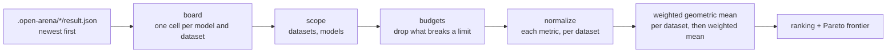
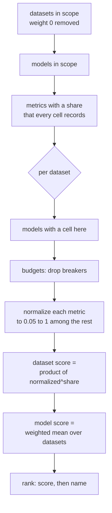

# Leaderboards

A leaderboard turns the scores of finished runs into one ranking. Use one to
answer a question like "which model should we use for this job?". It never calls
a model. It reads the `result.json` files that
[evaluations](evaluations.md) already wrote, so ranking costs nothing and you
can rank the same runs in as many ways as you like.

A leaderboard is a saved entry in `configs/leaderboards.yaml`. It sets three
things:

- **the scope**: which datasets and which models are compared;
- **the weights**: how much each metric (reward, cost, latency, ...) counts;
- **the limits**: hard budgets that leave a model out.



## A first leaderboard

```yaml
leaderboards:
  math-quality:
    title: Math, quality only
    description: Grade-school math. The reward alone decides.
    tags: [math]
    datasets: [gsm8k-20]
    models: []                  # every model scored on gsm8k-20
    shares:
      reward: 100

  math-value:
    title: Math, quality for the money
    description: Reward first, cost second. Nothing above 5 cents a cell.
    tags: [math, value]
    datasets: [gsm8k-20]
    models: [qwen38, gpt-4o-mini, gpt-4o]
    shares:
      reward: 70
      cost: 30
    budgets:
      - {metric: cost, op: lte, value: 0.05}
      - {metric: reward, op: gte, value: 0.5}
```

```shell
openarena check configs
openarena leaderboards list
openarena leaderboards run math-value
```

The two entries rank the same runs. The first answers "which model is most
accurate?". The second answers "which model gives the best accuracy for what
it costs, among those we can afford?". Keep one leaderboard per question and
don't bend one leaderboard to answer both.

## Fields

| field | type | default | what it does |
|---|---|---|---|
| `title` | text, 1 to 200 characters | required | the name printed above the ranking |
| `description` | text | none | printed after the title; say what decision the board supports |
| `tags` | list of tags | `[]` | labels for browsing (`math`, `reward-first`, `weekly`); the ranking ignores them |
| `datasets` | list of dataset names | `[]` = every dataset scored | the datasets in scope |
| `models` | list of model names | `[]` = every model scored | the models in scope |
| `shares` | `{metric: number}`, each 0 or more | `{}` = the default preset | each metric's weight in the score |
| `budgets` | list of `{metric, op, value}` | `[]` | hard limits; a model that breaks one is left out |
| `group_shares` | `{group: number}`, each 0 or more | `{}` | a weight per group of datasets |
| `dataset_shares` | `{dataset: number}`, each 0 or more | `{}` | a weight per dataset within its group; 0 takes it out |

Any other key is refused by `openarena check`.

### `title`, `description`, `tags`

These fields are for people. `leaderboards list` shows `title` and
`description`, and `leaderboards run` prints them above the table. Write the
description as the question the board answers ("cheapest model that still gets
math right"). Six months from now, it tells a reader why the weights are what
they are. Tags follow the rules shared by every registry: lower case, letters,
digits and `:+./-`, at most 40 characters each.

### `datasets`: what is compared

Set it to the dataset names you used in your evaluations (the keys of
`datasets.yaml`).

- **Empty** means every dataset that has at least one scored cell in the state
  folder. This is convenient while you explore. It is risky once you have run
  unrelated evaluations, because a model is ranked only when it has a score on
  **every** dataset in scope (see [Missing runs](#missing-runs)).
- **A list** fixes the scope. A name with no score in any run is silently
  dropped. If every name you list is unknown, nothing is ranked.

!!! tip "When to list datasets"
    List them as soon as the board supports a real decision. An empty scope
    changes meaning every time someone runs a new evaluation. A listed scope
    keeps the same meaning.

`openarena check` warns when a listed name is not in `datasets.yaml`. This is
only a warning: runs outlive the entries that made them, so a board can still
rank scores from a dataset you have since removed.

### `models`: who is compared

Set it to model names, which are the keys of `models.yaml`. For an A2A sweep,
use the agent names. These are the names the runs recorded, not the provider
ids.

- **Empty** means every model with a scored cell.
- **A list** keeps only those models. A name that never scored is ignored and
  does not appear in the output at all.

Narrowing `models` changes more than the rows you see. Scores are relative:
each metric is rescaled against the models in scope (see
[How the score is computed](#how-the-score-is-computed)). Adding or removing a
model can change the scores of all the others, and sometimes their order. Pick
the models that are real candidates for the decision.

### `shares`: what matters, and how much

A share is a metric's weight. Only the proportions count: `{reward: 70, cost:
30}`, `{reward: 7, cost: 3}` and `{reward: 0.7, cost: 0.3}` give the same
ranking. The run prints the shares as percents of their total.

| you write | what happens |
|---|---|
| nothing, or `{}` | the default preset: `reward` gets weight 9 and every other metric the scope records gets 1. `eol_days` gets 0 |
| `{reward: 100}` | quality only. Cost and latency don't count |
| `{reward: 70, cost: 30}` | a trade-off; see [the arithmetic](#how-much-a-share-buys) |
| a share of `0` | the metric doesn't count, the same as leaving it out |
| a negative share, or every share at `0` | refused by `openarena check` |

A metric can carry weight only if **every cell in scope records it**. A share
on any other metric is dropped without an error. This covers a typo
(`costs`), a judge metric that only some datasets have, and `eol_days` under
`--no-eol`. If every share you wrote is dropped, the board falls back to the
default preset.

!!! warning "Read the `Shares:` line"
    `leaderboards run` prints the shares it actually used, for example
    `Shares: reward 70%, cost 30%`. If it differs from what you wrote, a
    metric was dropped. Check its name in the run's `meta.metrics`
    ([Reading results](results.md)), and check that every dataset in scope
    records it.

With the default preset, the reward leads and the other measurements mostly
break near-ties. With `reward`, `cost`, `input_tokens` and `output_tokens`,
for instance, the reward gets 9/12 = 75%, and each of the other three gets
1/12, about 8%. The more measurements a run records, the less the reward
weighs by default. Write `shares` explicitly for any board you rely on.

### `budgets`: hard limits

A budget is a pass/fail rule on one metric:

```yaml
leaderboards:
  under-a-cent:
    title: Under a cent a cell
    budgets:
      - {metric: cost, op: lte, value: 0.01}       # at most
      - {metric: avg_latency, op: lte, value: 5}   # at most, in the unit the run records
      - {metric: reward, op: gte, value: 0.7}      # at least
```

| key | values |
|---|---|
| `metric` | a metric name as the run records it |
| `op` | `lte`: at most `value`; `gte`: at least `value` |
| `value` | a number, in the metric's own unit (USD for `cost`) |

How budgets apply:

- A budget is checked **on each dataset separately**, against that cell's
  value. It is not checked against an average. If a model breaks it on any
  dataset in scope, the model is out of the ranking, and the run prints it as
  `Over budget <model>: cost at most 0.01`.
- Budgets are applied **before normalizing**. A model that is far too
  expensive can't stretch the cost scale and flatten the differences between
  the models you can afford.
- A budget can use any metric the cell records, even one with no share.
- If a cell doesn't record the budget's metric, the budget can't be broken
  there. A misspelled metric therefore never excludes anyone.

!!! note "Budget or share?"
    Use a **budget** for a requirement you won't trade: "no more than 1 cent a
    request", "at least 70% correct". Use a **share** for a preference you
    will trade: "cheaper is better, but not at any price". A budget answers
    yes or no. A share moves the score.

!!! warning "A cell's cost covers the whole dataset"
    `cost` is what the cell spent: the model under test over all the
    dataset's rows, not one request. A budget of `0.05` on `cost` means 5
    cents **for the dataset**. Divide by the number of rows (the dataset's
    `limit`) to think per request. If two datasets in scope have very
    different sizes, one cost limit means different things on each. Rank
    them on separate boards.

### `group_shares` and `dataset_shares`: weighing datasets

By default every dataset in scope counts the same, and a model's score is the
plain mean of its per-dataset scores. Each dataset belongs to a group. Its
weight is its group's share (1 if not given), split among the group's
datasets in proportion to their `dataset_shares` (1 each if not given):

```
weight(d) = group_shares[group(d)] × dataset_shares[d] / sum of dataset_shares in group(d)
```

Groups come from imported benchmarks, which name their suites. Runs made with
`openarena evaluations run` carry no groups, so **each of your datasets is a
group of its own**. That has two consequences:

=== "Weighing your own datasets"

    Use `group_shares`, keyed by dataset name:

    ```yaml
    leaderboards:
      support-mix:
        title: Support, weighted by traffic
        datasets: [faq-answers, refund-requests, escalations]
        group_shares:
          faq-answers: 6       # 60% of the traffic
          refund-requests: 3
          escalations: 1
        shares: {reward: 80, cost: 20}
    ```

=== "What `dataset_shares` does here"

    A dataset alone in its group always takes its group's full share, so a
    `dataset_shares` value other than 0 has no effect on it. `dataset_shares:
    {escalations: 0}` still works: it takes the dataset out of the score.

A dataset weighed 0 (through either field) is out of the score **and out of
the requirement**. Models need no score on it to be ranked. Use this to keep a
diagnostic dataset in the board's definition while it is not ready yet.

Weigh datasets when they don't matter equally for the decision: traffic share,
business risk, or one task being the main job and another a sanity check.
Don't weigh them to correct for difficulty. Normalization already puts every
dataset on the same 0.05 to 1 scale.

## Metrics you can name

`shares` and `budgets` use the metric names the runs recorded. A run lists them
in `meta.metrics` of its `result.json` ([Reading results](results.md)).

| metric | where it comes from | better | scale |
|---|---|---|---|
| `reward` | the dataset's reward, the mean over its rows | the reward's `direction` ([Rewards](rewards.md#direction)) | linear |
| `cost` | USD the model under test spent on the cell, from litellm's prices, when listed under `metrics:` | its `direction`: write `min` | log |
| `input_tokens`, `output_tokens` | tokens the cell used, when listed under `metrics:` | its `direction`: write `min` | log |
| latency | when listed under `metrics:`; use the name in `meta.metrics` (for example `avg_latency`) | its `direction`: write `min` | log |
| an extra metric's alias | `metrics:` on the dataset or the evaluation ([Datasets](datasets.md#extra-metrics)) | its `direction` | log, or linear (see below) |
| `eol_days` | days left before the model's announced end of life, looked up when the board is built | higher | linear |

You never write a direction in a leaderboard: each metric's direction comes
from the run that recorded it. A metric listed under `metrics:` defaults to
`direction: max`, so a `cost` listed without `direction: min` ranks the most
expensive model best.

!!! warning "Set `direction: min` on cost, tokens and latency"
    Write it where you list the metric, on the dataset or the evaluation
    ([Running evaluations](evaluations.md#metrics-the-columns-beside-reward)),
    then run the evaluation again: the leaderboard reads the direction
    stored in `result.json`, which is written from the config at the end of
    each run.

**Linear or log.** `reward` and `eol_days` are normalized linearly: 0.9
against 0.8 counts as much as 0.6 against 0.5. Every other metric is
normalized on a log scale, as long as all its values on that dataset are
above zero. On a log scale, 10 times cheaper counts the same wherever it
happens: $0.001 against $0.01 weighs as much as $0.10 against $1. This suits
cost, tokens and latency, which vary across orders of magnitude. If a value is
0 or negative, for example a local model with a cost of exactly 0, that
dataset's column falls back to a linear scale. The free model then gets the
top score, and every paid model is placed by its absolute cost.

### `eol_days`: time to end of life

`eol_days` measures how long you can keep using a model. It is a fact about
the model, not about a run, so every cell of a model gets the same value.
`leaderboards run` looks it up each time it builds the board. The lookup uses
the model id (`model:` in `models.yaml`) recorded in the `config.yaml` of the
newest run that scored the model. It tries these sources:

1. the provider's own deprecation date, from litellm's model table;
2. for `openai/`, `azure/` and `azure_ai/` ids, Azure's OpenAI retirement
   schedule. It is fetched online and cached for a day. When the fetch fails,
   a copy shipped with the package is used;
3. for `openrouter/` ids, OpenRouter's expiration date, when it comes before
   the vendor's date. OpenRouter ids are also looked up under the vendor's
   own id.

| situation | `eol_days` |
|---|---|
| no date known (open-weight models, most current models) | 1825 (five years) |
| a date more than five years out | 1825 |
| a date ahead | the days until it |
| a date already past | negative: the model may already refuse calls |

The five-year cap means "no announced end" is treated as "far away", not as
"unknown". `eol_days` is on the board by default but has no weight unless you
give it a share. Pass `--no-eol` to skip the online lookups, for example
offline or in CI. A share or budget on `eol_days` then has no effect.

## Where the scores come from

`leaderboards run` reads every `<state-dir>/*/result.json`, newest file first.
For each pair of model and dataset, it keeps **one cell, taken whole from the
newest run that scored it**. That cell's reward and every metric it recorded
come from the same run, and nothing from an older run is mixed in.

What follows from that:

- **Running again replaces.** Rerun an evaluation, or run a new one with the
  same model and dataset names, and the board uses the new cell.
- **A failed cell does not replace.** A cell with no reward is not a score.
  If the newest run failed on a pair, the board keeps the older successful
  cell for it. Look at the `runs` field of `--json` to see which run each
  cell came from.
- **Names, not ids, identify a model.** Cells are matched by the model's
  registry name. If you point an existing name at a new `model:` id, cells
  for the datasets you haven't rerun still hold the old model's scores under
  that name. See [Refreshing](#refreshing-a-leaderboard).
- **Every run in the state folder counts.** Smoke tests, `limit: 5`
  experiments and half-finished sweeps all feed the board, unless a newer
  cell replaced them.

## How the score is computed



1. **Scope.** The datasets in scope, minus those weighed 0. The models in
   scope.
2. **Weights.** Keep the shares of metrics that every cell in scope records,
   or use the default preset if none are left. Divide each by their sum, so
   the weights add up to 1.
3. **Per dataset**, among the models that have a cell there:
    1. drop the models that break a budget on this dataset;
    2. rescale each weighted metric to `[0.05, 1]`, with 1 for the best value
       and 0.05 for the worst. When every model has the same value, all get
       1;
    3. the dataset score is the **weighted geometric mean** of the rescaled
       values: the product of `normalized ^ weight`.
4. **Overall.** The model's score is the mean of its dataset scores,
   weighted by the dataset weights. It ranges from 0.05 to 1.
5. **Rank.** Only models with a score on every dataset in scope and no broken
   budget are ranked. They are sorted by score, high to low.

### Why a geometric mean

In a geometric mean, a weak metric pulls the score down: one value at the
floor costs a lot, and other metrics can't fully make up for it. A model that
is free but always wrong does not win a 50/50 reward/cost board. The floor of
0.05 instead of 0 means that being worst on one metric hurts without zeroing
the score.

### How much a share buys

Here are three models on one dataset:

| model | reward | cost (USD) | reward, normalized | cost, normalized |
|---|---|---|---|---|
| cheap | 0.5 | 0.01 | 0.24 | 1.0 |
| good | 0.9 | 1.00 | 1.0 | 0.174 |
| bad | 0.4 | 2.00 | 0.05 | 0.05 |

| shares | cheap | good | bad | winner |
|---|---|---|---|---|
| `{reward: 50, cost: 50}` | 0.490 | 0.418 | 0.050 | cheap |
| default (here reward 90%, cost 10%) | 0.277 | 0.840 | 0.050 | good |
| `{reward: 100}` | 0.24 | 1.0 | 0.05 | good |

At 50/50, being 100 times cheaper outweighs 0.4 of reward. At 90/10, it does
not. Before you commit to a set of shares, compute a few of these by hand, or
compare the `contributions` in `--json` output. Make sure the board picks the
model you would pick yourself in the clear cases.

### The Pareto frontier

The `frontier` column marks with ★ each ranked model that no other ranked
model dominates. A model is dominated when another one is at least as good on
every weighted metric and better on at least one. The comparison uses each
metric's raw mean over the datasets, and doesn't depend on the shares. The
frontier shows the models worth considering under some weighting. With
`{reward: 100}`, only the models with the best reward are on it.

### Edge cases

| case | what happens |
|---|---|
| two models with the same score | both are ranked, in alphabetical order, with different rank numbers |
| one model in scope | each metric normalizes to 1, so its score is 1 |
| every model has the same value on a metric | that metric gives 1 to every model and doesn't change the order |
| a model has no cell on a dataset in scope | `Not ranked <model>: not scored on <dataset>`. It still counts when other models are normalized on the datasets it does have |
| a model breaks a budget on one dataset | `Over budget <model>: ...`. It is left out of normalization on that dataset only, and still counts on the others |
| no finished runs in the state folder | the command stops with `no finished runs under <dir>` |

!!! warning "Unranked models still shape the scale"
    A model that misses a dataset, or breaks a budget on one dataset, still
    counts when the other datasets are normalized. A very cheap model with a
    gap can still push everyone else's cost scores down. To remove it from
    the comparison entirely, leave it out of `models`.

## Running it

```shell
openarena leaderboards list
openarena leaderboards run math-value
openarena leaderboards run math-value --no-eol --json ranking.json
openarena leaderboards run overall --configs my-arena/configs --state-dir my-arena/.open-arena
```

| option | default | |
|---|---|---|
| `--configs DIR` | `configs` | the folder holding `leaderboards.yaml` |
| `--state-dir DIR` | `.open-arena` | where the runs are, one folder per evaluation |
| `--no-eol` | off | skip the end-of-life lookup, which goes online |
| `--json FILE` | none | also write the ranking as JSON |

`leaderboards run` reads the saved entry as it is and doesn't validate it.
Run `openarena check configs` after editing ([Checking configs](check.md)).

The output, in outline:

```
Math, quality for the money — Reward first, cost second. Nothing above 5 cents a cell.
Datasets: gsm8k-20
Shares: reward 70%, cost 30%
 #  model        score   reward ↑  cost ↓  frontier
 1  gpt-4o-mini  ...
Not ranked qwen38: not scored on gsm8k-20
Over budget gpt-4o: cost at most 0.05
```

The `Datasets:` and `Shares:` lines show what the board actually used, after
the scope and the shares were resolved. Read them first. Each metric column
shows the model's raw mean over the datasets, with ↑ when higher is better
and ↓ when lower is better.

??? details "The `--json` file"
    ```json
    {
      "leaderboard": {"name": "math-value", "title": "...", "shares": {"reward": 70, "cost": 30}},
      "datasets": ["gsm8k-20"],
      "models": ["qwen38", "gpt-4o-mini", "gpt-4o"],
      "shares": {"reward": 70.0, "cost": 30.0},
      "axes": [{"name": "reward", "direction": "max"}, {"name": "cost", "direction": "min"}],
      "rows": [
        {
          "rank": 1, "model": "gpt-4o-mini", "score": 0.81,
          "values": {"reward": 0.85, "cost": 0.004},
          "contributions": [
            {"metric": "reward", "value": 0.85, "normalized": 1.0, "weight": 0.7, "factor": 1.0}
          ],
          "per_dataset": {"gsm8k-20": 0.81},
          "dataset_contributions": {"gsm8k-20": 0.81},
          "on_frontier": true,
          "runs": ["math-compare"]
        }
      ],
      "skipped": ["qwen38"],
      "gaps": {"qwen38": [{"dataset": "gsm8k-20", "missing": null}]},
      "excluded": [{"model": "gpt-4o", "failed": [{"metric": "cost", "op": "lte", "value": 0.05}]}]
    }
    ```

    | key | |
    |---|---|
    | `leaderboard` | the saved entry, with its name |
    | `datasets`, `models` | the scope used: datasets after weight 0 is removed, every model in scope |
    | `shares`, `axes` | the weights used, in percent, and each weighted metric's direction |
    | `rows[].values` | raw mean per metric over the datasets |
    | `rows[].contributions` | per metric: mean normalized value, weight, and `factor` (normalized ^ weight) |
    | `rows[].per_dataset`, `dataset_contributions` | each dataset's score, and its part of the total (they add up to `score`) |
    | `rows[].runs` | the run folder each cell came from |
    | `skipped`, `gaps` | the models left unranked, and per dataset why (`missing: null` = never scored there) |
    | `excluded` | the models over budget, and the budgets they broke |

    The numbers above are placeholders that show the shape.

## Designing a leaderboard for a decision

Start from the decision, not from the data. Write down the question, who
acts on the answer, and what they won't trade away. Then set the fields.

=== "Quality only"

    Use this for research comparisons, or when cost doesn't matter at your
    volume.

    ```yaml
    leaderboards:
      reasoning-quality:
        title: Reasoning, quality only
        description: Which model is most accurate on our reasoning sets?
        datasets: [gsm8k-20, logic-puzzles]
        shares: {reward: 100}
    ```

    Cost and latency play no part. The frontier holds only the models with
    the best reward.

=== "Quality for the money"

    Use this to pick a production model when spending matters but isn't a
    hard limit.

    ```yaml
    leaderboards:
      reasoning-value:
        title: Reasoning, quality for the money
        description: Best accuracy per dollar among the candidates.
        datasets: [gsm8k-20, logic-puzzles]
        models: [qwen38, gpt-4o-mini, gpt-4o]
        shares: {reward: 70, cost: 30}
    ```

    Start around 70/30 and work out by hand which trade you are making (see
    [How much a share buys](#how-much-a-share-buys)). Look at the ★ models:
    they are the only ones worth arguing over.

=== "Shortlist under limits"

    Use this when a team has a hard cost ceiling or a quality floor, and wants
    the best model inside it.

    ```yaml
    leaderboards:
      reasoning-shortlist:
        title: Reasoning, within budget
        description: Under 2 cents per 20-row dataset, at least 70% correct.
        datasets: [gsm8k-20]
        shares: {reward: 80, avg_latency: 20}
        budgets:
          - {metric: cost, op: lte, value: 0.02}
          - {metric: reward, op: gte, value: 0.7}
    ```

    The budgets express the requirements. The shares rank the models that
    pass. The models over budget are listed, so you can see what each limit
    costs you. Check the latency metric's exact name in `meta.metrics`.

=== "A model to keep for years"

    Use this when switching models later is expensive: tuned prompts,
    certification, contracts.

    ```yaml
    leaderboards:
      reasoning-long-lived:
        title: Reasoning, built to last
        description: Accuracy first, but penalize models close to retirement.
        datasets: [gsm8k-20]
        shares: {reward: 70, cost: 15, eol_days: 15}
    ```

    With `eol_days` in the shares, a model retiring next quarter loses
    ground. Don't run this board with `--no-eol`, or the `eol_days` share is
    silently dropped.

### Don't mix incomparable datasets

Each dataset is normalized on its own, so each one gives a spread from 0.05
to 1, however large or small the real differences are. On a dataset where
every model scores between 0.95 and 0.96, the 0.01 gap still becomes the full
0.05 to 1 spread. On that board, that dataset counts as much as one where
scores range from 0.2 to 0.9.

- Put datasets on one board only if they measure the same capability for
  the same decision. Use separate boards for "math" and "customer support".
- Leave out datasets that every candidate saturates. They add noise, not
  signal.
- Use the same `limit` and reward for a dataset across all the runs you rank.
  A cell scored on 5 rows and one scored on 200 rows look the same on the
  board.
- Use `group_shares` to say which datasets matter more. Don't use it to fix
  a dataset you shouldn't have included.

### Missing runs

The board ranks only complete rows: a model needs a score on every dataset in
scope. When a model shows up as `Not ranked`, you can:

| choice | when |
|---|---|
| run the missing cells (`openarena evaluations run` with that model and dataset) | the model is a real candidate |
| take it out of `models` | it isn't a candidate. This also stops it from shaping the scale |
| narrow `datasets` | the dataset isn't central to this decision |
| weigh the dataset 0 | you want to keep it in the definition but not require it yet |

If a metric is missing from some cells, for example a judge metric added to
one evaluation only, that metric loses its share for the whole board. Add it
to every evaluation that feeds the board, and rerun them with `--no-cache`, or
drop it from `shares`.

### Refreshing a leaderboard

A leaderboard is recomputed from the state folder on every run. It is always
as current as your runs. Keeping it honest means keeping the runs current:

- **A new model.** Add it to `models.yaml` and to the evaluations that feed
  the board, and run them. Finished cells are kept, so only the new model's
  cells run. Add the model to the board's `models` if you listed them. Expect
  the other models' scores to move, since the scale now includes the new
  model.
- **A model changed behind its name.** If you point a name at a new `model:`
  id, or change its params, rerun **every** dataset on the board for it with
  `--no-cache`. Otherwise the board mixes old and new cells under one name.
  To compare the old and new versions side by side, give the new one a new
  name instead.
- **A changed dataset or reward.** Rerun with `--no-cache` for every model.
  Old cells from the previous version aren't comparable with new ones.
- **End of life.** `eol_days` is shown, in the table and in `--json`, only
  when it has a share. Give it a small share on a board you depend on and run
  the board from time to time without `--no-eol`. A negative value means the
  date has passed: retire the model from `models` and pick its replacement
  from the board. With a share, the ranking reflects upcoming retirements
  before they happen.
- **Old runs.** Cells from runs you no longer trust (smoke tests, a broken
  config) stay on the board until a newer cell replaces them. Delete or move
  their folder out of the state folder.

!!! tip "Keep decision boards stable"
    For a board that drives a real choice, list `datasets` and `models`, write
    `shares` explicitly, and keep a `--json` export of each ranking you act
    on. The export records the runs behind every cell, so you can explain the
    decision later.
