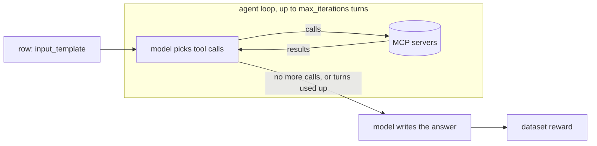
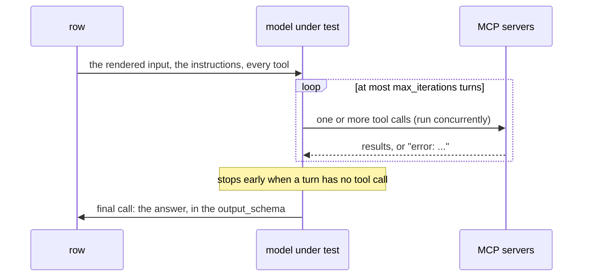

# MCP tools

`configs/mcp_servers.yaml` holds connections to
[MCP](https://modelcontextprotocol.io) tool servers: programs that expose
tools (fetch a page, query a database, run code) over a standard protocol. A
dataset with an `agent:` block hands those tools to the model under test. On
each row the model may call them, read the results, call again, and then
answers. The answer is scored by the dataset's reward as usual.

Use this to measure how well models **use** tools: whether they pick the right
one, pass sensible arguments, stop in time, and turn what they read into the
right answer. Every model runs the same loop over the same tools, so the
comparison is about the model.



## MCP tools, A2A agents, environments or `tools:`

Four ways to evaluate something that acts. Pick by what you are testing.

| you want to test | use | what runs | the axis is |
|---|---|---|---|
| models choosing and using live tools, in a loop the arena runs | `agent:` + MCP servers (this page) | the arena's tool loop, the real servers | models |
| which function a model would call, with which arguments, without running anything | [`tools:`](datasets.md#tool-calls) | one call, nothing executed, `tool_calls_accuracy` | models |
| an agent you built and deploy yourself, as a black box | [A2A agents](a2a-agents.md) | your service, its own loop and tools | agents |
| a model working in a sandbox: a terminal, files, packages | [Environments](environments.md), [Harbor tasks](harbor-tasks.md) | a Harbor agent in a container (MCP servers optional) | models |

- **`agent:` versus `tools:`.** `tools:` grades the decision only: the gold
  calls are in the dataset, so it is cheap, deterministic and needs no server.
  `agent:` grades the outcome: the tools really run and the final answer is
  scored. Use `tools:` to test function calling itself; use `agent:` when the
  answer depends on what the tools return.
- **`agent:` versus A2A.** With `agent:` the arena owns the loop and the
  prompt, and only the model changes. With A2A the agent is yours, its prompt,
  its tools and its model included; the arena only sends a message and scores
  the reply. Use A2A to compare versions of an agent, not models.
- **`agent:` versus environments.** An `agent:` row is a few tool calls over
  a protocol. An environment gives an agent a whole machine, which is slower
  and heavier. Use an environment when the work is done in a shell or on
  files; an environment can also take MCP servers
  ([below](#tools-in-a-harbor-sandbox)).

## The server entry

One entry per server. Its key is the name datasets and environments refer to,
and it also prefixes the server's tool names (see
[what the model sees](#what-the-model-sees)).

=== "stdio: a local process"

    ```yaml
    mcp_servers:
      fetch:
        transport: stdio                   # the default; spawn a process
        command: uvx                       # required: the executable
        args: [mcp-server-fetch]           # its arguments, one per item
        env:                               # variables the process gets
          USER_AGENT: openarena-eval
        # cwd: /abs/path/to/server         # its working directory
        description: Fetches a URL and returns it as markdown.
        tags: [web, local]
    ```

=== "streamable_http: a running server"

    ```yaml
    mcp_servers:
      docs:
        transport: streamable_http
        url: http://localhost:8080/mcp     # required: the endpoint
        headers:                           # sent on every request
          Authorization: Bearer <token>
        description: Search over the product documentation.
        tags: [search]
    ```

=== "sse: an older server"

    ```yaml
    mcp_servers:
      legacy-search:
        transport: sse
        url: http://localhost:8000/sse
        headers:
          X-Api-Key: <key>
    ```

=== "websocket"

    ```yaml
    mcp_servers:
      calc:
        transport: websocket
        url: ws://localhost:8765            # ws:// or wss://
    ```

| field | transport | |
|---|---|---|
| `transport` | all | `stdio` (default), `streamable_http`, `sse` or `websocket` |
| `command` | stdio | required. The executable to spawn: `uvx`, `npx`, `python`, a path |
| `args` | stdio | its arguments, a list; blank items are dropped |
| `env` | stdio | environment variables for the process; keys without spaces |
| `cwd` | stdio | the process's working directory |
| `url` | streamable_http, sse, websocket | required. Starts with `http://`, `https://`, `ws://` or `wss://` |
| `headers` | streamable_http, sse | HTTP headers on every request, typically `Authorization`; keys without spaces |
| `description`, `tags` | all | for listings (`openarena mcp-servers list`) only |

A field another transport reads is an error, not ignored: a `url` on a stdio
server, or `headers` on a websocket one. Any other field (`timeout`, `tools`,
...) is an error too.

### Which transport

| transport | when |
|---|---|
| `stdio` | The server is a package or a script you can launch: most published MCP servers. Nothing to keep running; the run starts it. |
| `streamable_http` | The server runs on its own, locally or remotely, at a URL. The protocol's current HTTP transport: prefer it for any HTTP server that supports it. |
| `sse` | An HTTP server that only speaks the older Server-Sent Events transport. Its URL usually ends in `/sse`. |
| `websocket` | A server that serves MCP over websockets. No `headers`, so it cannot carry a key that way. Not usable in a [Harbor sandbox](#tools-in-a-harbor-sandbox). |

The server's own docs say which transport it serves and at which path. A
wrong transport or path shows when the run connects, not in `openarena check`.

### stdio: how the process is started

!!! warning "A stdio server does not see your `.env`"
    The run reads the workspace's `.env`, but a stdio server does not inherit
    the run's environment. It gets a short safe list (`HOME`, `LOGNAME`,
    `PATH`, `SHELL`, `TERM`, `USER` on Linux and macOS) plus what `env:` sets.
    A server that needs `GITHUB_TOKEN` or `BRAVE_API_KEY` fails unless that
    variable reaches it some other way ([Secrets](#secrets)).

- **One process per tool call.** The tool list is read once, when the run
  prepares a model's program. After that, every tool call opens a fresh
  connection: for stdio, a new process that serves that one call and exits.
  Keep start-up cheap (`uvx` and `npx` cache their package after the first
  download), and do not count on anything the server keeps in memory between
  two calls.
- **Relative paths** in `command`, `args` and `cwd` are read from the folder
  you run `openarena` in, not from `configs/`. Use absolute paths, or set
  `cwd:`, for a script of your own.
- `PATH` is the run's, so `uvx`, `npx` or `python` are found as in your shell.

### Remote servers: url and headers

The server must be up before the run starts, and reachable from the machine
that runs `openarena`. The run reads every server's tool list while it
prepares, before any cell runs: a server that is down then stops the run
with the error. A server that goes down mid-run fails the tool call, which
the model sees as an error ([below](#how-a-row-runs)).

### Secrets

Values in `mcp_servers.yaml` are used as written: there is no `${VAR}`
substitution. A key in `env:` or `headers:` sits in the file, and in the
run's copy of it, `.open-arena/<evaluation>/config.yaml`.

- Keep `.open-arena/` out of git (a new workspace's `.gitignore` does), and
  do not commit a `mcp_servers.yaml` that holds a real key.
- Prefer a stdio server that reads its own key, so the YAML holds no secret.
  For example, have `uv` load the workspace's `.env` into the process:
  `command: uv`, `args: [run, --env-file, .env, my_server.py]`.
- An HTTP server's token can only go in `headers:`. Use a key scoped to the
  evaluation, read-only where the server allows it.

### What there is no field for

- **No tool filter.** The model gets every tool each listed server exposes.
  To hide tools, run the server in a mode that exposes fewer (many take flags
  for that, given in `args`), or put a small server of your own in front.
- **No timeout.** There is no per-call or per-row timeout to set; HTTP
  transports use the client's built-in defaults. A tool that hangs holds its
  row, so keep your servers' own timeouts sensible.

## The `agent:` block

A dataset with an `agent:` block is answered by the tool loop. The
evaluation's `language_models` are ordinary models from `models.yaml`; each
must support tool calling, which `check` cannot know.

```yaml
datasets:
  web-questions:
    type: local
    config:
      path: questions.jsonl            # {"question": "...", "answer": "..."}
      input_template: '{"question": {{ question | tojson }}}'
      output_template: '{"answer": {{ answer | tojson }}}'
      input_schema: {type: object, properties: {question: {type: string, description: The question to answer}}, required: [question]}
      output_schema: {type: object, properties: {answer: {type: string, description: The answer only}}, required: [answer]}
    agent:
      mcp_servers: [fetch]             # mcp_servers.yaml keys, at least one
      max_iterations: 8                # tool-calling turns per row (default 5)
      instructions: >-
        Answer the question. Fetch the pages you need first; do not answer
        from memory.
    reward: judge
```

| field | default | |
|---|---|---|
| `mcp_servers` | | required. A list of `mcp_servers.yaml` keys, at least one. Their tools are merged into one list |
| `max_iterations` | 5 | tool-calling turns per row ([below](#max_iterations)) |
| `instructions` | a generic "helpful agent" line | the instructions for every turn; say when to use the tools |
| `final_instructions` | `instructions` | instructions for the last call, the one that writes the answer |
| `use_chain_of_thought` | false | have the model reason before each tool decision; for non-reasoning models |
| `return_inputs_with_trajectory` | true | keep the tool trajectory (`messages`) beside the answer ([scoring](#what-gets-recorded-and-scored)) |
| `return_inputs` | false | also put the row's input fields in the prediction |
| `type` | `function_calling` | the only loop there is |

`language_model` and `tools` are set by the run and refused here. Every other
key goes to the agent as a setting, so a misspelled one (`max_iteration:`)
passes `check` and stops the run when the program is built.

??? details "Other agent settings"
    The block also forwards `temperature`, `max_tokens`, `top_p`, `top_k`,
    `reasoning_effort`, `examples`, `use_inputs_schema`, `use_outputs_schema`
    and `prompt_template` to the agent. Set here, they apply to every model of
    the evaluation alike. A model's own sampling params belong in
    `models.yaml` ([Models](models.md#params)); set a param in one
    place, not both. Leave `autonomous` at its default: the run needs the
    agent to execute the tools itself.

### How a row runs



1. Each turn, the model sees the conversation so far and the full tool list,
   and either calls tools or does not. Several calls in one turn run at once.
2. A turn without a tool call ends the loop. So does the last allowed turn.
3. A last call writes the answer from the whole trajectory, shaped by the
   dataset's `output_schema` (an `answer` field above). It is made even when
   the turns ran out: a model cut off mid-search still answers, usually
   badly, and is scored for it.
4. A tool that fails (bad arguments, a server error) does not fail the row.
   Its result becomes `error: <message>` in the conversation, and the model
   may retry or work around it. That is part of what is measured.

### max_iterations

Each turn is a model call, plus the final answer call: a row costs up to
`max_iterations + 1` calls of the model under test, and each call re-sends the
whole conversation, tool results included. Tokens grow with every turn.

| setting | when |
|---|---|
| 1 to 3 | one lookup is enough (a single fetch, a calculator); cuts cost and keeps models from wandering |
| 5 (default) | a few dependent lookups |
| 8 to 15 | multi-hop tasks: search, open, follow a link, compare |

Too low, and good models are cut off before they finish: every model scores
alike and the evaluation measures the limit. Too high costs money on models
that loop. Run a few rows (`limit: 5` on the dataset), read the trajectories,
and set it a little above what a good model needs.

### What the model sees

Each tool is named `<server key>_<tool name>`: the `fetch` tool of the `fetch`
server is `fetch_fetch`, and two servers can both expose `search` without a
clash. Its description and parameters are the server's own. Name server keys
plainly, since every model reads them.

## What gets recorded and scored

A row's prediction is the answer, with the trajectory beside it:

```json
{
  "messages": [
    {"role": "assistant", "tool_calls": [{"id": "c1", "type": "function",
      "function": {"name": "fetch_fetch", "arguments": {"url": "https://example.com"}}}]},
    {"role": "tool", "tool_call_id": "c1", "content": "# Example Domain ..."}
  ],
  "answer": "Example Domain"
}
```

| the dataset has | the prediction is |
|---|---|
| an `output_schema` (the usual case) | its fields, plus `messages` |
| an `output_schema`, and `return_inputs_with_trajectory: false` | its fields only |
| no `output_schema` | `messages` only: the trajectory is the answer |
| `return_inputs: true` | the row's input fields as well; an input field named like an answer field, or `messages`, stops the run before it starts |

How each kind of [reward](rewards.md) reads it:

| reward | reads | use it for |
|---|---|---|
| `exact_match`, `answer_accuracy`, ... | the answer fields only: a deterministic reward is limited to the fields the `output_template` renders, so `messages` never counts | a short, checkable answer |
| `lm_as_judge`, `rubrics_as_judge`, ... | the whole prediction, trajectory included | free-text answers; asking whether the answer is backed by what the tools returned |
| `tool_correctness`, `tool_use`, `argument_correctness`, `step_efficiency`, `agent_loop_detection`, `task_completion` | the whole prediction | **how** the model worked, not only the result; good as extra [`metrics:`](datasets.md#extra-metrics) beside the main reward |
| `tool_calls_accuracy` | a top-level `tool_calls` | not this page: it scores [`tools:`](datasets.md#tool-calls) datasets and reads nothing from an agent's `messages` |

!!! tip "Score the answer, watch the process"
    Make the main `reward` about the answer, and add one or two tool-use
    judges under `metrics:`. A model that gets the right answer in two calls
    and one that needs eight then show the same reward and a different
    `step_efficiency`.

Cost, tokens and latency, when you list them under `metrics:`
([Running evaluations](evaluations.md#metrics-the-columns-beside-reward)),
cover every turn of the loop. Judges are counted apart (`reward_cost`).
Per-row trajectories are not written to `result.json`, and
`openarena evaluations run` does not trace into MLflow; to keep them, run the
sweep from Python with `on_sample` ([Reading results](results.md)) or from the
arena app.

## Fair comparisons

The tools are part of the test. Keep them the same for every model, and as
few as the task needs.

- **Give only the tools the task needs.** Every tool is in every prompt. Extra
  tools cost tokens on each turn and give weaker models more ways to go wrong.
  That may be what you want to measure, or may be noise.
- **One evaluation, one tool set.** Every model of an evaluation gets the same
  servers, the same `max_iterations` and the same instructions. To compare
  tool sets, write two datasets over the same rows with different `agent:`
  blocks, and put both in the evaluation.
- **Pin the server.** `uvx mcp-server-fetch` runs the latest release; a new
  version can change tool names, descriptions or output between two runs.
  Pin it (`args: [mcp-server-fetch==<version>]`, `npx -y <package>@<version>`)
  for results you will compare later.
- **Live data moves.** A web or search tool returns something different next
  week. Models in one run see nearly the same web; runs a month apart do not.
  For a benchmark meant to last, point the tools at a fixed copy of the data.

## Servers that keep state

Some tools change something: write a file, insert a row, open a ticket. Then
what one row did can change what the next row sees.

- Rows of a batch run at the same time (`batch_size`), so their tool calls
  interleave on a shared server.
- Models run one after the other against the same server: the second model
  sees what the first left behind.
- A stdio server is a fresh process per tool call, so in-memory state does
  not survive from one call to the next, even within a row. State on disk, in
  a database or in a remote service does.
- Resuming reruns only the cells that did not finish, against the server as
  it is now.

To keep results comparable:

| approach | how |
|---|---|
| read-only tools | the safest: expose only tools that read |
| isolate per row | have the tools key their state on something the row provides, such as an id in the input |
| reset between runs | restore the database or files before each run, and run with `--no-cache` so every cell starts from the same state |
| one row at a time | `batch_size: 1` in the dataset's `config:`, and no `batch_size` on the evaluation (it would override it) |

When each row needs its own clean machine, an [environment](environments.md)
is the better fit: every Harbor trial gets a fresh sandbox.

## Tools in a Harbor sandbox

An [environment](environments.md) can hand servers to its agent with
`mcp_servers: [...]`. They are written into the Harbor task, and Harbor
carries less than a dataset's agent does:

- `stdio`, `sse` and `streamable_http` only; `websocket` is refused.
- No `headers`, and no stdio `env` or `cwd`: Harbor would drop them, so a
  server that sets them is refused. Put a stdio server's variables in the
  environment's `env:` instead.
- A stdio command runs inside the sandbox, so the image must have it (`uvx`
  needs `uv` installed in the Dockerfile).
- An HTTP server must be reachable from the sandbox, not on `localhost`.

## Common mistakes

`openarena check configs` catches the shape of an entry and every reference
by name ([Checking configs](check.md)):

| mistake | what `check` reports |
|---|---|
| a stdio server without `command` | ``a stdio server needs a `command` to spawn`` |
| `url: localhost:8080/mcp` | `` `url` must start with http://, https://, ws:// or wss:// `` |
| `command` on an HTTP server, `headers` on a websocket one | `a <transport> server does not take [...]; it reads [...]`, and which transport reads it |
| `transport: http` | `Input should be 'stdio', 'streamable_http', 'sse' or 'websocket'` |
| `timeout:` or another unknown field on a server | ``not a field of a `mcp_servers` entry``, with the fields it reads |
| `mcp_servers: []` or `mcp_servers: fetch` in `agent:` | it cannot be empty; write it as a list |
| `agent.mcp_servers` naming a server not in `mcp_servers.yaml` | an unknown reference |
| `tools:` or `language_model:` inside `agent:` | `` `agent:` keys [...] are set by the run `` |
| `agent:` and `tools:` on one dataset | `` `agent`, `tools` are mutually exclusive `` |

What `check` cannot see shows up when the run reaches it
([Reading results](results.md#when-a-cell-failed-or-scored-0)):

| symptom | likely cause |
|---|---|
| the run stops while preparing: `no MCP tools loaded from servers [...]` | the server started but lists no tools |
| the run stops while preparing: connection refused | the HTTP server is not running, or its URL or transport is wrong |
| the run stops while preparing: command not found | `command` is not on `PATH`, or a relative path read from the wrong folder |
| the run stops while preparing: an unexpected keyword | a misspelled `agent:` setting |
| tool results read `error: ...` about a missing key | a stdio server's variable is in `.env` but does not reach the process |
| every model scores about the same, and low | `max_iterations` too low, or models without tool calling |

## Commands

```shell
openarena mcp-servers list --configs configs   # every server: transport, command, url
openarena check configs                        # shapes and references
```

To add servers with a coding agent, the workspace's `openarena-add-mcp-tools`
skill walks through it ([Coding agents](../coding-agents.md)).
