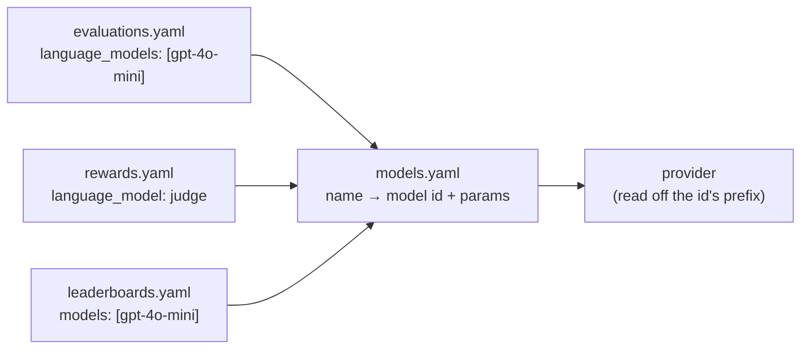

# Models

`configs/models.yaml` is the list of models the workspace can call. Each entry
gives a model a **name** and says which litellm id that name calls, with which
settings. Everything else refers to the model by that name, never by id: an
evaluation's `language_models`, a judge reward's `language_model`, a
leaderboard's `models`. Results and rankings are kept under the name too.



The name is the indirection that keeps a sweep comparable: you change what a
name calls, or add a second name for the same id with other settings, without
touching the evaluations, rewards and leaderboards that use it.

## A model entry

```yaml
models:
  gpt-4o-mini:                       # the name: what every other file refers to
    model: openai/gpt-4o-mini        # required: <provider>/<id>, as litellm routes it
    type: llm                        # llm (the default) or embedding
    params:                          # the settings the type takes; leave one out for the provider's default
      temperature: 0
      max_tokens: 2048
    modalities: [text]               # what it reads: text, image, audio (default: [text])
    description: OpenAI's small model, the hosted baseline.
    tags: [openai, hosted]           # labels for browsing; never sent to the model
  gpt-4o:
    model: openai/gpt-4o             # the larger sibling, for quality comparisons
    params:
      temperature: 0
    tags: [openai, hosted]
  qwen3-local:
    model: ollama/qwen3:8b           # a local Ollama: no key, no bill
    params:
      temperature: 0
      reasoning_effort: disable      # turn native thinking off
    tags: [local, open-weights]
  minilm:
    model: ollama/all-minilm
    type: embedding                  # encodes text into vectors; does not answer
    params:
      dimensions: 384
    tags: [local]
  jev:
    model: typesafe/jev-latest       # needs TYPESAFE_API_KEY
    type: decision                   # grades typed questions with calibrated probabilities; does not write
    description: The decision model the rubric judges grade with.
    tags: [judge]
```

| field | values | default | effect |
|---|---|---|---|
| name (the key) | a letter or digit, then letters, digits, `_`, `.`, `-`; at most 128 characters | | what every other file and every result calls the model |
| `model` | `<provider>/<id>`, a litellm id | required | which provider is called, and which model there |
| `type` | `llm`, `embedding`, `decision` | `llm` | what the model does: which params it takes, where it may be named |
| `params` | a mapping, by type ([below](#params)) | `{}` | settings sent with each call; a param left out keeps the provider's default |
| `modalities` | a list of `text`, `image`, `audio` | `[text]` | a fact about the model, for listings |
| `description` | text | none | shown by `openarena models list` |
| `tags` | a list of labels | `[]` | for browsing and filtering lists |

An entry refuses any other field. A run and `openarena check` read it with the
same schema: a field `check` rejects is one the run would refuse.

## The name

The name is the model's identity in the workspace. It is what a sweep's
results, a run's table and a leaderboard's rows show.

- Name what you compare, not the vendor's id: `gpt-4o-mini`, `gpt-4o-mini-t07`,
  `o4-mini-high`. The id is one field below; the name is what people read.
- Keep it stable. Results of earlier runs keep the name they were made with, so
  renaming a model splits its history: a leaderboard shows the old runs under
  the old name and the new runs under the new one. `openarena check` lists
  every reference the rename broke in the configs; it cannot rename results.

## `model`: the id and the provider

The id is written the way litellm routes it: a provider prefix, a slash, and
the provider's own model id. The prefix picks the provider; there is no
`provider:` field.

| prefix | example | needs |
|---|---|---|
| `openai/` | `openai/gpt-4o-mini` | `OPENAI_API_KEY` |
| `anthropic/` | `anthropic/claude-sonnet-4-5` | `ANTHROPIC_API_KEY` |
| `gemini/` | `gemini/gemini-2.5-flash` | `GEMINI_API_KEY` |
| `mistral/` | `mistral/mistral-small-latest` | `MISTRAL_API_KEY` |
| `groq/` | `groq/llama-3.3-70b-versatile` | `GROQ_API_KEY` |
| `openrouter/` | `openrouter/mistralai/ministral-14b-2512` | `OPENROUTER_API_KEY` |
| `ollama/` | `ollama/qwen3:8b` | a running Ollama; `OLLAMA_API_BASE` when it is not at `http://localhost:11434` |
| `vllm/` | `vllm/Qwen/Qwen3-4B` | `HOSTED_VLLM_API_BASE`: your server's OpenAI endpoint, `/v1` included |
| `sglang/` | `sglang/Qwen/Qwen3-4B` | `SGLANG_API_BASE`: your server's OpenAI endpoint, `/v1` included (default `http://localhost:30000/v1`) |

Any provider [litellm supports](https://docs.litellm.ai/docs/providers) works
the same way, with the variables litellm reads for it.

After the prefix, spell the id exactly as the provider does: `ollama/qwen3:8b`
is the tag `ollama list` shows, `vllm/Qwen/Qwen3-4B` the name your vLLM server
serves the model under.

### Keys and base URLs

Keys and server addresses live in the environment, never in `models.yaml`.
`openarena evaluations run` loads the workspace's `.env` (beside `configs/`)
before it runs, and never overrides a variable already set in your shell. No
other command reads it. The workspace's
`.env.template` lists the usual ones:

```shell
cp .env.template .env
```

```shell
# .env
OPENAI_API_KEY=sk-...
OPENROUTER_API_KEY=sk-or-...
TYPESAFE_API_KEY=ts-...
OLLAMA_API_BASE=http://localhost:11434
HOSTED_VLLM_API_BASE=http://localhost:8000/v1
SGLANG_API_BASE=http://localhost:30000/v1
```

A base URL is per provider, not per model: every `vllm/` entry reaches the one
server `HOSTED_VLLM_API_BASE` names. To compare two models served by vLLM,
serve them from the same server, or run the sweeps one after the other with the
variable changed.

!!! warning "There is no `api_base` param"
    `params` takes only the settings listed [below](#params). `api_base:`,
    `top_p:`, `seed:` or `stop:` in an entry are refused. Set a server address
    in the environment.

!!! note "`check` does not check keys"
    `openarena check` reads files only. A missing key or a server that is down
    shows up when the run reaches the model: the cell fails and the run says
    why ([Reading results](results.md#when-a-cell-failed-or-scored-0)).

### Local or hosted

=== "Hosted API"

    ```yaml
    models:
      gpt-4o-mini:
        model: openai/gpt-4o-mini        # needs OPENAI_API_KEY
        params:
          temperature: 0
        tags: [openai, hosted]
    ```

    Nothing to run on your side. Each call is billed, and the run's `cost` is
    counted from the provider's price ([Prices](#prices)). The provider may
    retire the model ([End of life](#end-of-life)).

=== "Ollama"

    ```yaml
    models:
      qwen3-local:
        model: ollama/qwen3:8b           # `ollama pull qwen3:8b` first
        params:
          temperature: 0
        tags: [local]
    ```

    Runs on your machine. No key, and the cost is 0. Pull the model before the
    run: a model Ollama does not have fails the cell. Speed depends on your
    hardware, so keep `batch_size` low on a laptop.

=== "vLLM"

    ```yaml
    models:
      qwen3-4b:
        model: vllm/Qwen/Qwen3-4B        # the name the server serves it under
        params:
          temperature: 0
        tags: [local, vllm]
    ```

    A server of your own, local or on a GPU box, reached through its OpenAI
    endpoint: set `HOSTED_VLLM_API_BASE=http://<host>:8000/v1`. The cost is 0.
    It serves many requests at once, so it suits large batches.

=== "OpenRouter"

    ```yaml
    models:
      ministral:
        model: openrouter/mistralai/ministral-14b-2512   # needs OPENROUTER_API_KEY
        params:
          temperature: 0
        tags: [openrouter, mistral]
    ```

    One key for many vendors. Every call to an `openrouter/` id is sent with
    OpenRouter's `require_parameters` routing: it only goes to a host that
    honours every parameter sent, tools included. A host that would drop the
    structured-output call is skipped, and the call fails at once rather than
    answering in prose.

**When to use which.** A hosted API for the models you measure against, and for
judges, where answer quality matters more than cost. Ollama to iterate on a
dataset or a reward on your laptop, at no cost. vLLM to score open-weight
models at scale. Mixing them in one evaluation is fine: each name calls its
own provider.

!!! warning "Harbor agents and local models"
    A Harbor agent installed inside the sandbox calls its model from there. It
    cannot reach an `ollama/` or `vllm/` model on the arena's machine, and
    `check` reports the pair. See [Harbor tasks](harbor-tasks.md).

## `type`

| type | what it does | where it can be named |
|---|---|---|
| `llm` | answers prompts: chat, structured output, tool calls, agents | an evaluation's `language_models`; a reward's `language_model`, `smart_language_model`, `sub_language_model`, `panel_language_models`; `default_language_model` |
| `embedding` | turns text into vectors | the `language_models` of a sweep over retrieval datasets (`embedding:` in [Datasets](datasets.md)); a reward's or metric's `embedding_model`; `default_embedding_model` |
| `decision` | answers typed questions (yes/no, a choice, a score) with calibrated probabilities; does not write text | a rubric judge's `decision_model` ([Rewards](rewards.md#grading-with-a-decision-model)) |

The type is checked wherever the model is named: a judge set to an embedding
model, or an embedding model in the `language_models` of a sweep over text
datasets, is an error. A sweep runs one type, so a retrieval dataset cannot
share an evaluation with other kinds of dataset. A decision model cannot be
under test: it only grades.

## `params`

What `params` takes depends on the type. A param left out, or set to null, is
not sent, and the provider's default applies.

| type | param | values | effect |
|---|---|---|---|
| `llm` | `temperature` | a number, 0 to 2 | how much the model samples; lower is more consistent |
| `llm` | `max_tokens` | an integer, at least 1 | the longest answer, in tokens |
| `llm` | `reasoning_effort` | `disable`, `minimal`, `low`, `medium`, `high`, `xhigh`, `max` | how much the model thinks before answering, where it can |
| `embedding` | `dimensions` | an integer, at least 1 | the vector size, where the model lets you pick |
| `decision` | none | | a decision model takes no params; `params` must be left out or empty |

### `temperature`

Temperature trades consistency for variety. At 0 the model takes its most
likely answer; higher values spread over more answers.

| setup | when |
|---|---|
| `temperature: 0` | benchmarks and comparisons. Two runs of the same model stay as close as the provider allows, so a difference between two models is the models, not the dice. |
| left out | when you want each model as its vendor ships it. Vendors pick different defaults, so you compare the models plus their defaults. |
| `0.7` to `1` | when the task rewards variety (writing, brainstorming), or to measure how stable a model's score is across runs. |

!!! tip "Temperature 0 is the default choice for a benchmark"
    The evaluation's `seed` seeds the arena's own randomness, not the
    provider's sampling. Only a low temperature keeps a model's answers
    steady from run to run. Even at 0, hosted providers do not promise
    identical answers.

If a provider refuses a param for a model, the cell fails with the provider's
message. Remove the param from that entry.

### `max_tokens`

The cap on the length of each answer. Set it to bound cost and time per row, or
when a provider's default is too short for the task. Too low cuts answers off
mid-way: a truncated answer usually fails the reward, so a low score may be the
cap, not the model. On a reasoning model, leave room: depending on the
provider, the thinking may count against the cap. Leave it out unless you have
a reason.

### `reasoning_effort`

How much a model that can think does so before answering.

| value | effect |
|---|---|
| `disable` | turns native thinking off, for local models that think by default (Ollama's `qwen3`, `deepseek-r1`) |
| `minimal`, `low`, `medium`, `high`, `xhigh`, `max` | the effort, where the model supports levels; each model takes the ones its provider lists (OpenRouter states them per model) |
| left out | the provider's default |

More effort usually means better answers on hard rows, at the price of more
output tokens, more cost and more latency. That trade-off is what a
leaderboard with shares on `cost` and latency weighs. A model that does not
support the param may ignore it or refuse it.

### `dimensions`

For an embedding model that lets you choose its vector size. Smaller vectors
are cheaper to store and compare; larger ones keep more of the meaning. Leave
it out for a model with a fixed size.

### Where the params apply

The params travel with the model wherever it is named: as the model under
test, as a judge, as a metric's model or as a default.

| the model is... | its params |
|---|---|
| under test on a generator, agent or tools dataset | sent with every call |
| under test on a Harbor dataset | given to the Harbor agent where its options take them (`temperature`, `reasoning_effort`, `max_tokens`); what it does not take is logged and left out |
| under test on a retrieval (`embedding:`) dataset | `dimensions` sent with every embedding call |
| a reward's or metric's model (`language_model`, `embedding_model`, a panel, ...) | sent with every call the reward or metric makes |
| `default_language_model`, `default_embedding_model` | sent with every call, as for a reward's model |

So a judge entry with `temperature: 0` grades at temperature 0. See
[Choosing a judge](#choosing-a-judge-model).

## `modalities`

What the model reads: `text`, `image`, `audio`. Default `[text]`; at least one;
duplicates dropped. Add `image` for a vision model.

It is a fact for listings: the run does not read it, and it does not turn image
input on or off. What a model is sent comes from the dataset's templates.

## `description` and `tags`

`description` is free text, shown as a column by `openarena models list`. Say
what the entry is for and what sets it apart from its neighbours: "high
effort", "the hosted baseline", "served from the lab's GPU box".

`tags` are short labels: what the model is (`openai`, `local`, `open-weights`),
what it can do (`tools`, `vision`, `128k-context`), what it is for (`judge`,
`baseline`). The engine never reads them, and they are never sent to the
model.

| rule | |
|---|---|
| form | a list: `tags: [openai, hosted]`, never `tags: openai` |
| characters | lower-case letters, digits, `-`, `.`, `:`, `+`, `/`; starting with a letter or digit |
| folding | upper case is lowered, spaces and `_` become `-`: `Open AI` is stored as `open-ai` |
| limits | at most 40 characters a tag, 32 tags an entry; duplicates dropped |

Pick one spelling per idea and keep to it across the workspace, so one filter
finds them all.

## Two entries for one id

Two entries calling the same id with different params are two models. Each gets
its own row in every result and its own place on a leaderboard. This is how you
measure what a setting does.

```yaml
models:
  o4-mini-low:
    model: openai/o4-mini
    params:
      reasoning_effort: low
    description: o4-mini, light thinking.
    tags: [openai, reasoning]
  o4-mini-high:
    model: openai/o4-mini
    params:
      reasoning_effort: high
    description: o4-mini, deep thinking.
    tags: [openai, reasoning]
```

Then sweep both:

```yaml
evaluations:
  effort-ablation:
    language_models: [o4-mini-low, o4-mini-high]
    datasets: [gsm8k-20]
```

Do this when the question is "is the extra thinking worth it?" or "does
temperature 0 hurt this task?", or to keep the setting you deploy next to the
default. Both entries share the id's price and end-of-life date: only the
tokens they spend differ.

Do not duplicate an entry just to label it differently; that is what `tags` and
`description` are for. A duplicate with identical params doubles the cost of
every sweep that names both.

## Choosing a judge model

A judge reward ([Rewards](rewards.md#judged-rewards)) names an `llm` entry of
`models.yaml`, by name.

```yaml
models:
  judge:
    model: openai/gpt-4o
    params:
      temperature: 0                 # grade the same answer the same way every time
    description: The judge of the free-text rewards.
    tags: [openai, judge]
```

```yaml
rewards:
  graded:
    type: lm_as_judge
    config:
      language_model: judge          # a models.yaml name, never an id
      instructions: |
        Score 1.0 when the answer is correct and complete, 0.0 when it is wrong.
```

- **Stronger than the models it judges.** A judge weaker than the model under
  test misses the errors that matter.
- **Not one of the models under test**, when you can avoid it. A model tends to
  favour answers like its own. Prefer a judge from another vendor, or a panel
  (`multi_judge_panel`).
- **One judge for a whole comparison.** Scores from two judges are not on the
  same scale. Change the judge and you rerun every model.
- **A dedicated entry.** Name it `judge`, not `gpt-4o`: you swap what it calls
  in one place, and it keeps its own params apart from the `gpt-4o` you may
  test.
- **`temperature: 0`.** A judge's params are sent with its calls
  ([above](#where-the-params-apply)). At 0 it grades an answer the same way
  from row to row and from run to run, as far as the provider allows, so a
  difference in score is the answers, not the judge's sampling.
- **Cost.** A judge makes a call per row, counted apart as `reward_cost`. A
  local judge costs nothing but is usually weaker.

An evaluation's `default_language_model` is the model a reward uses when its
config names none ([Running evaluations](evaluations.md)).

### A decision model as the grader

A `decision` model does not write: asked a typed question (is this true,
which option, which level) it answers with a calibrated probability per
option, in one short call. The rubric judges can grade with one instead of a
language model: name it in the reward's `decision_model`
([Rewards](rewards.md#grading-with-a-decision-model)).

```yaml
models:
  jev:
    model: typesafe/jev-latest       # hosted: needs TYPESAFE_API_KEY
    type: decision
    tags: [judge]
  laya:
    model: ollama/laya               # local: `ollama pull laya` first
    type: decision
    tags: [judge, local]
  kev:
    model: sglang/kev                # local: a decision checkpoint SGLang serves
    type: decision
    tags: [judge, local]
```

- **Why.** A fraction of a language judge's cost and latency, and a steadier
  score: the probabilities are calibrated, so the same answer gets the same
  grade.
- **What you give up.** No critique: the trace shows each criterion's level,
  not why. A judge that must write (`lm_as_judge`, the agent judges) cannot
  use one.
- **Where it can be named.** A rubric judge's `decision_model`, and nowhere
  else: not in `language_models`, not as a `language_model`.

## Prices

A run's `cost` (and `reward_cost`, `embedding_cost`) is the sum of each call's
price, which litellm counts as the run goes. Before a run, the arena makes sure
litellm has a price for every model the run may call, the models under test and
the judges, from the first source that knows one:

1. **A local server.** An `ollama/`, `ollama_chat/`, `vllm/`, `hosted_vllm/`,
   `sglang/`, `lm_studio/` or `llamafile/` id costs 0: there is no bill.
2. **litellm's pricing table.** The live one, filled with the rows only the
   copy shipped in the package has.
3. **OpenRouter's catalogue.** For an `openrouter/` id, and for a vendor's
   direct id when OpenRouter routes the same model at the vendor's price.

A source that prices both input and output wins over one that prices one side.

!!! warning "Unpriced is not free"
    A hosted model that no source prices still runs, but its spend reads 0. On
    a leaderboard with a share on `cost` or a cost budget, it looks free. Check
    a new model's cost after its first run.

The price is per id: two entries for one id share it.

## End of life

A leaderboard adds `eol_days` to every model: the days left before its id stops
being served. A model about to be retired is a poor choice to build on, however
well it scores. The date comes from the first source that has one:

| source | for |
|---|---|
| the provider's announced date, as recorded in litellm's table | any provider that announces one |
| Azure's OpenAI retirement schedule | `openai/`, `azure/`, `azure_ai/` ids the provider has not dated; fetched once a day, a shipped snapshot answers offline |
| OpenRouter's expiration date | `openrouter/` ids; it wins when it is earlier than the vendor's |

An `openrouter/<vendor>/<model>` id is also looked up under the vendor's own id:
it is the same model, and it stops on the same day.

| case | `eol_days` |
|---|---|
| no date known (local and open-weight models, most current models) | 5 years: no end of life |
| a date further than 5 years away | 5 years |
| a date in the past | negative: the provider may already refuse calls |

`openarena leaderboards run <name> --no-eol` leaves `eol_days` out, for a
ranking that asks nothing of the network ([Leaderboards](leaderboards.md)).

## Tags and leaderboards

A leaderboard's scope is its `models:` list, by name. Tags do not select models
for it: a leaderboard does not read them.

```yaml
leaderboards:
  local-vs-hosted:
    title: Local against hosted
    models: [qwen3-local, gpt-4o-mini]   # names; empty means every scored model
    datasets: []
    tags: [baseline]
```

Use tags to find the names to list: give every model of a family or a
deployment the same tag, browse the lists by it, and copy the names into the
leaderboard's `models:`. When the set changes, edit the list.

## Common mistakes

Run `openarena check configs` after every edit ([Checking configs](check.md)).
What it reports for a model, and the fix:

| mistake | `check` says | fix |
|---|---|---|
| a param beside `model:` (`temperature: 0`) | `not a field of a models entry` | move it under `params:`; `check` prints the block |
| an option the type does not take, beside `model:` (`top_p`, `seed`) | `not a field of a models entry`, fix: `` remove `top_p:`; it is not supported: a chat model takes only reasoning_effort, temperature, max_tokens under `params:` `` | remove it |
| an option the type does not take, under `params:` (`top_p`, `temperature` on an embedding model) | `Chat models take reasoning_effort, temperature, max_tokens, not top_p` | remove it |
| a server address or key (`api_base`, `base_url`, `api_key`) | `not a field of a models entry`, fix: `` remove `api_base:`; a base URL is not a model setting: set it in the environment instead (`.env`) `` | set the provider's variable in `.env` (`OLLAMA_API_BASE`, `HOSTED_VLLM_API_BASE`) |
| `provider: openai` | `not a field of a models entry` | remove it: the provider is read off the id's prefix |
| `reasoning_effort: max` | `reasoning_effort: one of disable, low, medium, high` | use one of those |
| `temperature: 3` | `temperature: between 0 and 2` | a value in range |
| `modalities: [video]` | `Input should be 'text', 'image' or 'audio'` | one of those |
| `tags: OpenAI` | `` `tags:` is a list `` | `tags: [openai]` |
| a name with a space | `a name starts with a letter or a digit, ...` | rename it as `check` suggests, and update what refers to it |
| a reward naming an id (`language_model: openai/gpt-4o-mini`) | `'openai/gpt-4o-mini' is not in models` | name the entry that calls it; `check` names it |
| a judge set to an embedding model | `'minilm' is an embedding model; this setting needs a language model` | name an `llm` entry |
| a renamed model still named elsewhere | `'old-name' is not in models` | update the reference; on a leaderboard it is a warning |

`check` does not reach the provider. A misspelt id after the prefix, a missing
key, a model Ollama has not pulled or a vLLM server that is down fail the cell
at run time, with the provider's message.

## Commands

```shell
openarena models list            # name, id, type and description of ./configs
openarena check configs          # after an edit
```

See the [CLI reference](../cli.md) for the options.

## See also

- [Rewards](rewards.md): judges, and the models they name.
- [Datasets](datasets.md): the dataset kinds, including retrieval over
  embedding models.
- [Running evaluations](evaluations.md): sweeping models, `seed`,
  `default_language_model`, cost and time.
- [Leaderboards](leaderboards.md): `cost`, `eol_days`, budgets and shares.
- [Harbor tasks](harbor-tasks.md): which agents can drive which models.
