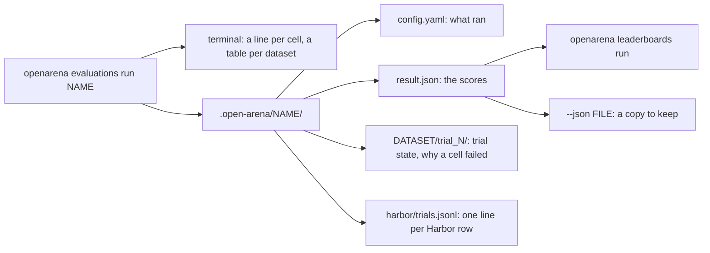

# Reading results

A run answers one question per cell: how did this model do on this dataset? This
page says where the answers are written, what every number means, and how to
get from a surprising number to the rows behind it.



## What a run writes

Everything lands in `<state-dir>/<evaluation>/`, `.open-arena/<evaluation>/` by
default ([`--state-dir`](../cli.md#openarena-evaluations-run)).

```
.open-arena/math-compare/
  config.yaml              the evaluation and every entry it names, gathered
  result.json              the scores, one row per model, dataset and metric
  <dataset>/               trial state, one folder per dataset
    oracle.json
    trial_0/trial.json     one trial per model: its status, metrics and error
  harbor/                  Harbor datasets only
    trials.jsonl           one line per row: question, answer, outcome, usage
    trials/<trial>/        that row's logs: agent session, verifier output
  environments/ tasks/     copies of the Harbor folders the run used
```

| file | written | read it for |
|---|---|---|
| `config.yaml` | at the start of every run | what actually ran: models, params, rewards, templates, after the registries were gathered; a `${NAME}` stays a reference, never the secret |
| `result.json` | at the end, only when the sweep finishes | the scores; this is what [leaderboards](leaderboards.md) read |
| `<dataset>/trial_N/trial.json` | as each cell ends | a failed cell's full error; this is also the resume cache |
| `harbor/trials.jsonl` | as each Harbor row ends | the row-level view of a Harbor cell |

!!! note "`config.yaml` is the record of what ran"
    It is rewritten from `configs/` at every launch. To know what produced a
    number, read this copy, not `configs/`, which may have changed since.

!!! warning "`result.json` is replaced, not appended"
    Running the same evaluation again rewrites its `result.json` with every
    cell, the cached ones included. A run that stops before the end writes
    none, and the previous `result.json` stays in place. Keep a copy with
    `--json` when you want history ([Comparing runs over time](#comparing-runs-over-time)).

## The terminal

While it runs, the CLI prints a line per cell, and after each dataset one line
per failed cell:

```
gsm8k-20
  qwen38 running…
  qwen38 done reward 0.6500
  gpt-4o-mini running…
  gpt-4o-mini done reward 0.8500
  qwen38 failed: <the exception's last line>
```

`done` lists every number the cell measured. `failed` is the last line of the
cell's error; the full traceback is in its `trial.json` ([When a cell failed](#when-a-cell-failed-or-scored-0)).
After the tables, a run with failed cells names them all,
`N cell(s) failed: <model> × <dataset>, ...`, and exits 1.

At the end it prints one table per dataset: a row per model, a column per
metric, four decimals, `—` where a cell has no value. Add `-v` for a progress
bar, `-vv` for a line per batch.

## result.json

```json
{
  "meta": {
    "config": ".open-arena/math-compare/config.yaml",
    "models": ["qwen38", "gpt-4o-mini"],
    "datasets": ["gsm8k-20"],
    "metrics": ["reward", "cost", "output_tokens"],
    "directions": {"gsm8k-20": "max"},
    "metric_directions": {"cost": "min", "output_tokens": "min"},
    "objectives_by_ds": {"gsm8k-20": [["reward", "max"], ["cost", "min"]]},
    "frontier_by_ds": {"gsm8k-20": ["qwen38", "gpt-4o-mini"]}
  },
  "rows": [
    {"model": "gpt-4o-mini", "dataset": "gsm8k-20", "metric": "reward",
     "value": 0.85, "status": "COMPLETED", "direction": "max", "on_frontier": true},
    {"model": "gpt-4o-mini", "dataset": "gsm8k-20", "metric": "cost",
     "value": 0.0021, "status": "COMPLETED", "direction": "min", "on_frontier": true}
  ]
}
```

### meta

| key | meaning |
|---|---|
| `config` | the gathered config the run read |
| `models` | the models (or A2A agents) compared, in the evaluation's order |
| `datasets` | the datasets, in the evaluation's order |
| `metrics` | every column: `reward` first, then each extra metric's alias, across all datasets |
| `directions` | per dataset, the direction of its `reward` (`max` unless the reward says `min`) |
| `metric_directions` | per extra metric, its direction: as written in `metrics:`, else `min` for a cost, tokens or latency measurement and `max` for anything else |
| `objectives_by_ds` | per dataset, the axes of its Pareto frontier: `reward`, plus every metric marked `objective: true` |
| `frontier_by_ds` | per dataset, the models no other model beats on every axis; empty when the dataset has one axis |

### rows

Long form: one row per model, dataset and metric. Every row carries what it
needs to be read alone.

| key | meaning |
|---|---|
| `model`, `dataset`, `metric` | the cell and the column |
| `value` | the number, or `null` when the cell did not finish or that dataset does not measure that metric |
| `status` | the cell's outcome, the same on all of its rows |
| `direction` | `max` or `min`: which way is better |
| `on_frontier` | whether the model is on the dataset's Pareto frontier |

`status` tells "did not run" apart from "ran and scored 0":

| status | meaning | what to do |
|---|---|---|
| `COMPLETED` | every row was asked and scored | read the value |
| `FAILED` | the cell gave no score: no row got an answer (a missing key, a model server down, an unknown model id), an agent's MCP servers gave no tools, a Harbor cell where no task got an answer | read the error; it is the setup, not the model. Fix it and run again: the cell runs again |
| `INVALID` | the cell raised any other error: a template, a reward that cannot be built | read the error, fix, run again |
| `null` | the cell has no trial | the run did not reach it |

!!! warning "A 0 is not a failure, and a failure is not a 0"
    A failed cell has `value: null`, and leaderboards skip it. A cell that
    `COMPLETED` with 0 did run: the model answered and every answer scored 0, or
    the scoring could not match its form. See [Model or infrastructure](#model-or-infrastructure).

### Reading it

=== "The rewards"

    ```shell
    python - <<'EOF'
    import json
    r = json.load(open(".open-arena/math-compare/result.json"))
    for row in r["rows"]:
        if row["metric"] == "reward":
            print(f'{row["dataset"]:20} {row["model"]:20} {row["value"]} {row["status"]}')
    EOF
    ```

=== "Only what failed"

    ```shell
    python - <<'EOF'
    import json
    r = json.load(open(".open-arena/math-compare/result.json"))
    seen = set()
    for row in r["rows"]:
        cell = (row["dataset"], row["model"])
        if row["status"] != "COMPLETED" and cell not in seen:
            seen.add(cell)
            print(*cell, row["status"])
    EOF
    ```

=== "With jq"

    ```shell
    jq -r '.rows[] | select(.metric == "reward") | [.dataset, .model, .value, .status] | @tsv' \
      .open-arena/math-compare/result.json
    ```

## What each metric means

Every number is per cell: one model over all the rows of one dataset.

### reward

The mean of the dataset's [reward](rewards.md) over its rows. Most rewards
score a row from 0 to 1, so the mean reads as a share: 0.85 is 85% of the
rows, or 85% of the credit when the reward gives partial credit. A row the
model answered nothing for scores 0 and still counts.

Its direction is the reward's own `direction`. A `min` reward (a toxicity, a
hallucination score) is better low; leaderboards account for it.

### Extra metrics

A dataset's or the evaluation's `metrics:` adds columns
([Datasets](datasets.md#extra-metrics)). A catalog reward used as a metric is
averaged over the rows like `reward`. Cost, tokens and latency are metrics too,
counted on the model calls of the program under test. A column is in
`result.json` only when it is listed:

```yaml
evaluations:
  math-compare:
    # ...
    metrics:
      - cost                    # min: lower is better, from the name
      - output_tokens           # min
      - avg_latency             # min
      - {class: answer_accuracy, alias: accuracy}   # max
```

| name | unit | what it counts |
|---|---|---|
| `cost` | USD | the cell's total spend on the model under test, priced by litellm |
| `input_tokens`, `output_tokens`, `total_tokens` | tokens | the cell's totals |
| `avg_input_tokens_per_call`, `avg_output_tokens_per_call`, `avg_total_tokens_per_call` | tokens | per model call |
| `avg_reasoning_tokens_per_call`, `avg_cached_tokens_per_call` | tokens | per model call |
| `avg_cost_per_call` | USD | per model call |
| `avg_latency` | seconds | mean duration of one model call, however many ran at once |
| `throughput`, `tokens_per_second` | tokens/s | output tokens, or all tokens, over the cell's wall-clock time; these depend on `batch_size` |
| `program_calls`, `program_elapsed_time` | count, seconds | calls to the program under test, and the wall-clock time spent in them |
| `reward_cost` | USD | what the reward's model calls spent: the judge, apart from the model under test |
| `embedding_cost` | USD | the embedding model's spend, for retrieval datasets |

!!! note "Cost, tokens and latency rank lower first"
    Without `direction:`, a metric measuring what the calls spend (a name
    ending in `tokens`, `cost`, `latency`, `time_to_...`, `elapsed_time`,
    `error_rate`, `failed_calls`, ... with an optional `_per_call`) is `min`;
    every other metric, `avg_cached_tokens_per_call`, `throughput` and
    `tokens_per_second` included, is `max`. An explicit `direction:` wins.
    [Running evaluations](evaluations.md#metrics-the-columns-beside-reward)
    has the full rule.

!!! tip "When cost reads 0"
    A local model (`ollama/...`, `vllm/...`) costs 0 by design. A hosted model at
    0 usually means no price source knows its id: check its price before you
    compare costs.

### Harbor cells

The agent calls the model itself, inside the sandbox, so a Harbor cell's usage
is what the agent reported per trial: its tokens and its cost. `avg_latency` is
the agent's run time divided by its model calls, so the commands it ran
between calls are included. That is the wait a task costs, not the model's
speed.

### The Pareto frontier

With one axis there is no trade-off: the best model is the top of the `reward`
column, `frontier_by_ds` is empty and every `on_frontier` is `false`. Mark a
metric `objective: true` to make it an axis:

```yaml
datasets:
  gsm8k-20:
    # ...
    metrics:
      - {class: cost, objective: true}
```

A model is then on the frontier when no other model is at least as good on
every axis and better on one. A model with a missing value on any axis is left
out. Use it when "best" depends on a budget: the frontier is the short list,
and a [leaderboard](leaderboards.md) then weighs the axes.

## When a cell failed or scored 0

The `failed:` line is the last line of the error. The whole traceback is in the
cell's trial, under the dataset's folder:

```shell
grep -lE '"status": "(FAILED|INVALID)"' .open-arena/math-compare/*/trial_*/trial.json
python -c "import json,sys; t=json.load(open(sys.argv[1])); print(t['hyperparameters']['values'], t['status']); print(t['message'])" \
  .open-arena/math-compare/gsm8k-20/trial_1/trial.json
```

`hyperparameters.values.language_model` names the model, `status` the outcome,
`message` the traceback.

| symptom | likely cause | fix |
|---|---|---|
| `no row got an answer: all N call(s) failed; the first: <error>` | every call of the cell failed; the error after `the first:` says why, as in the rows below | fix it and run again: the failed cell runs, no `--no-cache` needed |
| an authentication error | the provider's key is not set | set it in `.env`, run again (it resumes) |
| connection refused | no Ollama running, or `HOSTED_VLLM_API_BASE` unset | start the model server |
| model not found | a wrong id in `models.yaml` | fix `model:` |
| `could not load the MCP tools of [...]` | an agent's MCP server is down, its command is not on the `PATH`, or it exposes no tools | start the server or fix its entry; only that agent's cells failed |
| an error reading the dataset | a wrong `path`, `name` or `split`, or a template naming a missing column | look at a real row, fix `config` |
| reward 0 everywhere, answers look right | the answer's form differs from the expected one (`"42"` and `"42.0"`, `"B"` and `"B) ..."`) | tighten the `output_schema` or the template, or use `answer_accuracy` or a judge |
| a judge reward fails | the judge model's key is not set | set its provider's key |
| `none of the N Harbor task(s) got an answer` | the sandbox: no Docker or E2B key, a failed image build, no `tmux` | read `harbor/trials.jsonl` |

!!! note "Every cell runs"
    A failed cell never stops the run, however many fail in a row: every
    cell runs, `result.json` is written with every failure in it, and the
    command exits 1. The trial state stays, so the next run resumes and runs
    only the failed cells.

## Model or infrastructure

A low number has three possible owners: the model, the scoring, or the plumbing
between them. Rule out the last two before blaming the first.

| signal | points to |
|---|---|
| `status` is `FAILED` or `INVALID` | infrastructure or config: the cell never produced a score |
| every model scores 0 on a dataset | the scoring or the data: a template, a schema, an expected answer, a Harbor task whose solution fails its own tests |
| one model at 0, the others fine | that model's setup first (key, id, server), then the model |
| a low reward with `output_tokens` near 0 | the model answered nothing: the provider failed on the rows |
| a Harbor line with `"status": "failed"` | the sandbox did not run that row; it scored 0 |
| a Harbor line `answered` with an `error` | the agent ran but stopped short (a timeout, nothing in the answer file); the score is the model's |
| scores move when only `batch_size` changes | rate limits, or a struggling local server |

!!! warning "A provider error on some rows does not fail the cell"
    When a call fails on one row, or an A2A agent does not answer it, that row
    gets no answer and scores 0, with a warning, and the cell still completes.
    A rate limit therefore shows as a lower reward, not as an error, and the
    cell is kept on a rerun. Only a cell where no row got an answer fails. Add
    `output_tokens` to the metrics: a model that scored low because it never
    answered spent no output tokens.

## From a number to the rows

The aggregate tells you which cell to look at; the rows tell you why.

### Harbor runs

Each row's trial writes one line to `harbor/trials.jsonl`:

| key | meaning |
|---|---|
| `trial`, `dir` | the trial's name, and where its logs are |
| `dataset`, `model`, `agent` | the cell, and the Harbor agent that ran |
| `task`, `question` | the task folder (task datasets), the instruction asked |
| `status` | `answered`, or `failed` when the trial left no trajectory |
| `answer`, `steps` | what the agent answered, and how many steps it took |
| `rewards` | what the verifier, or the task's `rewards.yaml`, scored |
| `error` | why it failed, or why an answered trial stopped short |
| `seconds`, `input_tokens`, `output_tokens`, `cost_usd` | that row's time and usage |

```shell
jq -c 'select(.model == "qwen38") | {task, status, rewards, error}' \
  .open-arena/swe-smoke/harbor/trials.jsonl
```

Then open the trial's `dir`: Harbor keeps the agent's session under
`agent/`, the verifier's output under `verifier/`, and its own `trial.log`.
The trials sit in the run's `harbor/trials/` unless `ARENA_HARBOR_WORKDIR`
moves them, or a snap Docker cannot read a hidden folder (then
`~/arena-harbor/`); `dir` always says where.

### Other datasets

The CLI keeps only the aggregates. To read the answers, run the sweep from
Python with `on_sample`: it receives the first `samples_per_cell` rows of
each cell.

```python
import asyncio, json
from pathlib import Path
from openarena.cli.main import load_env
from openarena.evaluate import run_sweep

load_env(Path("."))  # the workspace's .env, as the CLI reads it
with open("samples.jsonl", "w") as out:
    asyncio.run(run_sweep(
        ".open-arena/math-compare/config.yaml",   # the config the CLI gathered
        state_dir=Path(".open-arena/math-compare-samples"),
        on_sample=lambda row: out.write(json.dumps(row) + "\n"),
        samples_per_cell=20,
    ))
```

Each line is `{dataset, model, index, input, target, output, reward}`.
`index` is the row's place in the dataset, the same row for every model,
so two models' answers can be put side by side. `output: null` is a row the
model answered nothing for. `reward` is the dataset's reward for that row;
extra metrics are not recorded per row.

!!! warning "Use a fresh `state_dir`"
    Only cells that run are recorded. A cell cached in the state dir is read
    back, not run, so pointed at the evaluation's own folder the call
    records nothing for the cells already done.

The [arena](../introduction.md#the-arena) app does this for its runs and
shows the answers beside the scores.

### What to look for

- **The answer is right, the score is 0.** The form differs from the target.
  Fix the template or schema, or switch to a reward that tolerates form
  ([Rewards](rewards.md#which-reward-for-which-dataset)).
- **The answer is empty or `null`.** The call failed, or the model ran out of
  tokens or iterations. Check `max_tokens` and the agent's limits.
- **The answer is wrong.** That is the model. Compare it with another model's
  answer on the same `index`.

## Checking a judge

A judge reward is a model: it can be wrong, lenient, or partial to its own
family. Before trusting a ranking built on one, check it.

- **Put a second scorer beside it.** Add a deterministic metric where the data
  allows it, or a second judge on another provider, under its own alias. The
  columns land side by side in `result.json`.

    ```yaml
    datasets:
      support-qa:
        # ...
        reward: judge-gpt
        metrics:
          - answer_accuracy
          - {class: lm_as_judge, alias: judge_b, language_model: claude-haiku}
    ```

- **Compare orders, not values.** Two judges rarely agree on the number; they
  should agree on which model is better. When the orders differ, read the rows
  of the cells that swapped.
- **Read the rows it scored.** With `on_sample`, read the answers it gave 1
  and those it gave 0. A judge that gives 1 to an empty answer is broken.
- **Use a panel when one judge is not enough.** `multi_judge_panel` asks several
  models and reconciles them ([Rewards](rewards.md#judged-rewards)).
- **Mind the cost.** Each judge is a model call per row. List `reward_cost` to
  see what the judging spent.

## Tracing in MLflow

Tracing records each model call of a run, with its inputs, outputs, tokens and
cost, in an MLflow server. Use it when a number needs the full story of a row:
every step of an agent, every tool call, what each call cost.

!!! warning "The CLI does not trace"
    `openarena evaluations run` never turns tracing on, whatever
    `MLFLOW_TRACKING_URI` says. The [arena](../introduction.md#the-arena) app
    traces its runs; from Python, turn it on yourself.

Turn it on before the sweep builds anything, and name the experiment:

```python
import asyncio
from openarena.evaluate import run_sweep
from openarena.programs.observability import enable_observability, run_experiment_name, tracking_uri

experiment = run_experiment_name("math-compare/1")
if enable_observability(experiment_name=experiment):
    print("tracing into", experiment)
asyncio.run(run_sweep(
    ".open-arena/math-compare/config.yaml",
    mlflow_experiment=experiment,
    mlflow_tracking_uri=tracking_uri(),
    mlflow_tags={"note": "baseline"},
))
```

| variable | effect |
|---|---|
| `MLFLOW_TRACKING_URI` | the server; unset, tracing is off |
| `ARENA_MLFLOW_TRACING` | on by default; `0`, `false`, `no` or `off` turns it off while keeping the URI |
| `MLFLOW_EXPERIMENT_NAME` | the base of every experiment name |
| `MLFLOW_HTTP_REQUEST_TIMEOUT`, `MLFLOW_HTTP_REQUEST_MAX_RETRIES` | the client's budget per request; 10 s and 2 retries unless you set them |

What lands in the server:

- **One experiment per run**: `<base>/eval-<run>`, with an optional scope
  between them, so two launches of one evaluation never mix.
- **One MLflow run per cell**, named `<dataset> · <model>` and tagged `dataset`
  and `language_model`, plus your `mlflow_tags`, holding the cell's metrics.
- **One span per module call**, the model call's span carrying its cost.

Tracing never decides whether a cell runs:

- A server that does not answer `GET /health` leaves tracing off, with a
  warning. A `sqlite:///` or file store needs no server and is not checked.
- A cell whose MLflow run cannot be opened runs untraced, with a warning.

## Comparing runs over time

A run's scores depend on everything in its `config.yaml`: model ids and params,
the dataset's rows and templates, the reward and its judge. Compare two runs
only when you know what changed between them: diff their `config.yaml` first.

| you want | do |
|---|---|
| the same evaluation after a fix | run it again; finished cells are kept, failed ones run again |
| fresh numbers after changing a dataset, a model's params or a reward | run with `--no-cache`, or old cells are reused as they are |
| to keep each run | `--json results/2026-10-15-math-compare.json`, or a new evaluation name |
| two setups side by side | two evaluations with different names: each has its own folder |
| less noise between runs | `seed:` on the evaluation, and `temperature: 0` on the models; the provider's sampling can still vary |

!!! warning "Leaderboards read the newest cell"
    [`leaderboards run`](leaderboards.md) reads every `<state-dir>/*/result.json`
    and, for each model and dataset, takes the cell from the newest file that
    scored it. An old evaluation folder still counts for the cells no newer run
    has. Move or delete a folder to drop its numbers.

To compare two saved results cell by cell:

```shell
python - old.json new.json <<'EOF'
import json, sys
def load(p):
    return {(r["dataset"], r["model"], r["metric"]): r["value"] for r in json.load(open(p))["rows"]}
old, new = load(sys.argv[1]), load(sys.argv[2])
for key in sorted(old.keys() | new.keys()):
    a, b = old.get(key), new.get(key)
    if a != b:
        print(*key, a, "->", b)
EOF
```

## Exporting

| what | how |
|---|---|
| the scores, anywhere | `openarena evaluations run NAME --json FILE` writes the same content as `result.json` |
| a ranking | `openarena leaderboards run NAME --json FILE` ([CLI](../cli.md#openarena-leaderboards-run)) |
| a spreadsheet | `result.json` is long form: one row per cell and metric, ready for a pivot |
| Harbor rows | `harbor/trials.jsonl`, one JSON object per line |

```shell
jq -r '["model","dataset","metric","value","status","direction"],
       (.rows[] | [.model, .dataset, .metric, .value, .status, .direction]) | @csv' \
  .open-arena/math-compare/result.json > math-compare.csv
```
