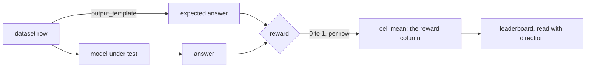

# Rewards

A reward scores one answer, from 0 to 1. It is the number a run is about: the
`reward` column of every cell, and the first thing a leaderboard ranks on.
Pick the wrong reward and every number after it measures the wrong thing, so
this page takes its time.

`configs/rewards.yaml` gives each reward a **name**. Behind the name sit a
catalog reward (`type`), its settings (`config`) and which way is better
(`direction`). A dataset names the reward that scores it with `reward:`, and a
dataset cannot run without one.



## The entry

```yaml
rewards:
  exact-match:                       # the name a dataset's `reward:` uses
    type: exact_match                # required: a catalog reward, see below
    direction: max                   # max (higher is better, the default) or min
    description: One when the answer is exactly the reference, zero otherwise.
    tags: [strict]
  judge:
    type: lm_as_judge
    description: A grader model scores correctness against the reference.
    tags: [judge]
    config:                          # the type's settings, and only those
      language_model: gpt-4o-mini    # a models.yaml name, never a litellm id
      instructions: |
        Score 1.0 when the answer is correct and complete, 0.0 when it is wrong.
```

| field | values | default | effect |
|---|---|---|---|
| `type` | a catalog reward, below | required | what computes the score |
| `direction` | `max`, `min` | `max` | which way is better on leaderboards and the Pareto frontier |
| `config` | the type's settings | `{}` | handed to the reward; models are resolved by name first |
| `description` | text | none | shown by `openarena rewards list` |
| `tags` | a list of labels | `[]` | for browsing; lower-cased and de-duplicated |

`config` takes the type's settings and nothing else. `name` and `direction`
may not appear in it: `type:` and `direction:` sit beside `config:`. Every
model setting (`language_model`, `smart_language_model`, `sub_language_model`,
`panel_language_models`, `embedding_model`) is a key of
[models.yaml](models.md), and of the right type: an `llm` model for a judge, an
`embedding` model for `embedding_model`.

The same entry can score many datasets. Give a reward a name that says what it
measures (`math-exact`, `support-judge`), not which dataset uses it.

## Deterministic or judged

There are two families, and the choice between them matters more than any
setting.

**Deterministic** rewards compare the answer with the expected answer by a
rule: equality, token overlap, embedding distance, set recall. **Judged**
rewards ask a language model to read the answer and grade it.

| | deterministic | judged |
|---|---|---|
| expected answer | required | optional; used as a reference when present |
| cost per row | nothing (embeddings: two embedding calls) | one model call or more, counted as `reward_cost` |
| same answer, same score | always | only as stable as the judge model |
| what it can grade | short, checkable answers | free text, style, reasoning, faithfulness |
| bias | none beyond the rule | the judge's own preferences: length, wording, its own family's style |
| failure mode | marks a right answer wrong for its form | marks a wrong answer right because it sounds sure |

**Use a deterministic reward whenever the answer can be checked by rule.** A
number, the letter of a multiple choice, a label, a list of retrieved
passages, a function call: compare them. It is free, instant, reproducible,
and nobody can argue with it. The work is in the dataset: make the
`output_template` render a short, normalized expected answer, and ask the
model for the same shape ([Templates](datasets.md#templates-from-a-row-to-json)).

**Use a judge when no rule can tell right from wrong**: a summary, an
explanation, an email, an answer that is right in many wordings. Then spend
time on the judge: its model, its instructions, and a check that its scores
agree with yours ([Choosing and calibrating a judge](#choosing-and-calibrating-a-judge)).

!!! tip "Read the answers before you pick"
    Run the dataset with `limit: 5` and any reward, then read the answers in
    the result. If a correct answer would fail `exact_match` only because of
    its form, fix the templates first. Reach for a judge when the form cannot
    be fixed.

## What a reward compares

The model's answer is a JSON object, and so is the expected answer the
dataset's `output_template` renders. Before scoring, the engine picks the
fields each reward sees:

- **A deterministic reward** sees only the top-level fields the
  `output_template` renders, and compares each one's value whole: a field
  that holds an object or a list of objects (a nested answer, a list of tool
  calls) is compared with everything inside it. Whatever else the program
  returns (the question, when the program returns its inputs; a chain of
  thought's `thinking`; an agent's `messages`) is left out, so it never costs
  a point.
- **A judge** sees every field the program returns, since judging them is its
  job. Two exceptions: on an [MCP agent](mcp-tools.md) dataset the agent's
  `messages` transcript is left out, and on a [Harbor](harbor-tasks.md)
  dataset only the agent's `answer` is read.

Setting any mask yourself (below) turns this automatic choice off: the reward
then sees what your mask keeps, applied as written.

A judge reads the expected answer beside the answer, with the expected
answer's fields prefixed `gold_`. It does **not** read the question unless the
program returns it: set `return_inputs: true` in the dataset's `generator:`
block when the judge needs the question to grade (relevancy, instruction
following).

```yaml
datasets:
  support-replies:
    # ...
    generator:
      return_inputs: true            # the answer carries the question, so the judge reads it
    reward: support-judge
```

### Masks

Every type takes four optional settings that choose the fields by hand. The
automatic choice above fits most datasets; reach for a mask when a field the
`output_template` renders should not count, or when a judge should not see a
field.

| field | values | default | effect |
|---|---|---|---|
| `in_mask` | a list of field names | none | keep only these fields |
| `out_mask` | a list of field names | none | drop these fields |
| `in_mask_pattern` | a regex | none | keep the fields whose name matches; combined with `in_mask`, either keeps a field |
| `out_mask_pattern` | a regex | none | drop the fields whose name matches |

Masks apply to both sides, the answer and the expected answer, and at every
level of nesting: `in_mask: [answer]` on `{"answer": {"value": 1}}` keeps
`{"answer": {}}`.

!!! warning "Masks and nested values"
    Because masks reach into nested objects, keeping a field whose value is an
    object or a list of objects empties it, and every answer then scores the
    same. The automatic choice does not have this problem: it keeps whole
    values. To leave a field out, prefer `out_mask` over an `in_mask` naming
    the others.

## Deterministic rewards

All of them need the expected answer, so the dataset needs an
`output_template`. None calls a language model.

| type | settings | scores | fits |
|---|---|---|---|
| `exact_match` | masks | 1 when the answer equals the expected answer, else 0 | numbers, letters, labels |
| `answer_accuracy` | masks | each field compared by its type, averaged, with partial credit | structured answers, several fields |
| `cosine_similarity` | `embedding_model`, masks | embedding similarity, 0 to 1 | short free text with a reference |
| `retrieval_recall` | masks | the share of gold passages retrieved | [retrieval datasets](datasets.md#retrieval) |
| `tool_calls_accuracy` | masks | the right functions with the right arguments | [tool-call datasets](datasets.md#tool-calls) |
| `harbor_verifier` | `key`, masks | what a Harbor task's own tests wrote | [Harbor tasks](harbor-tasks.md) |

### exact_match

One when the answer's fields equal the expected answer's, zero otherwise. It
is plain equality of the JSON values: `"42"` and `42` differ, `"Paris"` and
`"paris"` differ, a trailing space differs.

```yaml
rewards:
  exact-match:
    type: exact_match
    description: One when the answer is exactly the reference.
```

**When**: the answer is one value with one correct spelling: a multiple-choice
letter, a final number, a class label, `true` or `false`. Make the template
and the instructions agree on the form (`"B"`, not `"B) Paris"`).

**Not when**: the answer has several fields and you want partial credit (use
`answer_accuracy`), or it is a sentence (use a judge, or `cosine_similarity`).

### answer_accuracy

Scores each field of the expected answer on its own, with the comparison its
value calls for, then averages the fields:

| expected value | comparison | partial credit |
|---|---|---|
| `true` / `false` | binary accuracy | no |
| a number | equality | no |
| text, a list, an object | token overlap: shared tokens over all tokens | yes |

A one-word text scores like an exact match; a longer text or a list of labels
scores the share of tokens in common. A correct negative (`false` expected,
`false` given) scores 1. A field missing from the answer scores 0.

```yaml
rewards:
  graded:
    type: answer_accuracy
    description: Each field compared by its type, averaged.
```

The comparison is chosen from the **expected value**, not from the dataset's
schema. A number rendered as text (`{{ answer | string | tojson }}`) is
compared as text, by tokens. Render it as a number (`{{ answer | tojson }}`)
when it should be compared as one.

**When**: an answer with several fields (a verdict and a label, an extraction
with five slots), where four right out of five should beat none. It also makes
a good extra column beside `exact_match`: the gap between the two shows how
many answers were nearly right.

### cosine_similarity

Embeds each field of the answer and of the expected answer, and scores how
close they are. Several fields are averaged.

```yaml
rewards:
  similar:
    type: cosine_similarity
    description: Embedding similarity to the reference answer.
    config:
      embedding_model: minilm        # a models.yaml key of `type: embedding`
```

| field | values | default | effect |
|---|---|---|---|
| `embedding_model` | a `type: embedding` model name | the evaluation's `default_embedding_model` | the model that embeds both sides |

The score is the cosine rescaled to 0 to 1, `(cos + 1) / 2`. Two unrelated
texts land near 0.5, not near 0, and answers on the same topic crowd together
near the top. Read it as a ranking between models, not as a share correct.

**When**: short free-text answers with a reference, where the wording varies
and a judge's cost or variance is not worth it (definitions, short factual
sentences). **Not when**: correctness hinges on a detail. "The meeting is on
Monday" and "The meeting is not on Monday" embed close together.

!!! note
    Every row embeds both sides; the cost is counted as `embedding_cost`.
    Another embedding model gives other scores, so keep it fixed across the
    runs you compare.

### retrieval_recall

The reward of a [retrieval dataset](datasets.md#retrieval): of the gold
passages, the share the embedding model ranked in its top `k`. Passages are
compared as text, trimmed. Every list field of the expected answer is scored
this way and the fields averaged; with one `chunks` list, that is recall at
`k`.

```yaml
rewards:
  recall:
    type: retrieval_recall
    description: Share of the gold passages among the top k retrieved.
```

The score depends on the dataset's `k` as much as on the model: with `k` as
large as the number of chunks, every model scores 1. Compare embedding models
at the same `k`, and pick a `k` close to what your application hands a model.

### tool_calls_accuracy

The reward of a [tool-call dataset](datasets.md#tool-calls). Each gold call is
matched with one call of the answer that has the same function name and the
same arguments (as JSON, key order aside). The score is the matched calls over
the longer of the two lists, so a missed call, an extra call and a wrong
argument all cost. Both lists empty scores 1: the model rightly called
nothing.

```yaml
rewards:
  tool-calls:
    type: tool_calls_accuracy
    description: The right functions called with the right arguments.
```

Arguments must match exactly: `{"city": "Paris"}` and `{"city": "paris"}`
differ, and so do `{"limit": 10}` and `{"limit": "10"}`. Write the gold calls
in the form the function declaration asks for. Each gold call is
`{"name": ..., "arguments": {...}}`; the wire shape the model answers in,
`{"id", "type", "function": {"name", "arguments"}}` with the arguments a
JSON string, is read the same way, so a benchmark's gold column goes in as
published.

It needs no mask: the automatic field choice keeps the `tool_calls` field
whole, and a call's `id`, which differs from run to run, is never compared.

### harbor_verifier

The reward of a [Harbor task folder](harbor-tasks.md) dataset. After the agent
works, Harbor runs the task's own `tests/`, which write
`/logs/verifier/reward.txt` (one number) or `reward.json` (named numbers).
This reward reads that score; it needs no expected answer.

```yaml
rewards:
  harbor-tests:
    type: harbor_verifier
    description: The score the task's own tests gave.
```

| field | values | default | effect |
|---|---|---|---|
| `key` | a name in `reward.json` | `reward` | which number to read; `reward.txt` is read as `reward` |

A trial whose tests wrote nothing scores 0. A value that is not a number
scores 0, and one outside 0 to 1 is clamped into it; both log a warning
asking you to fix the task's `tests/test.sh`. Set `key` when the tests write
several numbers (`{"reward": 0.5, "tests_passed": 0.8}`) and you want one
other than `reward`.

## Judged rewards

A judge is a language model that reads the answer, and the expected answer
when the dataset has one, then writes a critique and a grade. The grade is
normalized to 0 to 1.

| type | judge | grade | calls per row |
|---|---|---|---|
| `lm_as_judge` | one model | one score, 0 to 1 in steps of 0.05 | 1 |
| `rubrics_as_judge` | one model | one score per criterion, 1 to 20, weighted mean | 1 |
| ready-made rubrics | as `rubrics_as_judge`, criteria built in | as `rubrics_as_judge` | 1 |
| `multi_judge_panel` | several models, a stronger one on disagreement | the panel's or the arbiter's | one per panelist, plus 1 on disagreement |
| `rlm_as_judge` | a model writing and running Python | any value from 1 to 20 | up to `max_iterations` turns, plus sub-model calls |
| `deep_agent_as_judge` | a coding agent with files and a shell | 1 to 20 | up to `max_iterations` turns |

Every judge's model needs its provider key, like any model
([Providers and keys](models.md#keys-and-base-urls)). Its calls are counted
apart from the model under test's, as `reward_cost`.

Every judge takes, besides the masks:

| field | values | default | effect |
|---|---|---|---|
| `language_model` | an `llm` model name | the evaluation's `default_language_model` | the judge (`multi_judge_panel` names its models otherwise) |
| `decision_model` | a `decision` model name | none | rubric judges only: grade with a decision model instead of the language model ([below](#grading-with-a-decision-model)) |
| `instructions` | text | the type's own | what the judge is asked to do; replaces the default |
| `reduction` | `mean`, `sum`, `min`, `max`, `none` | `mean` | how several values from one call combine; a judge returns one, so leave it |

!!! warning "Always name the judge"
    Without `language_model`, a judge uses the evaluation's
    `default_language_model`, so the same reward means something else in
    another evaluation. Name the judge in the reward.

The scale and the prompt layout belong to the engine: a config cannot change
them. You control the judge model and the instructions.

### lm_as_judge

One call per row. The judge critiques the answer, then picks a score from 0.0
to 1.0 in steps of 0.05.

```yaml
rewards:
  support-judge:
    type: lm_as_judge
    description: Correct, complete and polite, against the reference reply.
    tags: [judge]
    config:
      language_model: judge-4o       # the judge's own models.yaml entry
      instructions: |
        You grade a support reply against a reference reply (the gold_ fields).
        Score 1.0 when it solves the customer's problem as the reference does
        and is polite. Score 0.5 when it is correct but misses a step.
        Score 0.0 when it is wrong, invents a policy, or refuses.
        Length and tone beyond politeness do not count.
```

**Writing instructions.** Without them the judge grades on its own idea of
quality. Say what full marks, half marks and zero look like, with the concrete
faults that cost points. Say what does not count (length, format): judges
otherwise favour long, confident answers. Mention the `gold_` fields when
there is a reference, so the judge grades against it rather than against its
own knowledge.

**When**: free text with one notion of good: correctness against a reference,
helpfulness, a style rule. To know *which* aspect failed, use rubrics.

### rubrics_as_judge

The judge scores each criterion on its own, from 1 to 20, and the reward is
the weighted mean of the criteria, normalized to 0 to 1. One call per row,
however many criteria.

```yaml
rewards:
  math-rubrics:
    type: rubrics_as_judge
    description: Correct result, shown work, stated unit.
    config:
      language_model: judge-4o
      rubrics:
        - The final answer is correct              # a bare string: the name is derived from it
        - name: shows_steps
          description: Each step of the computation is written out.
        - name: units
          description: The answer states its unit.
          weight: 0.5                              # counts half as much as the others
```

| field | values | default | effect |
|---|---|---|---|
| `rubrics` | a list of criteria, or a preset name | required | what is graded |
| `rubrics[].name` | text, turned into snake_case | derived from the description | the criterion's name; unique |
| `rubrics[].description` | text | required | what the judge checks |
| `rubrics[].weight` | a number above 0 | `1.0` | the criterion's share of the mean |
| `instructions` | text | grade each criterion independently, then critique | the judge's task |
| `decision_model` | a `decision` model name | none | grade each criterion with a decision model ([below](#grading-with-a-decision-model)) |

A criterion is a bare string (its name derived from it) or a mapping with
`name`, `description` and `weight`. `rubrics` can also name a preset from the
next section (`rubrics: faithfulness`).

**When**: the answer has several qualities you care about, and one number
would hide which one a model lacks. Write each criterion as one checkable
statement; "is good" grades nothing. Two to five criteria work better than
fifteen: each one dilutes the others in the mean.

!!! note
    The reward is still one number. To see a criterion apart in the results,
    give it its own reward as an [extra metric](#combining-rewards).

### Ready-made rubric judges

Rubric judges with their criteria built in, for common checks. Each takes
`language_model`, `decision_model`, `instructions`, `reduction` and the masks;
none takes `rubrics`.

```yaml
rewards:
  faithful:
    type: faithfulness
    description: The answer does not contradict the retrieved context.
    config:
      language_model: judge-4o
```

| task | types |
|---|---|
| answers and RAG | `answer_relevancy`, `faithfulness`, `hallucination`, `citation_faithfulness`, `contextual_precision`, `contextual_recall`, `contextual_relevancy`, `summarization` |
| agents and tools | `task_completion`, `goal_accuracy`, `plan_quality`, `plan_adherence`, `step_efficiency`, `tool_correctness`, `tool_use`, `tool_permission`, `argument_correctness`, `agent_loop_detection` |
| conversations | `topic_adherence`, `role_adherence`, `role_violation`, `prompt_alignment`, `knowledge_retention`, `conversation_completeness`, `turn_faithfulness`, `turn_relevancy` |
| safety | `bias`, `toxicity`, `pii_leakage`, `misuse`, `non_advice` |

They grade what the judge can see. `faithfulness` needs the context in the
answer or in the reference. Agent checks such as `step_efficiency` need the
agent's steps, which an MCP agent dataset hides from rewards by default: set a
mask that keeps them (`out_mask: [thinking]` turns the default off and leaves
`messages` in).

!!! warning "Check which way a preset scores"
    Each preset is one criterion written as a task ("indicate whether each
    opinion is toxic"). Whether a high score means *clean* or *toxic* is left
    to the judge's reading. Run five rows whose answer you know, read the
    scores, then set `direction`. When in doubt, use `rubrics_as_judge` with a
    criterion that says which way is good ("The answer contains no insult").

### Grading with a decision model

`rubrics_as_judge` and the ready-made rubric judges can grade with a
`decision` model ([Models](models.md#a-decision-model-as-the-grader)) instead
of a language model. Each criterion is then asked as one question with five
ordered levels, from "does not meet the criterion at all" to "meets it
fully", and the criterion's score is the probability-weighted level,
normalized to 0 to 1. The reward is the weighted mean of the criteria, as
with a language judge.

```yaml
rewards:
  faithful-fast:
    type: faithfulness
    description: Grounded in the context, graded by a decision model.
    config:
      decision_model: jev            # a models.yaml name of `type: decision`
  math-rubrics-fast:
    type: rubrics_as_judge
    config:
      decision_model: jev
      rubrics:
        - The final answer is correct
        - name: units
          description: The answer states its unit.
```

| | with `language_model` | with `decision_model` |
|---|---|---|
| each criterion | graded 1 to 20, with a written critique | graded on five levels, with a probability per level |
| the trace shows | the critique | each criterion's level |
| cost per row | one generation | one short call, a fraction of the price |
| run to run | steady at `temperature: 0`, as far as the provider allows | steady: the probabilities are calibrated |

**When**: many rows, a tight budget, or scores that must not drift between
runs. **When not**: you need the judge's reasoning in the trace, or a
free-form grade (`lm_as_judge` and the agent judges take no
`decision_model`). With both models named, the decision model grades;
`instructions` and the masks apply either way.

### multi_judge_panel

Several judges grade each row in parallel, with the same instructions. When
their scores lie within `agreement_threshold` of each other, the panelist
closest to the panel's mean gives the score. When they disagree, a stronger
model judges the row alone, and its score is the reward.

```yaml
rewards:
  panel:
    type: multi_judge_panel
    description: Two small judges, a large one on disagreement.
    config:
      panel_language_models: [qwen38, gpt-4o-mini]   # from different families
      smart_language_model: gpt-4o                   # required
      agreement_threshold: 0.2
      instructions: |
        Score 1.0 when the answer matches the reference (the gold_ fields), 0.0 when not.
```

| field | values | default | effect |
|---|---|---|---|
| `panel_language_models` | a non-empty list of `llm` model names | required | the panelists |
| `smart_language_model` | an `llm` model name | required | the arbiter on disagreement, and the fallback when every panelist fails |
| `agreement_threshold` | a number, 0 to 1 | `0.2` | the widest spread (highest score minus lowest) still read as agreement |
| `instructions` | text | the judge's own | given to every panelist and to the arbiter |

Panelists grade 0 to 1 in steps of 0.05. A panelist that returns no score is
dropped.

**When**: you want a strong judge's quality at a fraction of its cost, and
most rows are easy. Easy rows cost the small panel; hard ones add one call of
the arbiter. A lower `agreement_threshold` sends more rows to the arbiter
(dearer, closer to the strong judge alone); a higher one trusts the panel more
(cheaper, noisier). Panelists from different families also dilute any one
family's bias.

Both are required. `openarena check` reports a panel left empty
(``multi_judge_panel needs `panel_language_models`: at least one judge``) and a
missing arbiter (``multi_judge_panel needs `smart_language_model`: the judge
that settles a split panel``).

### rlm_as_judge and deep_agent_as_judge

Judges that work before they grade, for answers whose correctness cannot be
read off the text: code to run, a long output to diff, a figure to recompute.

- `rlm_as_judge` writes and runs Python in a sandbox, with the answer and the
  reference bound as data. It can compute its grade (a pass rate, a
  field-by-field ratio), so any value on its scale is allowed, and it can hand
  pieces of a long answer to a sub-model.
- `deep_agent_as_judge` is a coding agent in a sandbox, with file tools and a
  shell. The answer and the reference are written to a file there, so it can
  run a generated script before grading. Each row starts from a clean
  sandbox.

```yaml
rewards:
  code-judge:
    type: rlm_as_judge
    description: Runs the generated code and compares its output with the reference.
    config:
      language_model: judge-4o
      max_iterations: 10
      timeout: 60
      instructions: |
        Run the code in the answer. Score 1.0 when its output equals the
        reference output (the gold_ fields), 0.0 when it fails or differs.
```

| field | `rlm_as_judge` default | `deep_agent_as_judge` default | effect |
|---|---|---|---|
| `language_model` | the evaluation's default | the evaluation's default | the judge |
| `sub_language_model` | `language_model` | `language_model` | the model for sub-queries (rlm) or sub-agents (deep) |
| `max_iterations` | `20` | `10` | turns before the judge must grade |
| `timeout` | `60` | `30.0` | seconds per code turn (rlm) or per shell command (deep) |
| `use_chain_of_thought` | `false` | `false` | think step by step before each turn |
| `instructions` | the type's own | the type's own | the judging task |

Both grade on 1 to 20, normalized. They are the slowest and dearest rewards:
each row is a small agent run. Lower `max_iterations` to bound the cost, and
keep them for rows a single read cannot decide.

`agent_as_judge` is in the catalog too, but it needs tools to call, and a
config entry cannot give it any. `openarena check` refuses it
(``agent_as_judge cannot be built from an entry: it needs `tools`, which an
entry cannot give``) and points to the alternatives: `rlm_as_judge` or
`deep_agent_as_judge`, which need no tools, or a judge such as `lm_as_judge`
over the agent's `messages`.

## Choosing and calibrating a judge

### The judge model

A judge should be at least as capable as the models it grades, on the task it
grades. A small judge grading a large model's math marks right answers wrong.
Give the judge its own entry in [models.yaml](models.md), so it is never
confused with a model under test:

```yaml
models:
  judge-4o:
    model: openai/gpt-4o
    params:
      temperature: 0                 # the same answer gets the same grade, as far as the provider allows
    description: The judge. Never under test.
    tags: [judge]
```

Give the judge entry `temperature: 0`. A judge's `params` (`temperature`,
`max_tokens`, `reasoning_effort`) are sent with each of its calls, as a model
under test's are ([Where the params apply](models.md#where-the-params-apply)).
At 0 it grades steadily from row to row and from run to run; a sampling judge
adds its own noise to every score. Even at 0, hosted providers do not promise
identical answers, so expect a small spread between reruns.

Keep the judge fixed across every run you compare: scores from two judges are
not on the same scale. The evaluation's `seed` does not make a judge
reproducible; it seeds local randomness, not the provider's sampling.
`temperature: 0` is what steadies the judge.

### Self-preference

A model judging its own answers, or answers from its own family, tends to
score them higher. Nothing stops you from naming the same model as judge and
as candidate, so guard against it yourself:

- Never put the judge in the evaluation's `language_models`.
- Prefer a judge from another provider than the candidates. When the
  candidates span several providers, a `multi_judge_panel` mixing families
  spreads the bias instead of favouring one side.
- When your own model family is under test, do not let that family judge.

### Calibrating

A judge is an instrument: check it before trusting its readings.

1. Take 20 to 30 rows and grade the answers yourself.
2. Run the judge on the same answers.
3. Compare. Where you disagree, read the judge's critique and tighten the
   instructions: name the fault it missed, or say what should not count.
4. Repeat until it agrees with you on nearly every row, then freeze the model
   and the instructions.

Then run the judge twice on the same answers: the spread between the two runs
is the smallest gap between models you can believe.

## Combining rewards

A dataset has one `reward`: it fills the `reward` column, and leaderboards
rank on it first. Any other reward can score the same rows as an extra column,
under a dataset's or an evaluation's `metrics:`
([Extra metrics](datasets.md#extra-metrics)). There, a catalog reward is named
with `class:`, its settings written inline, an `alias` naming the column, and
its own `direction`. A metric written without `direction:` is read as `max`,
except a cost, tokens or latency measurement, read as `min`; write
`direction:` to say otherwise, as `toxicity` does below.

```yaml
datasets:
  gsm8k-20:
    # ...
    reward: exact-match                              # the primary score
    metrics:
      - answer_accuracy                              # partial credit beside it
      - {class: lm_as_judge, alias: reasoning, language_model: judge-4o, instructions: "Score 1.0 when every step is correct."}
      - {class: toxicity, alias: toxicity, language_model: judge-4o, direction: min}
```

A [leaderboard](leaderboards.md) then weighs the columns with `shares:`
(`{reward: 60, reasoning: 30, cost: 10}`) and can leave a model out with
`budgets:`.

| goal | primary `reward` | extra metrics |
|---|---|---|
| a strict score, and how close the misses were | `exact_match` | `answer_accuracy` |
| correctness with a safety gate | a judge or `exact_match` | `toxicity`, `pii_leakage`, used as budgets |
| several criteria reported apart | `rubrics_as_judge` for the whole | one judge per criterion |
| a cheap rule, checked by a judge | `exact_match` | `lm_as_judge`, to spot where the rule is too strict |

Make the primary reward the one you would defend alone. The extra metrics
explain it; they should not be needed to read it.

## Direction

`direction: min` is for a reward where lower is better: a score read as "how
much" of something bad. The run records the direction, and leaderboards and
the Pareto frontier read it: you never invert a score yourself. Every reward
above scores "how good" by design; only the safety and hallucination presets
may read the other way (see their warning).

## Which reward for which dataset

| dataset or task | reward | why |
|---|---|---|
| multiple choice (MMLU style) | `exact_match` on the letter | one correct token |
| math with a final number (GSM8K style) | `exact_match` on the number, `answer_accuracy` beside it | the number decides |
| classification, extraction into fields | `answer_accuracy` | partial credit per field |
| short factual answer, varied wording | `lm_as_judge` with the reference; `cosine_similarity` if cost matters | a rule cannot see synonyms |
| summaries, emails, open answers | `rubrics_as_judge` | several qualities in one score |
| RAG answers | `faithfulness`, `answer_relevancy`, or your own rubrics | grounding is not in the reference |
| retrieval with embedding models | `retrieval_recall` | the gold passages are known |
| function calling, nothing executed | `tool_calls_accuracy` | calls can be checked |
| MCP agents | `exact_match` or a judge on the final answer; agent presets as extra metrics | the answer and the path are scored apart |
| A2A agents | as for the task the agent answers | the reward reads the answer, whoever gave it |
| Harbor task folders | `harbor_verifier` | the task's tests decide |
| code that must run | `rlm_as_judge`, `deep_agent_as_judge`, or a Harbor task | the text alone cannot tell |

## Common mistakes

[`openarena check`](check.md) reads the files, without calling anything, and
reports:

| mistake | what it says |
|---|---|
| a misspelt type | ``unknown reward 'exact_matsh'``, with the closest name as the fix |
| a setting the type does not take | ``lm_as_judge does not take `language_modl` ``, with the rename |
| `name` or `direction` inside `config` | ``config cannot set direction: use `type` and `direction` `` |
| a litellm id instead of a model name | ``'openai/gpt-4o-mini' is not in `models` ``; the fix names the entry that calls it |
| an embedding model as a judge, or the reverse | `'minilm' is an embedding model; this setting needs a language model` |
| a dataset naming a reward that does not exist | the dataset's `reward` is not in `rewards`, with the closest name |
| `rubrics_as_judge` without `rubrics` | ``rubrics_as_judge needs `rubrics`: the criteria it grades``, with an example list as the fix |
| `multi_judge_panel` without its panel or its arbiter | ``multi_judge_panel needs `panel_language_models`: at least one judge``, ``multi_judge_panel needs `smart_language_model`: the judge that settles a split panel`` |
| `reduction` on a deterministic reward | ``exact_match does not take `reduction` ``; only judges take it |
| a judge's setting beside `type:` instead of under `config:` (`reduction: mean`) | `` not a field of a `rewards` entry ``, with the fix ``move it under `config:` `` |
| `agent_as_judge` | ``agent_as_judge cannot be built from an entry: it needs `tools`, which an entry cannot give``, with the alternatives |

What only the run finds:

- a dataset with no `reward`: the run refuses it.
- a judge whose provider key is missing: the cell fails
  ([Reading results](results.md#when-a-cell-failed-or-scored-0)).
- every row scoring 0 with `exact_match`: compare an answer with its expected
  answer in the result. The form differs: a string against a number, extra
  words, another case.

## Commands

```shell
openarena rewards list --configs configs       # each reward, its type and direction
openarena check configs/rewards.yaml           # validate, references checked against the folder
```

Next: point a dataset at the reward ([Datasets](datasets.md)), run it
([Running evaluations](evaluations.md)), then rank
([Leaderboards](leaderboards.md)).
