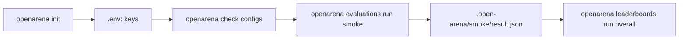

# Quickstart

**openarena** compares language models, and agents, on datasets. It runs every
model you name on every dataset you name, scores each answer with a reward,
and ranks the models on leaderboards. Everything is declared in YAML files and
run from one command, `openarena`, on your own machine. No server and no web
app: files in, files out.

This page takes you from nothing to a first ranking. You will:

1. install the `openarena` command,
2. create a workspace, a folder that already holds a working setup,
3. give it a model it can reach (a local one, or a hosted one and its key),
4. check the configs, run an evaluation, and rank the result.

Each step says what it does and why, so that when something differs on your
machine you know where to look. The guides go deeper on every file.



!!! info "Working with a coding agent?"
    `openarena init` also writes an `AGENTS.md` guide and one Agent Skill per
    task into the workspace. Start Claude Code, Codex, Cursor or another coding
    agent in the folder and ask in plain words ("add Mistral Small and compare
    it on GSM8K"). See [With a coding agent](coding-agents.md). Reading this
    page first still helps you check what it does.

## 1. Install

openarena is a Python package (Python 3.12 or newer), developed in
[open-arena](https://github.com/Atena-IT/open-arena). It installs one command,
`openarena`. The simplest way to get it is [uv](https://docs.astral.sh/uv/).

=== "As a tool"

    ```shell
    uv tool install "git+https://github.com/Atena-IT/open-arena"
    openarena --help
    ```

    `openarena` is then on your `PATH` in any folder. Pick this when you want
    to **use** openarena and keep your workspace wherever you like.

=== "From a clone"

    ```shell
    git clone https://github.com/Atena-IT/open-arena
    cd open-arena
    uv sync
    uv run openarena --help
    ```

    Pick this when you want to **change** openarena, or follow its main branch
    closely. The command lives in the clone's `.venv`: prefix every command on
    this site with `uv run --project <path-to-open-arena>` (which keeps the
    folder you are in), or activate the environment once with
    `source .venv/bin/activate` and type `openarena` anywhere.

!!! note "Datasets kept on a platform"
    Reading rows from Hugging Face or from local files needs nothing more.
    Reading them from an observability platform (Langfuse, LangSmith, Opik,
    Phoenix, Braintrust, Unity Catalog) needs that platform's SDK, shipped as
    an extra of the package: `openarena[langfuse]`, ..., or `openarena[all]`
    for every one. The clone's `uv sync` installs them all. You need none of
    them for this page. See [Datasets](guides/datasets.md).

## 2. Create a workspace

```shell
openarena init my-arena
cd my-arena
```

A workspace is a plain folder. `init` fills it with a setup that runs as it
is, so your first run tests your machine, not your YAML:

| What | What it is for |
|---|---|
| `configs/` | The registries, one YAML file each: `models`, `rewards`, `datasets`, `mcp_servers`, `a2a_agents`, `environments`, `evaluations`, `leaderboards`. Every file explains its own fields in comments. |
| `tasks/hello-world/` | A Harbor task folder, for evaluating agents in a sandbox (not used on this page). |
| `environments/python/` | The build context of the `python` sandbox environment (not used on this page). |
| `.env.template` | Every key and endpoint a run can read, commented out, each with a line on when you need it. |
| `.gitignore` | Keeps `.env` (your keys) and `.open-arena/` (your runs) out of git. |
| `AGENTS.md`, `CLAUDE.md`, `.agents/skills/` | The guide and skills a coding agent reads. |
| `README.md` | A short version of this page. |

The output ends with the next steps it expects you to take; they are the rest
of this page.

`init` writes into the current folder when you give no name
(`openarena init`). It refuses to overwrite any file already there, and then
writes nothing at all; `--force` overwrites. See
[The workspace](workspace.md) for every file and how registries refer to
each other.

!!! warning "Run every command from the workspace root"
    `openarena` looks for `./configs`, reads the `.env` beside it, and keeps
    runs in `./.open-arena`, all relative to where you stand. Run it from
    somewhere else and it stops with
    `no configs folder at configs; write one with openarena init`. The
    commands take `--configs DIR` (and the run commands `--state-dir DIR`)
    when you need another layout; see the [CLI reference](cli.md).

## 3. Give it a model

The example evaluation, `smoke`, is a deliberately small sweep: one model
answers 20 grade-school math questions from GSM8K, and an exact-match reward
checks each answer. Before it can run, the model it names must be reachable.

Models are declared in `configs/models.yaml`. Each entry has a **name**, which
everything else in the workspace uses, and the **id** it calls, in litellm's
`<provider>/<model>` form. The prefix picks the provider, and the provider
decides what you need: a local server, or an API key.

```yaml
models:
  qwen38:
    model: ollama/qwen3.8:27b-mlx     # a local Ollama, no API key needed
    type: llm
    description: Qwen 3.8 27B (MLX) served by a local Ollama, no API key needed.
    params:
      temperature: 0
    tags: [local]
  gpt-4o-mini:
    model: openai/gpt-4o-mini          # needs OPENAI_API_KEY
    description: OpenAI's small model, the hosted baseline.
    params:
      temperature: 0
    tags: [openai, hosted]
```

`params` is passed with every call. `temperature: 0` makes answers as
repeatable as the provider allows, which is what you want when comparing
models. [Models](guides/models.md) covers every field.

Choose one of these setups.

=== "Local model (Ollama)"

    `smoke` uses `qwen38` out of the box. Install [Ollama](https://ollama.com),
    then pull the model:

    ```shell
    ollama pull qwen3.8:27b-mlx
    ```

    No key is needed. `ollama/...` ids reach Ollama at its default address;
    if yours runs elsewhere, set `OLLAMA_API_BASE` in `.env` (step 4).

    **When to pick it:** you want a first run that costs nothing and sends no
    data off your machine. **Trade-off:** a 27B model is slow without a strong
    GPU. Any model you have already pulled works: change the `model:` id of
    `qwen38` to it (for example `ollama/llama3.2`), or add your own entry and
    name it in `smoke`.

=== "Hosted model (OpenAI)"

    `gpt-4o-mini` is already declared. Put your key in `.env` (step 4), then
    point `smoke` at it in `configs/evaluations.yaml`:

    ```yaml
    evaluations:
      smoke:
        description: A first run on the hosted baseline.
        language_models: [gpt-4o-mini]
        datasets: [gsm8k-20]
        batch_size: 4
    ```

    **When to pick it:** you have no GPU, or you want the fastest first run.
    **Trade-off:** each run costs a little, and the questions go to the
    provider.

=== "Both, side by side"

    A comparison needs at least two models. With Ollama running and
    `OPENAI_API_KEY` set, list both:

    ```yaml
    evaluations:
      smoke:
        language_models: [qwen38, gpt-4o-mini]
        datasets: [gsm8k-20]
        batch_size: 4
    ```

    Each model × dataset pair runs as its own cell, so one model failing
    does not stop the other.

=== "Another provider"

    Add an entry with that provider's prefix, then name it in `smoke`:

    ```yaml
    models:
      my-claude:
        model: anthropic/<model-id>    # the provider's own id; needs ANTHROPIC_API_KEY
        params:
          temperature: 0
    ```

    `.env.template` lists the keys of the common providers (`OPENAI_API_KEY`,
    `ANTHROPIC_API_KEY`, `GEMINI_API_KEY`, `MISTRAL_API_KEY`, `GROQ_API_KEY`,
    `OPENROUTER_API_KEY`) and the endpoint of a vLLM server
    (`HOSTED_VLLM_API_BASE`, with its `/v1` suffix). See
    [Models](guides/models.md) for providers and their settings.

!!! tip "Names, not ids"
    An evaluation lists models by their **name** in `models.yaml`
    (`gpt-4o-mini`, `qwen38`), never by the id they call. Two entries calling
    the same id with different `params` are two models, and rank separately.

## 4. Set your keys

```shell
cp .env.template .env
```

Then uncomment and fill in only what your models need, for example
`OPENAI_API_KEY=sk-...`. Nothing else is needed for this page.

`openarena evaluations run` loads `.env` from the workspace before anything
reads the environment. It **never overrides a variable already set** in your
shell: if you exported an old `OPENAI_API_KEY` earlier, that one wins. Unset
it, or fix it, rather than editing `.env` again.

`.env` stays out of git (`.gitignore` lists it). Keep keys there, never in
the YAML files, which you will want to commit and share. A field that must
carry a secret (an agent's `headers`, say) names the variable as `${NAME}`
and the run fills it in from the environment; see
[Secrets in configs](workspace.md#secrets-in-configs).

## 5. Check the configs

```shell
openarena check configs
```

`check` reads every registry file with the same strict schema the run uses,
then resolves the references between them: a dataset's reward, an
evaluation's models and datasets. It runs nothing and calls no model, so it
is instant. On the fresh workspace every file is clean:

```text
✓ configs/models.yaml: 2 models, no problems
✓ configs/rewards.yaml: 2 rewards, no problems
✓ configs/datasets.yaml: 3 datasets, no problems
...
✓ configs/evaluations.yaml: 2 evaluations, no problems
✓ configs/leaderboards.yaml: 2 leaderboards, no problems
```

Run it after every edit. A typo in a name is the most common mistake, and
`check` points at the line and suggests the fix:

```text
✗ configs/evaluations.yaml: 2 evaluations, 1 error

  error    line 15  evaluations.smoke.language_models[0]
           'gpt4o-mini' is not in `models`
     fix   change 'gpt4o-mini' to 'gpt-4o-mini'
```

It exits with status 1 on an error, so it also fits a CI step or a
pre-commit hook. Because it calls nothing, it cannot tell you that a key is
missing or a model is not pulled; the run shows that (step 6). See
[Checking configs](guides/check.md) for every kind of problem it reports.

## 6. Run the evaluation

```shell
openarena evaluations run smoke
```

What happens:

1. `.env` is loaded, as in step 4.
2. The evaluation `smoke` and the entries it names are gathered into one
   config and validated. A copy is written to `.open-arena/smoke/config.yaml`,
   so you can always see exactly what ran.
3. Every model in `language_models` runs on every dataset in `datasets`. Each
   model × dataset pair is a **cell**: the dataset's rows are rendered into
   questions, the model answers them `batch_size` rows at a time, and the
   dataset's reward scores each answer. A cell's `reward` is the mean over
   its rows.
4. A table is printed per dataset, a row per model and a column per metric,
   `reward` first. The result is saved to `.open-arena/smoke/result.json`.

```text
  qwen38 running…
  qwen38 done reward 0.8500
     gsm8k-20
┏━━━━━━━━┳━━━━━━━━┓
┃ model  ┃ reward ┃
┡━━━━━━━━╇━━━━━━━━┩
│ qwen38 │ 0.8500 │
└────────┴────────┘
```

Your numbers will differ. With the exact-match reward, `0.8500` means 17 of
the 20 answers were exactly the reference. The run also prints the engine's
own progress lines between these; `-v` adds a progress bar, `-vv` a line per
batch.

### What `smoke` is made of

You need not edit anything to run it, but knowing the three entries behind it
is what lets you change it. `smoke` in `evaluations.yaml` names the models and
the datasets:

```yaml
evaluations:
  smoke:
    description: A first run on the local model.
    language_models: [qwen38]          # `models` keys
    datasets: [gsm8k-20]               # `datasets` keys
    batch_size: 4
```

| Field | Value | Default | What it does |
|---|---|---|---|
| `language_models` | list of `models` names | required | The models compared. Each one runs on every dataset. |
| `datasets` | list of `datasets` names | required, at least one | The datasets every model runs on. |
| `batch_size` | integer, 1 or more | each dataset's own | Rows sent at once, for every dataset of the evaluation. Higher is faster, until the provider rate-limits you. `--batch-size N` overrides it for one run. |
| `description` | text | none | Shown by `openarena evaluations list`. |

The dataset `gsm8k-20` in `datasets.yaml` says where the rows come from, how
each row becomes a question and a reference answer, what answers it, and
which reward scores it:

```yaml
datasets:
  gsm8k-20:
    type: huggingface
    description: Grade-school math word problems, GSM8K test split, 20 rows.
    config:
      path: openai/gsm8k                # the Hugging Face dataset
      name: main
      split: test
      limit: 20                         # only the first 20 rows
      batch_size: 4
      # Jinja2 over the row's columns: what the model is asked
      input_template: '{"question": {{ question | tojson }}}'
      # the reference: the text after `####`, commas removed
      output_template: '{"answer": {{ answer.split(''####'')[-1] | replace('','', '''') | trim | tojson }}}'
      input_schema:
        type: object
        properties:
          question: {type: string, description: The question to answer}
        required: [question]
        additionalProperties: false
      output_schema:
        type: object
        properties:
          answer: {type: string, description: "The final numeric answer only, no units or commas"}
        required: [answer]
        additionalProperties: false
    generator:                          # one model call per row
      chain_of_thought: true
      instructions: Solve the problem. Reply with the final number only, no units, no commas.
    reward: exact-match                 # a `rewards` key
```

The parts that matter most:

- **`type` and the provider settings** (`path`, `name`, `split`, `limit`)
  say where the rows come from. `limit` keeps a first run short; remove it to
  run the whole split.
- **`input_template` / `output_template`** turn each raw row into the JSON
  the model receives and the JSON the reward compares against. Here the
  reference is cleaned so that exact match is fair: GSM8K stores the worked
  solution followed by `#### 72`, and only `72` is kept.
- **`input_schema` / `output_schema`** describe that JSON. The output schema
  is also what the model is asked to produce, so its `description` reads as
  an instruction: "the final numeric answer only".
- **`generator`** says a model answers each row in one call.
  `chain_of_thought: true` lets it reason before answering, which usually
  helps on math; `instructions` is said to it before every row.
- **`reward`** names the scorer, a key of `rewards.yaml`.

And the reward `exact-match` in `rewards.yaml`:

```yaml
rewards:
  exact-match:
    type: exact_match
    direction: max
    description: One when the answer is exactly the reference, zero otherwise.
```

`exact_match` is strict and free: no grader model, no cost, but `"72"` and
`"72 apples"` differ. It is the right choice for answers with one canonical
form (numbers, labels, ids). For free text, use a judge reward such as
`lm_as_judge`, which `rewards.yaml` shows commented out. See
[Rewards](guides/rewards.md) for the catalog and how to choose, and
[Datasets](guides/datasets.md) for every provider, template and answering
block.

### Running again

Runs resume. Each finished cell is kept under `.open-arena/smoke/`, and
running `smoke` again only runs the cells that are not scored yet, so an
interrupted run picks up where it stopped. Add a model to `smoke` and only
that model runs. `--no-cache` starts the evaluation over.

!!! warning "A model that cannot be reached fails its cell"
    A model that cannot be reached does not stop the run, but its cell
    gives no score. With a missing key (`Missing credentials ...
    OPENAI_API_KEY`) or a model Ollama has not pulled, every call fails, and
    the cell ends with
    `qwen38 failed: no row got an answer: all N row(s) failed; the first error: <error>`
    and `—` in the table. The other cells still run, and at the end the
    command prints `1 cell(s) failed: qwen38 × gsm8k-20` and exits 1.

    Fix the cause and run the same command again: a failed cell is not
    kept, so the plain rerun runs it, with no `--no-cache`. A cell where only
    some rows failed (a rate limit, say) is different: it finishes, those
    rows score 0, and that score is kept.

Other mistakes and what you see:

| Symptom | Cause | Fix |
|---|---|---|
| `no configs folder at configs` | Run from outside the workspace | `cd` into the folder holding `configs/`, or pass `--configs` |
| `no evaluation 'smok' in configs; choose one of: harbor, smoke` | Wrong evaluation name | Use a listed name; `openarena evaluations list` shows them |
| `failed: no row got an answer ...` naming `Missing credentials` | Key not in `.env`, or a stale one exported in the shell | Set the key, then rerun |
| `failed: no row got an answer ...` with a connection or "not found" error | Ollama not running, or the model not pulled | Start Ollama, `ollama pull` the model, rerun |
| `failed: ...` under a model | The cell raised an error; the message says why | Fix what it names, and rerun |
| `not set in the environment: NAME (at ...)` | A config uses `${NAME}` and the variable is set nowhere | Add it to `.env`, or export it |

`--json FILE` also writes the result to a file of your choice. See
[Running evaluations](guides/evaluations.md) for every option, metrics beyond
the reward and the trial state, and [Reading results](guides/results.md) for
what `result.json` holds.

## 7. Rank the models

```shell
openarena leaderboards run overall
```

A leaderboard runs nothing. It reads every `result.json` under
`.open-arena/`, takes the newest score of each model × dataset cell across
all your runs, and ranks the models in its scope. So you can rank as often as
you like, and a model scored in one evaluation is ranked against a model
scored in another. With no finished run yet, it stops with
`no finished runs under .open-arena`.

With two models scored on `gsm8k-20`:

```text
Overall — Every model on every dataset, reward first.
Datasets: gsm8k-20
Shares: reward 100%
┏━━━┳━━━━━━━━━━━━━┳━━━━━━━━┳━━━━━━━━━━┳━━━━━━━━━━┓
┃ # ┃ model       ┃  score ┃ reward ↑ ┃ frontier ┃
┡━━━╇━━━━━━━━━━━━━╇━━━━━━━━╇━━━━━━━━━━╇━━━━━━━━━━┩
│ 1 │ gpt-4o-mini │ 1.0000 │   0.9000 │    ★     │
│ 2 │ qwen38      │ 0.0500 │   0.8500 │          │
└───┴─────────────┴────────┴──────────┴──────────┘
```

How to read it:

- **`reward ↑`** is the raw mean reward; the arrow says higher is better.
- **`score`** is relative, not absolute. Each metric is rescaled per dataset
  across the models in scope, the best to 1 and the worst to a floor of 0.05,
  then weighted by its share and averaged over the datasets. That is why
  `0.90` against `0.85` reads as `1.0000` against `0.0500`: the score says
  who is ahead, the `reward` column says by how much. With a single model the
  score is always `1.0000`.
- **`frontier`** marks the models no other model beats on every weighted
  metric at once.
- A model in scope that was not scored on every dataset in scope is listed
  under the table as `Not ranked`, with what it is missing.

The workspace has two leaderboards in `leaderboards.yaml`:

```yaml
leaderboards:
  overall:
    title: Overall
    description: Every model on every dataset, reward first.
    datasets: []                       # empty: every dataset scored
    models: []                         # empty: every model scored
    shares: {}                         # empty: the default, reward first
  math:
    title: Math, quality only
    description: Grade-school math, the reward alone decides.
    tags: [math]
    datasets: [gsm8k-20]
    shares:
      reward: 100
```

`overall` is the one to start with: it ranks everything you have run. A
scoped board like `math` is what you want once you run several kinds of
datasets and need one ranking per question you care about. `shares` is how
you trade quality against cost or latency, once your evaluations record those
metrics; `budgets` leaves out models over a hard limit.

The leaderboard also looks up each model's end-of-life date online. Pass
`--no-eol` to skip that, for example offline. `--json FILE` writes the
ranking to a file. See [Leaderboards](guides/leaderboards.md) for scopes,
shares and budgets.

## Where to go next

You now have the whole loop: declare, check, run, rank. Everything else is
more entries in the same files.

| You want to | Read |
|---|---|
| Understand how a sweep turns rows into a ranking | [Introduction](introduction.md) |
| Know every file of the workspace and how they refer to each other | [The workspace](workspace.md) |
| Add or tune models, local or hosted | [Models](guides/models.md) |
| Bring your own benchmark (files, Hugging Face, an observability platform) | [Datasets](guides/datasets.md) |
| Score free text, with a judge or rubrics | [Rewards](guides/rewards.md) |
| Evaluate a model that calls tools | [MCP tools](guides/mcp-tools.md) |
| Compare remote agents | [A2A agents](guides/a2a-agents.md) |
| Evaluate agents on tasks in a sandbox (the workspace's `harbor` evaluation; needs `OPENAI_API_KEY`, and Docker or `E2B_API_KEY`) | [Harbor tasks](guides/harbor-tasks.md), [Environments](guides/environments.md) |
| Rank by quality, cost and latency together | [Leaderboards](guides/leaderboards.md) |
| Let a coding agent do the editing | [With a coding agent](coding-agents.md) |
| Look up a command or option | [CLI reference](cli.md) |
