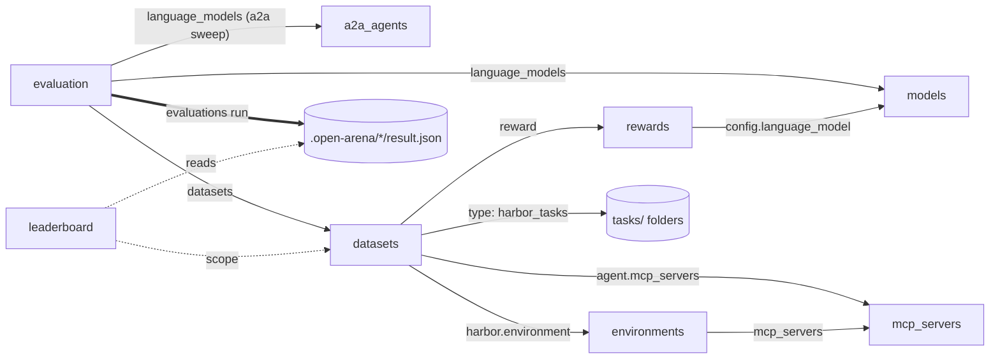
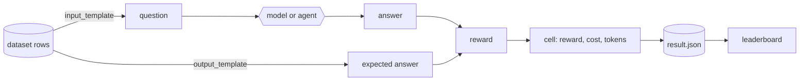
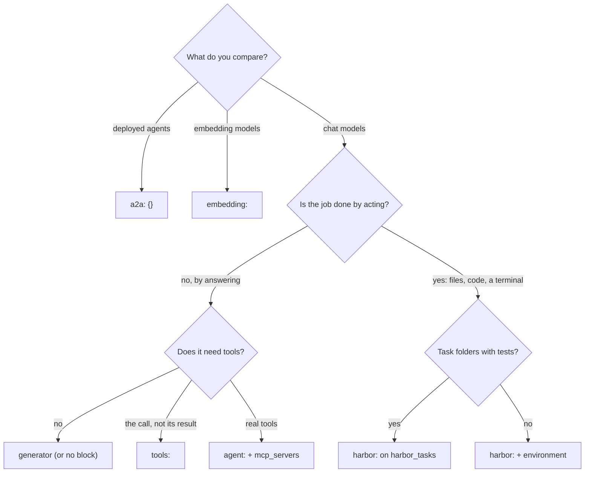

# Introduction

openarena answers one question: **which model, or agent, does this job best,
at what cost?** You describe the candidates and the job in YAML. openarena
runs every candidate on every dataset, scores each answer, and ranks them.

Use it when you have to pick, or keep picking: a cheaper model for a task that
already works, a local model to replace a hosted one, the model that uses your
MCP tools best, the deployed agent that answers your users best, the coding
agent that solves your tasks in a sandbox. It measures on your data, on your
machine, and keeps every score so the next comparison builds on the last one.

This page is the mental model: the pieces, how they name each other, what a
run does, and which setup fits which goal. The guides then go through each
piece field by field.

## The pieces

Everything is declared in **registries**: one YAML file per kind of thing,
under `configs/`, each a mapping of names to entries.

| registry | an entry is | it names | it is named by |
|---|---|---|---|
| [models](guides/models.md) | a litellm model id, its type (`llm` or `embedding`) and its params | nothing | evaluations, judge rewards, leaderboards |
| [rewards](guides/rewards.md) | a catalog reward (`type`), its kwargs (`config`), and which way is better (`direction`) | its judge model, if any | datasets |
| [datasets](guides/datasets.md) | where the rows come from, how each row becomes a question and an expected answer, what answers it, and the reward that scores it | a reward, MCP servers, an environment | evaluations, leaderboards |
| [mcp_servers](guides/mcp-tools.md) | a tool server, reached over `stdio`, `streamable_http`, `sse` or `websocket` | nothing | datasets with an `agent:` block, environments |
| [a2a_agents](guides/a2a-agents.md) | a remote agent reached over A2A: a URL, headers, a timeout | nothing | evaluations over `a2a` datasets |
| [environments](guides/environments.md) | a sandbox: a Docker image or a Dockerfile, resources, network | MCP servers | datasets with a `harbor:` block |
| [evaluations](guides/evaluations.md) | a sweep: the models (or agents) × the datasets to run | models or A2A agents, datasets | `openarena evaluations run` |
| [leaderboards](guides/leaderboards.md) | a way to rank finished runs: a scope and each metric's share of the score | datasets, models | `openarena leaderboards run` |

[Harbor tasks](guides/harbor-tasks.md) are the one piece that is not a
registry entry. They are folders under `tasks/`, each with its instruction,
its sandbox and its own tests, read by a dataset of `type: harbor_tasks`.

### How they reference each other



The evaluation is the root: it says what to run, and everything else is
reached from it by name. A leaderboard is not tied to an evaluation. It reads
the results every run left behind and ranks the models in its scope.

### Names are the glue

Every reference is a **registry name**, never a provider id. A dataset's
`reward` is a `rewards` key. An evaluation's `language_models` are `models`
keys. A judge's `language_model` is a `models` key too, and must be a chat
model. Names match `^[A-Za-z0-9][A-Za-z0-9_.-]*$`, up to 128 characters.

This has consequences worth knowing:

- **Two entries calling one id are two models.** `gpt-4o-mini` and
  `gpt-4o-mini-hot` can both call `openai/gpt-4o-mini` with a different
  `temperature`, and are compared as two candidates. That is how you compare
  settings, not only models.
- **Scores are stored under the name.** A leaderboard joins runs by model and
  dataset name. Rename an entry and its earlier scores no longer line up with
  its new ones. Point an entry at another id while keeping its name, and new
  runs score something else under the old name.
- **A typo is caught before anything runs.** `openarena check configs` resolves
  every reference across the registry files and says which line to fix. See
  [Checking configs](guides/check.md).

## A minimal workspace

The smallest set of entries that runs and ranks, shown together here but kept
in `models.yaml`, `rewards.yaml`, `datasets.yaml`, `evaluations.yaml` and
`leaderboards.yaml`. Follow the names: `math-compare` names two models and a
dataset, the dataset names a reward, and the leaderboard scopes the dataset.

```yaml
models:
  qwen38:
    model: ollama/qwen3.8:27b-mlx
    params: {temperature: 0}
  gpt-4o-mini:
    model: openai/gpt-4o-mini
    params: {temperature: 0}

rewards:
  exact-match:
    type: exact_match
    direction: max

datasets:
  gsm8k-20:
    type: huggingface
    config:
      path: openai/gsm8k
      name: main
      split: test
      limit: 20
      input_template: '{"question": {{ question | tojson }}}'
      output_template: '{"answer": {{ answer.split(''####'')[-1] | replace('','', '''') | trim | tojson }}}'
      input_schema:
        type: object
        properties: {question: {type: string}}
        required: [question]
      output_schema:
        type: object
        properties: {answer: {type: string, description: The final number only}}
        required: [answer]
    reward: exact-match

evaluations:
  math-compare:
    language_models: [qwen38, gpt-4o-mini]
    datasets: [gsm8k-20]

leaderboards:
  math:
    title: Math, quality only
    datasets: [gsm8k-20]
    shares: {reward: 100}
```

`openarena init` writes a workspace with entries like these and more, each
file explaining its own fields in comments. See [The workspace](workspace.md).

## What a run does

```shell
openarena evaluations run math-compare
```

1. **Reads `.env`** beside `configs/`, never over a variable already set.
   That is where provider keys go, and the values of any `${NAME}` a config
   uses ([Secrets in configs](workspace.md#secrets-in-configs)).
2. **Gathers the evaluation**: the entry, the datasets it lists, and the
   rewards, MCP servers, environments and A2A agents those name. Every model
   is kept, since rewards and metrics name their models by key.
3. **Validates it whole**, each `${NAME}` replaced by its variable. An unset
   variable, an unknown name, a judge that is not a chat model, a chat model
   on an embedding dataset, a Harbor agent that cannot call the model: the
   run stops here, before any call.
4. **Writes a snapshot** to `.open-arena/<evaluation>/config.yaml`, and copies
   the environments' build folders and the `harbor_tasks` folders beside it.
   That snapshot is exactly what ran, with the `${NAME}` references kept
   rather than the secrets.
5. **Prepares each dataset**: reads its rows, renders each through
   `input_template` (the question) and `output_template` (the expected
   answer), and builds what answers it, once per model.
6. **Runs the grid model by model**: every dataset for the first model, then
   the next, so a local server loads each model once. One **cell** is one
   model on one dataset. Rows go in batches of `batch_size`: the
   `--batch-size` option, else the evaluation's, else the dataset's, else 1.
7. **Scores every answer** with the dataset's reward, from 0 to 1. The cell's
   `reward` is the mean over its rows; the cost and tokens the calls used are
   recorded beside it, with any extra `metrics`.
8. **Writes `result.json`** next to the snapshot, and prints one table per
   dataset: a row per model, a column per metric.



A finished cell is kept. Run the same evaluation again and it resumes: cells
that completed are read back, cells that failed or never ran are run. This is
what makes a long sweep cheap to fix: correct a key or a template, run again.
When you change something finished cells depend on (the model list, a
dataset's reward or metrics), add `--no-cache` to start over. See
[Running evaluations](guides/evaluations.md) and
[Reading results](guides/results.md).

!!! warning "A failed cell is a result, not a crash"
    One model failing does not stop the others: every cell runs, and every
    failure is reported. A cell that cannot give a score (a template naming
    a missing column, an agent whose MCP servers give no tools, a missing key
    or a model server that is down, so that no row got an answer) prints
    `<model> failed: <why>` and shows `—` in the table, and the command
    exits 1 once the table is printed. A plain rerun runs those cells again.
    A cell where only some rows failed finishes, and those rows score 0.
    Read the warnings and the failed lines before the scores.

### Ranking is a separate step

```shell
openarena leaderboards run math
```

A leaderboard reads every `result.json` under `.open-arena/`, takes the
newest score of each model on each dataset, and ranks the models in its scope.
Each metric is normalized per dataset against the models in scope, weighted by
its share, and the result averaged over the datasets. With no `shares`, the
reward weighs most and the other measurements break ties. Budgets (cost at
most 0.05, say) are hard limits: a model breaking one is left out of the
ranking and listed as over budget. A model not scored on every dataset in
scope is listed as not ranked.

Keeping the two steps apart is deliberate. You pay for a run once and rank it
as many ways as you need: quality only, quality per dollar, one domain, every
domain. And runs add up: a model run this week on math and next week on code
ranks on both. See [Leaderboards](guides/leaderboards.md).

## What answers each row

A dataset says what answers its rows with at most one block. That choice
decides what is under test, what the answer looks like, and which rewards make
sense.

| block | what is under test | what the reward scores | the evaluation's `language_models` | guide |
|---|---|---|---|---|
| none, or `generator:` | a chat model, one call per row | the model's structured answer | chat models | [Datasets](guides/datasets.md) |
| `tools:` | a chat model's tool calls, one call, nothing executed | the calls it made | chat models | [Datasets](guides/datasets.md) |
| `agent:` | a chat model working with real tools over MCP, in a loop | the agent's final answer | chat models | [MCP tools](guides/mcp-tools.md) |
| `a2a: {}` | a remote agent, whatever is inside it | the agent's reply | A2A agents | [A2A agents](guides/a2a-agents.md) |
| `harbor:` with an `environment` | a model driving a Harbor agent (`terminus-2`, `claude-code`, `codex`, ...) in a sandbox, on your rows | what it wrote to `answer_file`, else its last message | chat models | [Environments](guides/environments.md) |
| `harbor:` on `type: harbor_tasks` | the same, on task folders with their own tests | the score the tests gave | chat models | [Harbor tasks](guides/harbor-tasks.md) |
| `embedding:` | an embedding model retrieving the row's passages | the passages it returned | embedding models | [Datasets](guides/datasets.md) |

### Which one fits your goal

=== "Plain model QA"

    **Block:** none, or `generator:` for `instructions` and
    `chain_of_thought`.

    **Pick it when** the job is a question in, an answer out: extraction,
    classification, math, summaries, multiple choice. It is the cheapest and
    fastest setup, one call per row, and the easiest to score exactly.

    **It does not tell you** how the model behaves with tools or over many
    steps.

=== "Tool calling"

    **Block:** `tools:` with `tool_schemas`, the functions every row shares;
    or `tools: {}` with a `tools_template` in `config`, when each row brings
    its own, the row being a Chat Completions request (`messages` + `tools`),
    the way a tool-calling benchmark is published.

    **Pick it when** you want to know whether a model picks the right function
    with the right arguments, without running a tool server. Nothing executes,
    so it is fast, repeatable and safe. Score it with `tool_calls_accuracy`
    against the expected calls.

    **It does not tell you** whether the model recovers from a tool's error or
    uses a result well: there is no result. For that, use `agent:`.

=== "Agent with MCP tools"

    **Block:** `agent:` naming `mcp_servers`.

    **Pick it when** the job needs real tools: search, a database, your own
    API. The model calls the tools, reads the results and decides, until it
    answers. This measures the model as an agent over your tools.

    **Trade-offs:** each row is several calls, so it costs more and takes
    longer. The servers must be reachable from your machine. A tool whose
    answers change over time makes scores drift between runs.

=== "Remote agents"

    **Block:** `a2a: {}`, and the evaluation lists `a2a_agents` keys.

    **Pick it when** what you compare is an agent already deployed behind the
    A2A protocol, built with any stack. Each row is sent as one message and
    the reply is scored. openarena does not see or choose the model inside.

    **Constraint:** an evaluation's axis is either models or A2A agents, so
    `a2a` datasets go in an evaluation of their own.

=== "Sandboxed tasks"

    **Block:** `harbor:`.

    **Pick it when** the job is done by acting, not replying: editing files,
    running code, working a terminal. The model drives a Harbor agent in a
    sandbox. Over your rows, name an `environment` and score the answer with
    any reward. Over task folders (`type: harbor_tasks`), each task's own
    tests score it, read by the `harbor_verifier` reward.

    **Trade-offs:** the slowest and most expensive setup: a sandbox per row,
    many calls per row. It needs Docker, or a sandbox provider's key.

=== "Retrieval"

    **Block:** `embedding:`.

    **Pick it when** you choose an embedding model for search. Each row brings
    a query and its passages, the model under test ranks them and returns the
    top `k`, and `retrieval_recall` scores how many of the expected passages
    came back.

    **Constraint:** an embedding dataset runs in an evaluation of its own,
    over embedding models.



## Choosing a reward

Every dataset names one reward, the primary score of its cells. It scores one
answer from 0 to 1, and its `direction` says which way is better on a
leaderboard.

| kind | examples | how it scores | pick it when | watch out for |
|---|---|---|---|---|
| deterministic | `exact_match`, `answer_accuracy`, `tool_calls_accuracy`, `retrieval_recall` | compares the answer with the fields `output_template` renders, each field whole (a list of calls, a nested object); what else the program returns stays out of the score | there is one right answer: a number, a label, a choice, a call | an answer right in substance but different in form scores 0 (`"42"` and `"42.0"`); tighten the `output_schema` |
| a model judges | `lm_as_judge`, `rubrics_as_judge`, `multi_judge_panel`, ... | a judge model (a `models` key) reads the answer, with the expected answer when there is one | the answer is open text: a summary, an explanation, an agent's report | every row costs a judge call; a judge has its biases; changing the judge changes every score |
| the task's own tests | `harbor_verifier` | reads the score a Harbor task's `tests/` wrote | `type: harbor_tasks` datasets | the tests are the spec: a weak test passes a wrong solution |

!!! tip "Prefer deterministic when you can"
    A deterministic reward is free, instant and gives the same score every
    time, so a gap between two models is a gap between the models. Shape the
    answer so it can be compared: the final number only, a letter, a label
    from an `enum` in the `output_schema`. Reach for a judge when the answer
    cannot be reduced to a value.

!!! tip "Keep the judge out of the race"
    A judge that is also under test grades its own style. Name a judge model
    that is not in the evaluation's `language_models`, and keep it the same
    across the runs you want to compare.

With a judge, `output_template` is optional: without a reference, the judge
grades the answer on the question and its instructions. A dataset can also
record extra scores beside its reward with `metrics:`; they show as columns
and can weigh on a leaderboard. See [Rewards](guides/rewards.md).

## Designing evaluations

An evaluation is a grid: every model on every dataset. A few rules of thumb:

- **One evaluation per question you want answered.** `math-compare`,
  `support-agents`: small grids are quick to run and to resume. Leaderboards
  bring them back together.
- **Start small.** A dataset's `limit` caps its rows. Run 20 rows, read the
  answers and the failures, then raise it. A template bug then costs 20 calls,
  not 2,000.
- **One kind of axis per evaluation.** Chat models, embedding models and A2A
  agents each need an evaluation of their own.
- **`batch_size` is concurrency.** A batch is sent at once: larger batches
  finish sooner and hit rate limits sooner, and a local model server may need
  it low.
- **`seed` is not determinism.** It seeds the engine's own randomness, not the
  provider's sampling. For steadier answers, set `temperature: 0` on the
  model.

## What runs where

- **Models are called through [litellm](https://docs.litellm.ai/).** Any
  provider it routes (OpenAI, Anthropic, Gemini, Mistral, Ollama, vLLM, ...)
  works, with that provider's key in the environment or in `.env`. Each call
  is priced from litellm's table, completed before the run from other price
  sources; a model on a local server (`ollama/`, `vllm/`) costs nothing.
- **Runs happen on your machine**, one cell after another. No server is
  needed, and a run's state stays under `.open-arena/<evaluation>/`.
- **MCP servers** are spawned by the run (`stdio`) or reached by URL from
  your machine.
- **Harbor trials run in a sandbox**: the provider named by
  `ARENA_HARBOR_SANDBOX`, E2B by default (with an `E2B_API_KEY`), and the
  local Docker when that provider has no credentials.

## The arena

openarena is the engine of the **arena**, a web app that edits the same
registries from forms, runs the same evaluations, and shows the leaderboards.
A workspace written by `openarena init` is a workspace the arena opens as it
is. This site documents the engine and its command; the app has its own
documentation in the repository.

## Where to go next

- New here: the [Quickstart](index.md), then [The workspace](workspace.md).
- Writing entries: [Models](guides/models.md), [Rewards](guides/rewards.md),
  [Datasets](guides/datasets.md), then the guide for the block you picked.
- Running and reading: [Running evaluations](guides/evaluations.md),
  [Reading results](guides/results.md), [Leaderboards](guides/leaderboards.md).
- Working with a coding agent: [With a coding agent](coding-agents.md).
- Every command and option: [CLI reference](cli.md).
