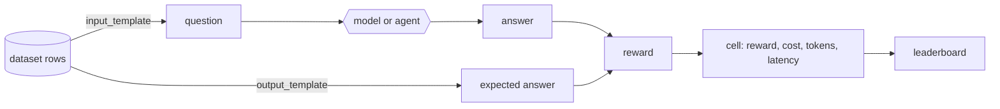

# Introduction

openarena answers one question: **which model, or agent, does this job best,
at what cost?** You describe the candidates and the job in YAML; openarena
runs every candidate on every dataset, scores each answer, and ranks them.

## The pieces

Each piece lives in its own YAML file, a **registry**, and every piece is
referenced from the others by its **name**:

| registry | an entry is | used by |
|---|---|---|
| [models](guides/models.md) | a name for a litellm model id, with its params | evaluations, judge rewards, leaderboards |
| [rewards](guides/rewards.md) | how to score one answer, from 0 to 1 | datasets |
| [datasets](guides/datasets.md) | where rows come from, how each becomes a question and an expected answer, what answers it | evaluations |
| [mcp_servers](guides/mcp-tools.md) | a tool server a model may call | datasets, environments |
| [a2a_agents](guides/a2a-agents.md) | a remote agent to compare | evaluations over agents |
| [environments](guides/environments.md) | a sandbox an agent works in | Harbor datasets |
| [evaluations](guides/evaluations.md) | the models × datasets to run | `openarena evaluations run` |
| [leaderboards](guides/leaderboards.md) | how to rank finished runs | `openarena leaderboards run` |

## From rows to a ranking

1. **A dataset turns rows into questions.** Each row of the source goes
   through the dataset's Jinja2 `input_template` (what the model is asked) and
   `output_template` (the expected answer).
2. **Something answers each question.** A model in one call, a model calling
   MCP tools, a remote A2A agent, an embedding model retrieving passages, or an
   agent working in a [Harbor](https://harborframework.com) sandbox.
3. **A reward scores each answer**, from 0 to 1: an exact comparison with the
   expected answer, or a judge model, or a task's own tests.
4. **A cell is one model on one dataset.** Its `reward` is the mean over the
   rows; beside it, the cost, the tokens and the latency the run measured.
5. **A leaderboard ranks the models** over the cells in its scope: each metric
   normalized against the models in scope, combined with the weights you give,
   and hard budgets (a cost cap) applied first.

## What runs where

- **Models are called through [litellm](https://docs.litellm.ai/)**: any
  provider it routes (OpenAI, Anthropic, Gemini, Mistral, Ollama, vLLM, ...)
  works, with that provider's key in the environment.
- **Runs happen on your machine**, one cell after another, model by model. A
  finished cell is cached: running the same evaluation again resumes where it
  stopped.
- **Harbor trials run in a sandbox**: E2B with an `E2B_API_KEY`, else the local
  Docker.
- **Tracing is optional**: with `MLFLOW_TRACKING_URI` set, every run traces
  into its own MLflow experiment, where each call and its cost can be read.

## The arena

openarena is the engine of the **arena**, a web app that edits the same
registries from forms, runs the same evaluations, and shows the leaderboards.
A workspace written by `openarena init` is a workspace the arena opens as it
is. This site documents the engine and its command; the app has its own
documentation in the repository.
