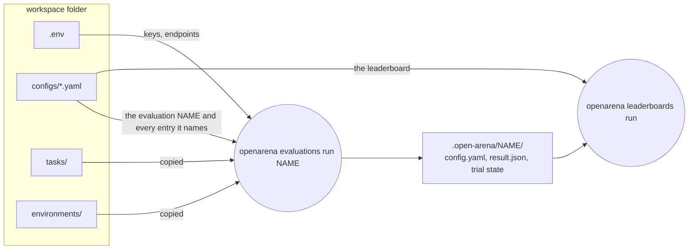

# The workspace

A workspace is a plain folder. Everything a comparison needs is a file in it:
the registries under `configs/` say what to compare, the Harbor folders beside
them say what sandboxes and tasks look like, `.env` holds the keys, and every
run writes its results under `.open-arena/`. There is no database and no
server: files in, files out. You can read it, diff it, commit it and hand it to
a colleague or a coding agent.

This page explains each part of that folder: what it is for, how the
`openarena` command finds it, what it writes, and what belongs in git. The
fields of each registry have their own guides (links below).



## Start one

```shell
openarena init my-arena        # DIR defaults to the current folder
```

`init` copies a template into the folder, then copies the engine's Agent
Skills (every `openarena-*` skill) into `.agents/skills/`. The result runs as
it is, given the keys or local servers its examples need (see
[What the example runs](#what-the-example-runs)).

| option | what it does | when to use it |
|---|---|---|
| `DIR` | where to write; created if missing | a new project folder, or `.` to turn the current folder into a workspace |
| `--template NAME` | the template to copy; `default` is the only one shipped | leave it |
| `--force` | overwrite files that are already there | to refresh the skills or reset an example file; it replaces your edits to those files |

Without `--force`, `init` checks every target file first. If any one exists, it
writes nothing at all and names every file in the way. So `init` on an existing
workspace is safe: it cannot half-overwrite it.

!!! warning "`--force` overwrites, it does not merge"
    `--force` copies the template's `configs/*.yaml` over yours as well as the
    skills. To pick up newer skills after upgrading the package, run `init`
    into an empty scratch folder and copy `.agents/skills/` across, or commit
    first and restore the files you edited with git.

## Layout

```
my-arena/
  configs/                          the registries, one YAML file each
    models.yaml                     name -> litellm id, type, params
    rewards.yaml                    name -> catalog reward, its kwargs, direction
    datasets.yaml                   name -> rows, templates, what answers, reward
    mcp_servers.yaml                name -> MCP tool server
    a2a_agents.yaml                 name -> remote A2A agent
    environments.yaml               name -> Harbor sandbox
    evaluations.yaml                name -> models x datasets, the sweep to run
    leaderboards.yaml               name -> how to rank finished runs
  tasks/hello-world/                a Harbor task folder
  environments/python/environment/  the `python` environment's build context
  .agents/skills/                   Agent Skills for a coding agent, one per action
  AGENTS.md                         the guide a coding agent reads first
  CLAUDE.md                         a link to AGENTS.md
  README.md                         the quickstart
  .env.template                     every key and endpoint a run may read
  .gitignore                        keeps .env and .open-arena/ out of git
  .env                              your keys (you create it from the template)
  .open-arena/                      runs, created by the first one
```

| part | written by | read by | commit it? |
|---|---|---|---|
| `configs/` | you, or a coding agent | every command | yes: it is the experiment |
| `tasks/`, `environments/` | you | `evaluations run`, for Harbor datasets | yes |
| local data files (JSONL, CSV, ...) | you | `local` and `folder` datasets | yes if small and shareable, else keep them elsewhere |
| `.agents/skills/`, `AGENTS.md`, `CLAUDE.md` | `init` | coding agents | yes, so everyone's agent works the same way |
| `README.md`, `.env.template`, `.gitignore` | `init` | people | yes |
| `.env` | you | `evaluations run`; `check` looks up `${NAME}`s in it | never: it holds secrets |
| `.open-arena/` | `evaluations run` | `leaderboards run`, you | no, by default (see [Versioning](#versioning)) |

## configs/: the registries

Each registry is one file, named after it, holding one top-level key with the
same name. Entries are keyed by a name you choose, and other entries refer to
them by that name.

```yaml
# configs/<registry>.yaml
<registry>:              # the one top-level key, the file's own name
  <name>:                # an entry; others refer to it by this name
    <field>: <value>
```

| file | holds | refers to | guide |
|---|---|---|---|
| `models.yaml` | the litellm id each name calls, its type (`llm` or `embedding`), its params | nothing | [Models](guides/models.md) |
| `rewards.yaml` | a catalog reward, its kwargs, which way is better | `models` (a judge's model) | [Rewards](guides/rewards.md) |
| `datasets.yaml` | where rows come from, the Jinja templates over them, what answers them, the reward | `rewards`, `models`, `mcp_servers`, `environments` | [Datasets](guides/datasets.md) |
| `mcp_servers.yaml` | MCP tool servers an agent dataset or an environment is given | nothing | [MCP tools](guides/mcp-tools.md) |
| `a2a_agents.yaml` | remote A2A agents an `a2a` sweep compares | nothing | [A2A agents](guides/a2a-agents.md) |
| `environments.yaml` | the Harbor sandboxes a `harbor:` dataset's agent works in | `mcp_servers` | [Environments](guides/environments.md) |
| `evaluations.yaml` | saved sweeps: which models on which datasets | `models`, `datasets`, `a2a_agents` | [Evaluations](guides/evaluations.md) |
| `leaderboards.yaml` | saved ways of ranking finished runs | `models`, `datasets` | [Leaderboards](guides/leaderboards.md) |

### The rules every file follows

- **The file name decides the registry.** Only `<registry>.yaml` is read, with
  that exact name and the `.yaml` extension. `model.yaml`, `models.yml` or
  `my-datasets.yaml` are ignored by a run; `openarena check` reports them as
  errors and gives the name to use.
- **One top-level key, the file's own.** `models.yaml` holds `models:` only.
  Another registry's key in the same file is not read; `check` says which file
  to move it to.
- **A missing file is an empty registry.** A workspace with no A2A agents can
  delete `a2a_agents.yaml`, or keep it as `a2a_agents: {}`. The template keeps
  every file so the commented field lists are at hand.
- **Names** match `^[A-Za-z0-9][A-Za-z0-9_.-]*$`, at most 128 characters:
  `gpt-4o-mini`, `gsm8k-20`.
- **References are by name, never by id.** A dataset's `reward` is a `rewards`
  key; an evaluation's `language_models` are `models` keys; a judge's
  `language_model` is a `models` key. A litellm id such as
  `openai/gpt-4o-mini` appears once, in `models.yaml`. To switch a judge or a
  model version everywhere, you change one line.
- **Unknown fields are errors.** A misspelled field is reported with the rename
  that fixes it ([Checking configs](guides/check.md)). Nothing inside an entry
  is silently ignored.
- **A key written twice is an error.** Plain YAML would keep the second one
  without a word; the engine refuses the file and gives the line.
- **`tags`** are lowercase labels matching `^[a-z0-9][a-z0-9:+./-]*$`:
  `[math, reasoning]`. **`description`** is free text. Neither changes what
  runs; they are for listing and browsing.

Each file of a new workspace starts with a comment listing every field its
entries take, with the optional ones as commented examples. Read it before
editing: it is the quickest reference for that registry.

!!! tip "Why one file per registry"
    Each file changes for its own reason: adding a model touches
    `models.yaml`, a new benchmark touches `datasets.yaml`. Diffs stay small,
    two people rarely edit the same file, and `openarena check configs/models.yaml`
    checks one file against its neighbours.

### What a run reads from them

`openarena evaluations run NAME` does not run the whole folder. It takes the
evaluation `NAME` and gathers only what it needs into one config:

- the evaluation itself;
- the datasets it lists;
- the rewards, MCP servers and environments those datasets name, and the MCP
  servers those environments name;
- for an `a2a` sweep, the A2A agents on its axis;
- every model, since rewards and metrics name theirs by key too.

So a broken entry that the evaluation does not use does not stop the run. It
still shows in `openarena check`, which reads every file. The gathered config
is validated before the first model call: an unknown reference, a dataset with
no `reward`, or a model of the wrong type stops the run with a message, before
it costs anything.

## tasks/ and environments/: the Harbor folders

These two folders only matter for [Harbor datasets](guides/harbor-tasks.md),
where an agent works in a sandbox. Delete them if you never run one.

| folder | what it is | who uses it |
|---|---|---|
| `tasks/<task>/` | a whole Harbor task: `task.toml`, `instruction.md`, `environment/`, `tests/test.sh`, `solution/solve.sh` | a `harbor_tasks` dataset, through its `config.path` |
| `environments/<name>/environment/` | the build context of the environment `<name>` in `environments.yaml`: whatever its Dockerfile copies | a `harbor:` dataset over rows, through `harbor.environment` |

Both are found **beside `configs/`**, not relative to where you run the
command:

- `environments/<name>/` is looked up for each environment the evaluation
  uses.
- A `harbor_tasks` dataset's relative `path` (the template's `path: tasks`) is
  read against the folder that holds `configs/`. An absolute `path` is read
  where it is, and is not copied.

At each run both are copied into the run folder, after deleting the previous
copy. A run therefore uses the folders as they are now: a file you removed
since the last run is gone from this one too.

!!! note "`init` makes the `.sh` scripts executable"
    Harbor runs a task's scripts as they are. `init` sets the executable bit on
    every `.sh` it writes. A script you add yourself needs `chmod +x`.

## Data files

`local` and `folder` datasets read files from disk through their
`config.path`. Unlike the Harbor folders, that path is used as written: a
relative path is read from **the folder you run the command in**.

```yaml
# ...
datasets:
  my-questions:
    type: local
    config:
      path: data/questions.jsonl     # relative to where you run openarena
```

Keep such files in a `data/` folder at the workspace root and run commands from
there. Then the paths in `datasets.yaml` work for everyone who clones the
workspace. Use an absolute path only for data that lives outside the workspace
on purpose (a shared drive, a large private file).

Datasets from a hub or a tracing platform (`huggingface`, `langfuse`,
`mlflow`, ...) need no local files: they are fetched at run time, with the
credentials in [`.env`](#env-keys-and-endpoints).

## .env: keys and endpoints

The registries never hold an API key: a model entry's `params` only take
generation settings (`temperature`, `max_tokens`, `reasoning_effort`, and
`dimensions` for embeddings). Keys and server addresses come from the
environment, which keeps them out of git and lets each person use their own.
A field that must carry a secret (a header, a server's `env`) names the
variable with `${NAME}` ([Secrets in configs](#secrets-in-configs)).

```shell
cp .env.template .env      # then uncomment and fill in what your models need
```

How it is loaded:

- `openarena evaluations run` reads `.env` from **the folder that holds
  `configs/`** (the parent of `--configs`), before anything else.
- A variable already set in your shell wins: `.env` never overrides it.
- No other command loads `.env`. `check`, `list` and `leaderboards run` make
  no model calls and need no keys; `check` only reads the file to look up the
  [`${NAME}` references](#secrets-in-configs) a config holds.
- The file is optional. Without one, the run uses your shell's environment.

| setting comes from | wins over |
|---|---|
| your shell (`export OPENAI_API_KEY=...`, CI secrets) | `.env` |
| `.env` beside `configs/` | nothing; it only fills what the shell left unset |

So a CI job or a one-off override
(`OPENAI_API_KEY=sk-other openarena evaluations run smoke`) works without
editing the file.

### The variables

=== "Models"

    | variable | when you need it |
    |---|---|
    | `OPENAI_API_KEY`, `ANTHROPIC_API_KEY`, `GEMINI_API_KEY`, `MISTRAL_API_KEY`, `GROQ_API_KEY`, `OPENROUTER_API_KEY`, ... | a hosted model: the key of each provider prefix in `models.yaml`, judges included |
    | `OLLAMA_API_BASE` | `ollama/...` ids, when Ollama is not on `http://localhost:11434` |
    | `HOSTED_VLLM_API_BASE` | `vllm/...` ids: your server's OpenAI endpoint, ending in `/v1` |

    These are read by litellm, so any provider variable litellm knows works.
    Since a model entry takes no address of its own, there is one address per
    kind of local server, shared by every model of that kind.

=== "Harbor"

    | variable | what it does | default |
    |---|---|---|
    | `ARENA_HARBOR_SANDBOX` | where trials run: a Harbor environment type (`e2b`, `docker`, `daytona`, `modal`, ...) | `e2b` |
    | `E2B_API_KEY` | E2B's key. Without it, the `e2b` setting falls back to the local Docker | none |
    | `ARENA_HARBOR_LOCAL_CPUS`, `ARENA_HARBOR_LOCAL_MEMORY_MB` | CPUs and memory a local Docker task gets when its environment sets none | 2, 2048 |
    | `ARENA_HARBOR_LOCAL_TRIALS` | trials at once on the local Docker | 1 |
    | `ARENA_HARBOR_WORKDIR` | where Harbor's task folders and trials go instead of the run folder | the run's `harbor/` |

    An unknown `ARENA_HARBOR_SANDBOX` value stops the run with the list of
    known ones, rather than scoring every task 0.

=== "Dataset sources"

    | variable | for |
    |---|---|
    | `LANGFUSE_PUBLIC_KEY`, `LANGFUSE_SECRET_KEY`, `LANGFUSE_HOST` | `langfuse` datasets |
    | `LANGSMITH_API_KEY`, `LANGSMITH_ENDPOINT` | `langsmith` datasets |
    | `PHOENIX_API_KEY`, `PHOENIX_COLLECTOR_ENDPOINT` (or `PHOENIX_HOST` and `PHOENIX_PORT`) | `phoenix` datasets |
    | `OPIK_API_KEY`, `OPIK_WORKSPACE`, `OPIK_URL_OVERRIDE` | `opik` datasets |
    | `BRAINTRUST_API_KEY`, `BRAINTRUST_APP_URL`, `BRAINTRUST_ORG_NAME` | `braintrust` datasets |
    | `MLFLOW_SOURCE_TRACKING_URI` | `mlflow` datasets that set no `tracking_uri` of their own |
    | `UNITY_CATALOG_API_URL`, `UC_TOKEN`, and the S3 settings `S3_ENDPOINT`, `AWS_ACCESS_KEY_ID`, `AWS_SECRET_ACCESS_KEY`, `AWS_DEFAULT_REGION` | `unity_catalog` datasets |

    See [Datasets](guides/datasets.md) for each provider's own fields.

=== "Tracing"

    | variable | what it does |
    |---|---|
    | `MLFLOW_TRACKING_URI` | the MLflow server runs are traced into; unset means no tracing |
    | `ARENA_MLFLOW_TRACING` | `0`, `false`, `no` or `off` turns tracing off while keeping the URI |
    | `MLFLOW_EXPERIMENT_NAME` | the experiment traces go to when no run names one |

    Tracing is optional; nothing in the workspace depends on it. The arena
    app traces its runs when the server answers, and an unreachable server
    leaves tracing off with a warning instead of slowing every call.
    `openarena evaluations run` itself does not switch tracing on in this
    version: its record is `result.json`.

### Secrets in configs

Some fields have to carry a secret: an A2A agent's or an MCP server's
`headers`, a stdio server's or an environment's `env`. Write a reference to an
environment variable there instead of the value, and put the value in `.env`:

```yaml
a2a_agents:
  support-bot:
    url: https://support-agent.example.com
    headers:
      Authorization: "Bearer ${SUPPORT_BOT_TOKEN}"
```

```shell
# .env
SUPPORT_BOT_TOKEN=...
```

- Any string value in any registry may hold `${NAME}`. When a run reads its
  config (`openarena evaluations run`, and the arena app when it launches
  one), each reference is replaced by the variable, after `.env` is loaded,
  so the shell still wins over the file.
- A variable that is not set makes the run refuse to start, before any call,
  naming each variable and where it is used.
- The run's snapshot, `.open-arena/<evaluation>/config.yaml`, keeps the
  `${NAME}` references, not the values, so it can be shared.
- `$${NAME}` writes a literal `${NAME}`. Jinja's `{{ ... }}` in templates is
  not touched.
- `openarena check` looks each `${NAME}` up in your shell and in the
  workspace's `.env`, and warns about one set in neither. It is a warning, not
  an error: CI can check configs without the secrets.

## .open-arena/: the runs

`openarena evaluations run NAME` writes everything into one folder per
evaluation, `<state-dir>/NAME/`, with `--state-dir` defaulting to
`.open-arena` in the folder you run from.

```
.open-arena/
  smoke/                        one folder per evaluation name
    config.yaml                 the evaluation and every entry it names, gathered: what ran
    result.json                 the scores, written when the sweep ends
    gsm8k-20/                   trial state of each dataset: what makes a run resume
    harbor/                     Harbor tasks, trials and trials.jsonl, for Harbor datasets
    environments/ tasks/        copies of the Harbor folders the run used
```

| file | why it is there | what reads it |
|---|---|---|
| `config.yaml` | a snapshot of exactly what ran, rewritten at every run | `leaderboards run` (to map names to model ids), you |
| `result.json` | the scores per model, dataset and metric | `leaderboards run`, [Reading results](guides/results.md) |
| `<dataset>/` | each cell's trial, saved as it finishes | the next run of the same evaluation, to resume |
| `harbor/` | Harbor task folders, trials and their logs | you, when a Harbor row fails |

Two consequences of "one folder per evaluation name":

- **Running the same evaluation again resumes it.** Finished cells are kept
  and only the missing or failed ones run. After changing what a finished cell
  depends on (a dataset, a model's params, a reward), add `--no-cache`, or the
  old cells are reused ([Evaluations](guides/evaluations.md#resuming-and-starting-over)).
- **The latest run of an evaluation replaces the previous one's
  `result.json`.** To keep both, copy the first away, save the second under
  another evaluation name, or run it into another `--state-dir`.

`openarena leaderboards run` reads every `<state-dir>/*/result.json`, newest
first per cell, so every evaluation run into the same state dir feeds the same
leaderboards. Point `--state-dir` elsewhere to rank a separate set of runs.

!!! tip "Avoid dataset names that clash with the run folder"
    Each dataset's trial state is a sub-folder named after it, beside
    `harbor/`, `tasks/` and `environments/`. A dataset named `harbor`, `tasks`
    or `environments` would share a folder with them.

### What lands outside the workspace

A run also writes a few things elsewhere. They matter when you clean up or
move a workspace.

- **Harbor on a snap-packaged Docker.** That Docker cannot read hidden
  folders such as `.open-arena`, so Harbor's tasks, trials and temporary files
  go under `~/arena-harbor/` instead, one sub-folder per run.
  `ARENA_HARBOR_WORKDIR` moves them anywhere you choose. `trials.jsonl` stays
  in the run's `harbor/` either way.
- **A default model.** An evaluation's `default_language_model` or
  `default_embedding_model` is also saved in a per-user settings file in your
  home folder, as a side effect of setting it, and a later run that sets no
  default can inherit it. Give rewards and metrics their `language_model`
  explicitly when this matters.
- **`--json FILE`** writes a copy of the result or ranking wherever you point
  it.

## How the command finds everything

There is no search up the folder tree and no global config file. Every path
comes from two options and the folder you run in.

| what | where it is looked for | change it with |
|---|---|---|
| the registries | `./configs` | `--configs DIR` |
| `.env` | the parent of the configs folder | move the file, or export the variables |
| `tasks/`, `environments/` | the parent of the configs folder | an absolute `harbor_tasks` `path`, read in place |
| `local` / `folder` data | the folder you run in, for a relative `path` | an absolute `path` |
| runs | `./.open-arena` | `--state-dir DIR` |
| rows per batch | the dataset's `batch_size`, overridden by the evaluation's | `--batch-size N`, which overrides both |

=== "Run from the workspace (recommended)"

    ```shell
    cd my-arena
    openarena check configs
    openarena evaluations run smoke
    openarena leaderboards run overall
    ```

    Every default lines up: `configs/`, `.env`, the Harbor folders, data
    paths and `.open-arena/` all resolve inside `my-arena/`.

=== "Run from elsewhere"

    ```shell
    openarena evaluations run smoke --configs my-arena/configs --state-dir my-arena/.open-arena
    openarena leaderboards run overall --configs my-arena/configs --state-dir my-arena/.open-arena
    ```

    `.env` and the Harbor folders still come from `my-arena/`, but runs go to
    `./.open-arena` unless you pass `--state-dir`, and relative data paths are
    read from the current folder. Pass both options, and prefer absolute data
    paths, when a script or CI job runs from another folder.

## Organising a workspace

=== "Solo"

    One workspace, run from its root, one `.env`. Use evaluation names as the
    unit of work: `smoke` to check a setup on a few rows (`limit: 5`), then
    `math-compare` for the full run. Keep `.open-arena/` out of git and treat
    it as a cache you can delete; what you keep is `configs/` and, when you
    need a record, the `result.json` files.

=== "Team"

    One workspace in a shared repository, with `configs/`, the Harbor folders,
    the skills and `.env.template` committed. Each person keeps their own
    `.env`. A few habits keep it workable:

    - **Add every key a run needs to `.env.template`**, commented, so a new
      member sees what to set, the variables your configs name as `${NAME}`
      included.
    - **Prefix names by project or owner** when several people add entries
      (`team-a-gsm8k`, `judge-v2`): a name is shared by the whole registry,
      and the same key written twice is an error.
    - **Run `openarena check configs` in CI.** It reads every file, needs no
      keys, and exits 1 on an error, so a broken reference never reaches the
      main branch.
    - **Share results, not run folders.** `.open-arena/` holds trial state
      and Harbor logs that are large and tied to one machine. To rank
      everyone's runs together, collect each run's `config.yaml` and
      `result.json` into a shared folder laid out as
      `<state-dir>/<evaluation>/`, and point `leaderboards run --state-dir` at
      it. Give evaluations distinct names, or one person's run replaces
      another's.

=== "Several setups"

    The same registries against different endpoints (staging and production,
    say) are best kept as one workspace with the variables set in the shell,
    which wins over `.env`, or two env files you swap.

    Genuinely different sets of registries can live side by side with
    `--configs` (`configs/` and `configs-nightly/` in one folder). They then
    share the same `.env`, `tasks/` and `environments/`, since those are found
    beside the configs folder. When they need different ones, use separate
    workspaces.

## Versioning

The `.gitignore` that `init` writes:

```text
# Keys and endpoints (copy .env.template)
.env

# Runs: configs snapshots, results, Harbor trials
.open-arena/

# Python
__pycache__/
*.py[cod]
.venv/
```

That covers the defaults. Extend it when you move things:

| you use | add to `.gitignore` |
|---|---|
| `--state-dir runs/...` | that folder |
| `--json results/...` | that folder, unless you commit results on purpose |
| a second env file (`.env.staging`) | that file |
| large local data | `data/`, or the files concerned |

Commit `.env.template`, never `.env`. Commit `CLAUDE.md` as the link it is; on
a system where links cannot be made, `init` writes it as a copy of `AGENTS.md`
instead.

??? details "Committing results on purpose"
    To keep a record of a published comparison, commit that run's
    `config.yaml` and `result.json` only, for example under
    `results/<evaluation>/`. That pair says what ran and what it scored, and is
    all `leaderboards run --state-dir results` needs to rank it again. Leave
    out the dataset sub-folders and `harbor/`: they are trial state and logs.

## For coding agents

`AGENTS.md`, its `CLAUDE.md` link and `.agents/skills/` exist so that Claude
Code, Codex, Cursor or another coding agent started in the folder knows the
layout, the rules above and the commands to run. Keep them committed, and
refresh the skills from a fresh `init` after an upgrade. See
[Coding agents](coding-agents.md).

## What the example runs

| evaluation | runs | needs |
|---|---|---|
| `smoke` | `qwen38` on `gsm8k-20`, 20 grade-school math questions, scored by exact match | a local Ollama |
| `harbor` | `gpt-4o-mini` driving the `terminus-2` agent on the `hello-world` task and on 5 GSM8K questions worked in a Python sandbox | `OPENAI_API_KEY`, and Docker or `E2B_API_KEY` |

And two leaderboards: `overall` (every model on every dataset, reward first)
and `math` (GSM8K, the reward alone).

## In the arena app

The layout is the arena's own: a workspace made by `init` is one the arena web
app opens as it is, forms and all.
